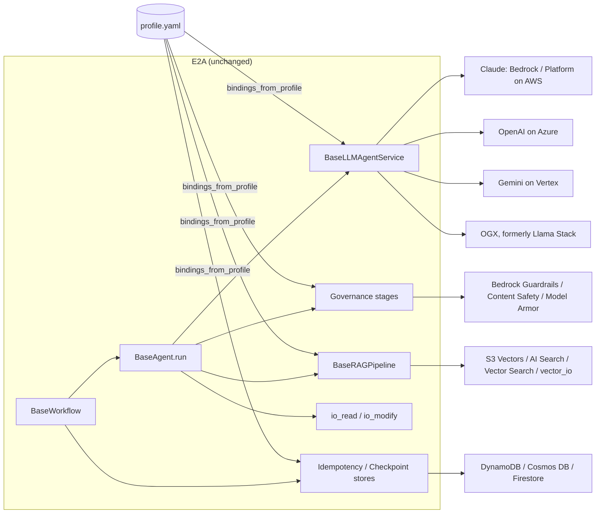

# Architecture

## Principle: managed services fill E2A's seams; they do not replace its guarantees

E2A already separates *what* an agent does (hooks) from *how* the platform runs it
(framework-owned lifecycle: screening, idempotency, deadlines, quotas, typed outcomes).
Every managed service in this repository is bound to an existing E2A seam. None changes
the lifecycle.



## Seam map

| E2A seam | Anthropic on AWS | OpenAI on Azure | Google on GCP | OGX (Llama) on AWS |
|---|---|---|---|---|
| `BaseLLMAgentService` | `BedrockClaudeLLMService`, `ClaudePlatformAWSLLMService` (anthropic SDK) | `AzureOpenAIResponsesLLMService` (openai SDK, v1 endpoint) | `VertexGeminiLLMService` (google-genai) | `OGXLLMService` (openai SDK at OGX) |
| `BaseEmbeddingModel` | Titan Text Embeddings V2 | text-embedding-3-large | gemini-embedding-001 | OGX embeddings |
| `BaseVectorIndex` | S3 Vectors (vector-only; the reranker adds keyword relevance) | Azure AI Search (native hybrid) | Vertex Vector Search (dense + sparse) | OGX vector stores (hybrid search) |
| reranker (`_rerank`) | Bedrock Rerank (Cohere 3.5) | semantic ranker | Vertex AI Ranking API | – |
| fully managed RAG (optional) | Bedrock Knowledge Bases | – | – | – |
| `IngressStage` (firewall) | Bedrock Guardrails | Content Safety Prompt Shields | Model Armor | Bedrock Guardrails |
| `BasePromptRegistry` | Bedrock Prompt Management | – | – | OGX prompts |
| `MCPToolService` via gateway | AgentCore Gateway | API Management | IAP / Apigee | (ingress) |
| model-side MCP | MCP connector (Platform on AWS only) | Responses `mcp` tool | – | Responses `mcp` tool |
| delegated runtime | AgentCore Runtime / Claude Managed Agents | Responses-API agent | Agent Engine | OGX Responses |
| idempotency / checkpoint | DynamoDB conditional writes | Cosmos DB ETag | Firestore preconditions | DynamoDB |
| `BaseObservability` | OTel → ADOT → CloudWatch/X-Ray | OTel → App Insights | OTel → Cloud Trace | OTel → CloudWatch |
| `BaseInfraProvisioner` | Terraform (aws) + `ant apply` | Terraform (azurerm) | Terraform (google), reuses E2A's GCP reference | Terraform (aws) + ECS for OGX |
| `BasePipeline` | ECR, Lambda/ECS rollout, OIDC | ACR, Container Apps revisions | Artifact Registry, Cloud Run split | as AWS |

Platform services (embeddings, vectors, guardrails, gateways, stores) live under
`clouds/<cloud>/` because they belong to the cloud, not to the model vendor: the Anthropic
and OGX profiles on AWS bind the same classes.

## Who owns what (one owner per runtime concern)

| Concern | Owner | How |
|---|---|---|
| Retries, circuit breaker | E2A `ResiliencePolicy` | SDK `max_retries=0` (`llm_sdk_max_retries`), so there's no double retry and outages stay visible |
| Deadline | E2A `Deadline` | the SDK timeout is only a backstop |
| Quota (RPM/TPM) | E2A token bucket | provider quotas are the outer limit; `max_rpm`/`max_tpm` should be set below them |
| Prompt cache | E2A decides *what* (static prefix ≥ threshold) | provider decides *how*: Claude `cache_control`, OpenAI `prompt_cache_key`, Gemini `cached_content` |
| Reasoning depth | `reasoning_effort` | Claude `output_config.effort`, OpenAI `reasoning.effort`, Gemini `thinking_level/budget` |
| Sampling | not sent to Claude/OpenAI | current reasoning models reject it; still sent to Gemini and Llama (their `features` declare `sampling: supported`) |
| Refusal | `ModelRefusal` (typed); E2A's `model_routes` answer it with another model | `fallback_model_id` becomes a refusal route on every Claude profile here; a platform that falls back server-side declares `refusal_fallback_server`, and E2A then takes no route (Anthropic documents server-side fallback, beta, for the Claude API and Claude Models on Google Cloud, Anthropic managed) |
| Input screening | E2A pattern firewall **and** the managed guardrail | the managed stage fails closed |
| Output DLP | E2A egress DLP | always on, whatever the provider does |
| Material effects | E2A `_act` through `io_modify` | never handed to a managed runtime (see below) |

## Delegated agent runtimes

Managed agent runtimes run the reasoning loop on the provider's side. Binding them as a
replacement for `BaseAgent` would move idempotency, approvals and material actions out
of E2A. So a runtime becomes the agent's **model step**:

```
screen → _prepare → decide → _apply_policy → _build_messages
      → infer == DelegatedRuntime (one managed session/run)
      → _evaluate_output → _act (io_modify) → _confirm → redaction
```

* A tool marked `material = True` cannot be bound to a runtime (`MaterialToolRefused`).
* Host-side tool calls (Claude Managed Agents custom tools, Responses function calls) run
  through the tool's own `execute()`, scoped to the request's tenant.
* Runtimes that call tools themselves (AgentCore, Agent Engine) reach only the read
  targets declared in the gateway's IaC.
* The run is bounded by `delegated_max_turns` and by E2A's request deadline.

## Composition (the reusable part)

`bindings_from_profile()` is generic: it imports `module:Class` per seam and builds each
one lazily as `Class(config=profile_config)`. So a deployment installs only the SDKs of the
profile it runs, and a new provider is a new folder plus a profile file. Startup
verification (`Bindings.verify`) fails fast when a profile requires a capability its
platform does not offer (for example `mcp_connector` on Bedrock).
