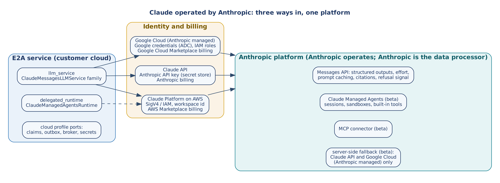
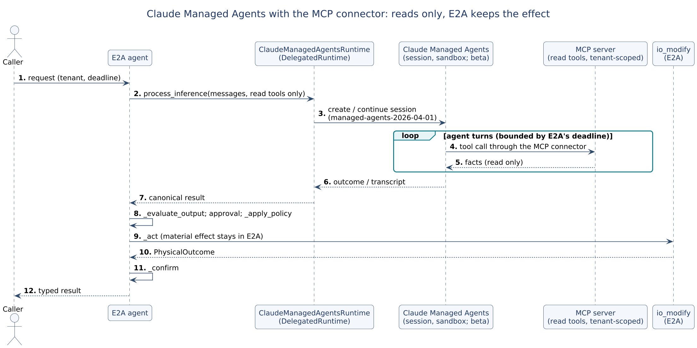

# Claude Operated by Anthropic — Design

### Claude API, Claude Platform on AWS, and Claude Models on Google Cloud (Anthropic managed)

*This document places Claude within E2A when Anthropic operates the service: the Claude API, reached directly or through an AWS or Google Cloud account. The three variants share one API surface and one feature set, including Claude Managed Agents, the MCP connector and native structured outputs. They differ in identity, billing and data terms. It records only what differs from the core design.*

| | |
|---|---|
| Framework | E2A, with `e2a-adapters` and `e2a-managed-providers` |
| Document type | Provider design document (HLD + LLD), Anthropic series |
| Author | Subham Gupta, Principal Platform Architect |
| Source baseline | `e2a-framework` `v1.7.4`; `e2a-managed-providers` `main`: `ClaudeMessagesLLMService`, `ClaudePlatformAWSLLMService`, `ClaudeManagedAgentsRuntime`, profile `anthropic_claude_platform_aws` |
| Date | 16 November 2026 (product facts checked on this date) |
| Status | Claude Platform on AWS: Implemented. Claude API and Google Cloud (Anthropic managed): Documented. |

> **Disclaimer.** This is independent reference material for studying software architecture. It has no affiliation with, and no endorsement by, Anthropic, Amazon / AWS, Google, Microsoft or any other company named, and it is not a substitute for any provider's products, documentation or terms. Product names are trademarks of their owners. Product facts change: they were checked on the date shown, against the sources listed in the last section; check them again before use. Provided "as is", without warranty; not legal, compliance, security or procurement advice. Full text: [DISCLAIMER.md](../DISCLAIMER.md).

## 1. Variant identity

| | Claude API | Claude Platform on AWS | Claude Models on Google Cloud (Anthropic managed) |
|---|---|---|---|
| Operator | Anthropic | Anthropic | Anthropic |
| Data processor (inference) | Anthropic | Anthropic. For workspaces created from 18 Sep 2026, content is processed and stored on AWS infrastructure. | Anthropic |
| Identity | Anthropic API key (from a secret store) | AWS IAM with SigV4 (primary) or an AWS-issued API key; `anthropic-workspace-id` header | Google Cloud credentials (ADC); IAM roles `roles/claude.user`, `roles/claude.viewer`, `roles/claude.admin` |
| Billing | Anthropic | AWS Marketplace (Claude Consumption Units) | Google Cloud Marketplace |
| Audit | Claude Console | AWS CloudTrail for requests through the AWS gateway (`x-amzn-requestid`) | Google Cloud audit logs |
| API surface | Claude API `/v1/*` | The same, through the AWS gateway | The same, under a base URL naming the project, location and workspace |
| Managed Agents | Beta | Beta (sessions re-authenticate after 6 hours without user events) | Beta |
| Server-side refusal fallback | Beta | **Not offered** | Beta |
| Pattern (core Section 3.2) | 1 | 2 | 2 |

Anthropic's documentation advises Claude in Amazon Bedrock (document 2) for organisations that need AWS to be the sole data processor, or FedRAMP High, IL4/IL5 or HIPAA readiness, rather than Claude Platform on AWS.

## 2. Profile

Claude Platform on AWS is implemented as `anthropic_claude_platform_aws`. It `extends` the `aws` cloud profile, so claims, checkpoints, rows, outbox, broker, secrets and identity come from DynamoDB, SQS/SNS, Secrets Manager and Cognito:

| Seam | Binding |
|---|---|
| `llm_service` | `ClaudePlatformAWSLLMService` (the SDK's AWS client: SigV4, workspace id) |
| `delegated_runtime` | `ClaudeManagedAgentsRuntime` (Claude Managed Agents) |
| `embedding_model`, `vector_index`, `reranker` | Titan embeddings, S3 Vectors, Bedrock Rerank. Anthropic offers no embedding model. |
| `guardrail_stage`, `prompt_registry` | Bedrock Guardrails (`ApplyGuardrail`), Bedrock Prompt Management |
| `observability_engine`, `infra_provisioner`, `release_pipeline` | the AWS substrate classes |

The **Claude API** and **Google Cloud (Anthropic managed)** variants use the same `ClaudeMessagesLLMService` family, with the SDK's direct client or Google client. These are Documented, not implemented here. On Google Cloud, the cloud profile `gcp` supplies the infrastructure ports. Configuration is `${VAR}` placeholders only, so no key appears in a profile.

## 3. Dispositions that differ from the core

| Responsibility | Disposition | This variant |
|---|---|---|
| `_format_and_validate_output` | REPLACE implementation | `output_config.format` (JSON schema); E2A still validates the result |
| Reasoning control | REPLACE | `output_config.effort` |
| `_apply_kv_caching` | REPLACE | prompt caching (`cache_control`); E2A decides what is cacheable |
| Refusal detection | ADAPT | HTTP 200 with `stop_reason: "refusal"` and `stop_details` → `ModelRefusal`. A mid-stream refusal discards the partial output. |
| Refusal outcome | COMPOSE | **Claude API, Google Cloud (Anthropic managed):** server-side fallback (`fallbacks`, beta) may answer it. A class that sends it declares `refusal_fallback_server`, and E2A then takes no route. **Claude Platform on AWS:** not offered; E2A's `model_routes` answer. |
| `DelegatedRuntime` | EXTEND | **Claude Managed Agents** (beta): hosted sessions, sandboxes, built-in tools (bash, file operations, web search and fetch, MCP servers). E2A binds read tools only, bounds the session by its deadline, and keeps `_act`. A read-only, bounded workload may run here entirely (conditional REPLACE of `LLMOnlyAgent`). |
| `MCPToolService` transport | REPLACE transport, EXTEND policy | **MCP connector** (beta): Claude calls remote MCP servers directly. Each server's authorisation token comes from the deployment's secret store (`token_env`), and a server holding tenant data must scope it to the calling tenant itself, because E2A is not in that call path. Material tools are never offered. |
| `BaseEmbeddingModel` | COMPOSE | Anthropic "does not offer its own embedding model"; the cloud's model is bound (Titan on AWS), or another provider such as Voyage AI. |
| `BaseRAGPipeline.evaluate_answer` | EXTEND | Native citations and search-result blocks give evidence identity; acceptance stays E2A's |
| Batches, Files API | REPLACE (offline only) | Message Batches for evaluation runs in the release pipeline; files for documents reused across requests |

Everything else keeps the core default, in particular the business idempotency key, approval, `_act` through `io_modify`, `_confirm`, and tenant resolution at ingress.

## 4. Sequences that differ

The model call, failure handling, unknown effects, outbox and identity follow the core's Section 5.

## 5. Error mapping

| Signal | Meaning | E2A result |
|---|---|---|
| 429 `rate_limit_error` (`retry-after`) | rate limit or spend limit | throttled: retried within the deadline by E2A's single retry authority (SDK retries 0) |
| 529 `overloaded_error` | temporarily overloaded | overloaded: retried within the deadline |
| 500 `api_error`, 504 `timeout_error` | internal error or timeout | transient: retried within the deadline. A model call has no business effect. |
| 400 `invalid_request_error`, 413 `request_too_large` | request or context problem | deterministic or context overflow: no retry, `FAILED` |
| 401 `authentication_error`, 403 `permission_error`, 402 `billing_error` | credentials, permissions, billing | auth: no retry, `FAILED`, alert |
| 200, `stop_reason: "refusal"` | the model's safety classifier declined | `ModelRefusal`, then fallback as above, else `REFUSED` |
| Managed Agents session exceeds E2A's deadline or turn limit | — | `DelegatedTurnLimit` / deadline: typed failure |

The provider request id (`request-id`, or `x-amzn-requestid` on AWS) is recorded in E2A telemetry with the tenant and correlation id.

## 6. Security, NFRs and cost

- **Identity.** Claude API: the key lives in a secret store and is injected by the platform, never written in a profile (N2). Platform on AWS: SigV4 from the workload's IAM role. Google: ADC with `roles/claude.user`.
- **Data.** Anthropic is the processor for inference inputs and outputs. Claude Managed Agents is not eligible for zero data retention (except self-hosted): its transcripts persist until deleted, so E2A sends it only what a read-only task needs.
- **Managed Agents scope.** E2A never offers a material tool (`MaterialToolRefused`). Because Claude calls MCP-connector servers directly, those servers enforce tenant access themselves. Tools that need E2A's tenant context run host-side through `run_tool` instead.
- **Region.** Platform on AWS: a workspace is bound to one AWS region for gateway, IAM and CloudTrail. That region does not pin where inference runs; `inference_geo` does.
- **Cost drivers.** Tokens (cache reads cheaper), Managed Agents session time, batches for offline evaluation. Each variant bills differently: Anthropic, AWS Marketplace or Google Cloud Marketplace.

## 7. Evidence

| Item | Status |
|---|---|
| Claude Platform on AWS model calls, structured output, effort, caching, refusal route, MCP connector request shape | Implemented: offline replay of the real SDK; `check_llm_service`; the three projects' suites run on this profile |
| Claude Managed Agents runtime (read tools only) | Implemented: `ClaudeManagedAgentsRuntime`, offline |
| Server-side fallback on Platform on AWS | Removed: not offered there (corrected 16 Nov 2026); E2A routes refusals |
| Claude API and Google Cloud (Anthropic managed) variants | Documented |
| Live behaviour, quotas, latency | Not covered: needs live tests |

## 8. Sources (checked 16 November 2026)

| Fact | Source |
|---|---|
| Platform on AWS: operator, processor, IAM, workspace, CloudTrail, feature limits, Managed Agents | Anthropic, "Claude Platform on AWS" (platform.claude.com/docs/en/build-with-claude/claude-platform-on-aws) |
| The two Google Cloud offerings; Anthropic managed: IAM roles, Marketplace | Anthropic, "Claude Models on Google Cloud" overview and "Anthropic managed" pages |
| Refusals, `stop_details`, server-side fallback platforms | Anthropic, "Refusals and fallback" |
| Managed Agents: beta header `managed-agents-2026-04-01`, tools, ZDR, platforms | Anthropic, "Claude Managed Agents overview" |
| MCP connector platforms (beta) | Anthropic, "MCP connector" |
| No Anthropic embedding model | Anthropic, "Embeddings" |
| Error types and request id | Anthropic, "Errors" |
