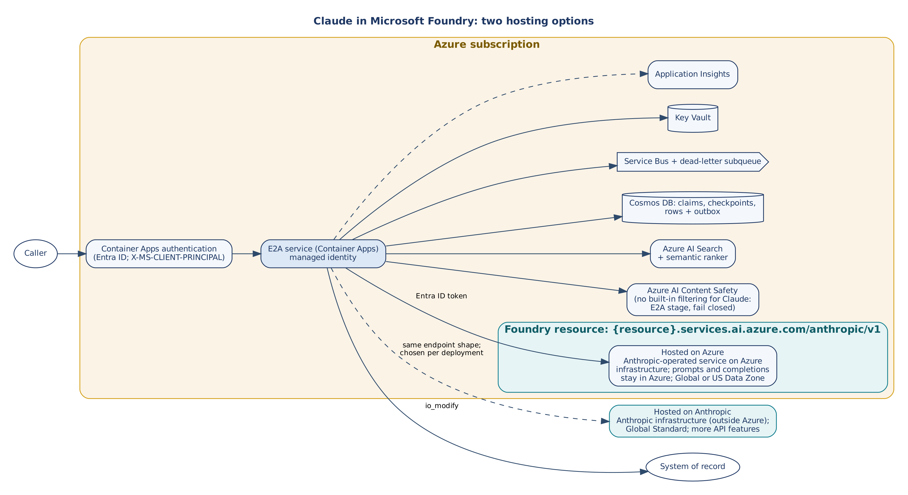

# Claude in Microsoft Foundry — Design

### Anthropic-operated Claude in a Foundry resource: hosted on Azure, or hosted on Anthropic

*This document places Claude within E2A when it is deployed in a Microsoft Foundry resource. Anthropic operates the service, on Azure infrastructure ("hosted on Azure") or on Anthropic's own ("hosted on Anthropic"). Access, billing and logging are Azure's. Foundry provides no built-in content filtering for Claude, has no Claude Managed Agents and no server-side fallback, so E2A's governance and Azure AI Content Safety take those roles. It records only what differs from the core design.*

| | |
|---|---|
| Framework | E2A, with `e2a-adapters` and `e2a-managed-providers` |
| Document type | Provider design document (HLD + LLD), Anthropic series |
| Author | Subham Gupta, Principal Platform Architect |
| Source baseline | `e2a-framework` `v1.7.4` (`azure` cloud profile); `e2a-managed-providers` `main`: the Azure service classes in `e2a_managed.clouds.azure.services` |
| Date | 16 November 2026 (product facts checked on this date) |
| Status | Documented. No Claude-in-Foundry profile here; the Azure service classes are Implemented for the `openai_azure` profile. |

> **Disclaimer.** This is independent reference material for studying software architecture. It has no affiliation with, and no endorsement by, Anthropic, Amazon / AWS, Google, Microsoft or any other company named, and it is not a substitute for any provider's products, documentation or terms. Product names are trademarks of their owners. Product facts change: they were checked on the date shown, against the sources listed in the last section; check them again before use. Provided "as is", without warranty; not legal, compliance, security or procurement advice. Full text: [DISCLAIMER.md](../DISCLAIMER.md).

## 1. Variant identity

| | Hosted on Azure | Hosted on Anthropic |
|---|---|---|
| Where inference runs | Anthropic-operated service on Azure infrastructure. Microsoft: "run on Azure infrastructure end-to-end". | Anthropic-operated service on Anthropic infrastructure, outside Azure |
| Data | "prompts and completions remain within Azure"; only usage metadata and content flagged by Anthropic's safety systems leave Azure | processed by Anthropic |
| Deployment types | Global Standard, US Data Zone Standard | Global Standard |
| Features | fewer than hosted on Anthropic: for example, only older web search and web fetch tool versions | more API features |
| Status (per model) | per model; Microsoft lists, for example, Claude Opus 5.5 and Haiku 5.5 GA | per model; some models in preview or gated |
| Common to both | endpoint `https://{resource}.services.ai.azure.com/anthropic/v1/*` (Messages API shape); Entra ID tokens (RBAC) or API keys; Azure Marketplace billing in Claude Consumption Units; Anthropic acts as an independent processor for Microsoft | |
| Pattern (core Section 3.2) | 2, with the infrastructure in the customer's cloud | 2 |

**Not supported in Foundry** (Anthropic's page):
- Claude Managed Agents;
- server-side fallback.

Microsoft: "Foundry doesn't provide built-in content filtering for Claude models at deployment time". It also states that the Microsoft Agent Framework supports agents that use Claude. The MCP connector is listed by Anthropic as beta on Microsoft Foundry.

## 2. Profile (design)

A profile would `extend` the `azure` cloud profile: Cosmos DB stores and outbox, Service Bus, Key Vault, and identity at ingress through `azure_container_apps`. It would bind:

| Seam | Binding | Status |
|---|---|---|
| `llm_service` | a `ClaudeMessagesLLMService` subclass on the SDK's Foundry client, with Entra ID tokens from the managed identity | Documented (not implemented) |
| `guardrail_stage` | `AzureContentSafetyStage`, **required**, because Foundry does not filter Claude by itself | Implemented class |
| `embedding_model` | an Azure embedding model (for example `AzureOpenAIEmbeddingModel`); Anthropic offers none | Implemented class; composition To validate |
| `vector_index`, `reranker` | `AzureAISearchIndex`, `AzureSemanticRanker` | Implemented classes |
| `mcp_gateway_tool` | `APIMGatewayTool` (API Management), or the MCP connector (beta) | Implemented class / Documented |
| `delegated_runtime` | none managed for Claude here: the E2A agent keeps the loop | — |
| `observability_engine`, `infra_provisioner`, `release_pipeline` | `AzureObservability`, `AzureInfraProvisioner`, `AzureReleasePipeline` | Implemented classes |

## 3. Dispositions that differ from the core

| Responsibility | Disposition | This variant |
|---|---|---|
| `ManagedGuardrailStage` | EXTEND, mandatory | No built-in content filtering for Claude in Foundry. Azure AI Content Safety screens input and output in E2A's order and fails closed. Claude's refusal classifier still applies. |
| Refusal outcome | COMPOSE, with E2A's route authoritative | no server-side fallback: E2A's `model_routes` |
| `DelegatedRuntime` | RETAIN | no Claude Managed Agents in Foundry; the E2A agent keeps the loop |
| `MCPToolService` transport | REPLACE transport, EXTEND policy | API Management as the MCP gateway; the MCP connector (beta) where it fits the tenant model |
| `BaseRAGPipeline.retrieve` | COMPOSE | Azure embeddings, Azure AI Search (tenant filter), semantic ranker |
| Hosting choice | configuration | Hosted on Azure by default; Hosted on Anthropic only for a feature or model it alone offers, and only if the data boundary allows it |

## 4. Sequences

As the core (Section 5), with Azure AI Content Safety at the guardrail stage, and E2A's refusal route as on Bedrock (Bedrock document, Figure 2).

## 5. Error mapping

| Signal | E2A result |
|---|---|
| 429 | throttled: E2A's single retry authority within the deadline |
| 5xx | transient or overloaded: retried within the deadline |
| 400 (including a feature not available on a hosted-on-Azure deployment, "by design") | deterministic: no retry |
| 401 / 403 (Entra token, RBAC) | auth: no retry, alert |
| 200 with `stop_reason: "refusal"` | `ModelRefusal`, then E2A's route, else `REFUSED` |
| Content Safety match | `GovernanceRefusal` at the guardrail stage |

## 6. Security, NFRs and cost

- **Identity.** The Container App's managed identity obtains Entra ID tokens; no API key in configuration. Callers are verified by Container Apps authentication (E2A v1.7.4, `azure_container_apps`), with the directory mapped to the tenant.
- **Data boundary.** Hosted on Azure keeps prompts and completions in Azure, apart from the usage metadata and safety-flagged content above. US Data Zone keeps inference in the United States. Hosted on Anthropic leaves Azure.
- **Logging.** Azure's logging is configured in the subscription. Microsoft states that enabling it gives neither Microsoft nor Anthropic access to content beyond billing and service operation.
- **Cost drivers.** Claude Consumption Units through Azure Marketplace; Content Safety calls; AI Search; Cosmos DB and Service Bus.

## 7. Evidence

| Item | Status |
|---|---|
| Azure service classes (AI Search, semantic ranker, Content Safety, API Management, observability, IaC) | Implemented for `openai_azure` (offline) |
| Claude in Foundry in E2A | Documented: no profile or offline replay yet |
| Live behaviour | Not covered |

## 8. Sources (checked 16 November 2026)

| Fact | Source |
|---|---|
| Hosting options, deployment types, data flow, processor role, endpoint, Entra ID, unsupported features | Anthropic, "Claude in Microsoft Foundry" |
| The two versions, per-model status, no built-in content filtering for Claude, Microsoft Agent Framework | Microsoft Learn, "Claude models in Microsoft Foundry" |
| MCP connector on Microsoft Foundry (beta) | Anthropic, "MCP connector" |
