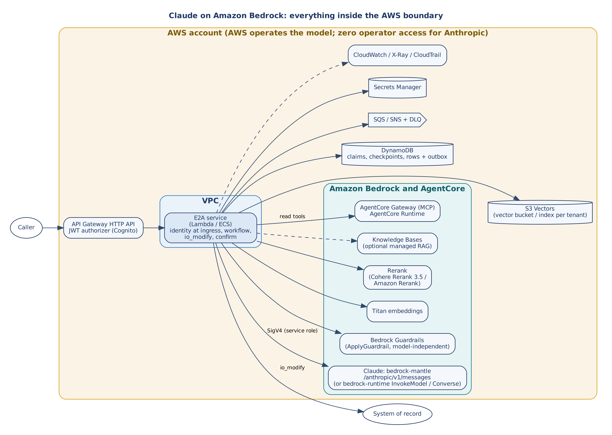
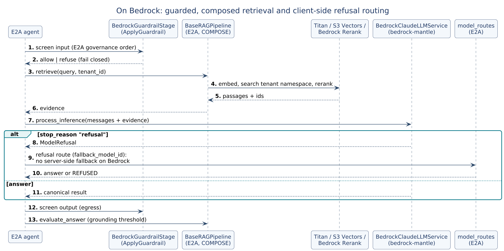

# Claude on Amazon Bedrock — Design

### AWS-operated Claude, with the Bedrock and AgentCore services around it

*This document places Claude within E2A when AWS operates the model in Amazon Bedrock. Inference stays inside the AWS boundary, with no operator access for Anthropic. Identity, network, logging and data handling are AWS's. Bedrock does not offer Claude Managed Agents, the MCP connector or server-side refusal fallback, so E2A and AWS services take those roles. It records only what differs from the core design.*

| | |
|---|---|
| Framework | E2A, with `e2a-adapters` and `e2a-managed-providers` |
| Document type | Provider design document (HLD + LLD), Anthropic series |
| Author | Subham Gupta, Principal Platform Architect |
| Source baseline | `e2a-framework` `v1.7.4`; `e2a-managed-providers` `main`: profile `anthropic_bedrock`, `BedrockClaudeLLMService`, `e2a_managed.clouds.aws.bedrock`, `e2a_managed.clouds.aws.substrate` |
| Date | 16 November 2026 (product facts checked on this date) |
| Status | Implemented (offline): every binding in Section 2 |

> **Disclaimer.** This is independent reference material for studying software architecture. It has no affiliation with, and no endorsement by, Anthropic, Amazon / AWS, Google, Microsoft or any other company named, and it is not a substitute for any provider's products, documentation or terms. Product names are trademarks of their owners. Product facts change: they were checked on the date shown, against the sources listed in the last section; check them again before use. Provided "as is", without warranty; not legal, compliance, security or procurement advice. Full text: [DISCLAIMER.md](../DISCLAIMER.md).

## 1. Variant identity

| | Claude in Amazon Bedrock (`bedrock-mantle`) | Claude on Amazon Bedrock (`bedrock-runtime`) |
|---|---|---|
| Operator | AWS ("zero operator access: Anthropic personnel have no access to the inference infrastructure") | AWS |
| API | Messages API at `https://bedrock-mantle.{region}.api.aws/anthropic/v1/messages`, same request body as the Claude API | `InvokeModel` and `Converse`, AWS event-stream encoding; newer models through cross-region inference profiles |
| Identity | Bedrock service role (recommended), IAM assumed roles, or short-term bearer tokens | SigV4 with IAM, or bearer tokens |
| Model ids | `anthropic.` prefix | base id or an inference profile id |
| Endpoints | Global (no premium) or regional (10 % premium; data residency); geography inference profiles | regional, with cross-region inference profiles |
| Data handling | governed by Amazon Bedrock ("Data protection in Amazon Bedrock") | the same |
| Logs | CloudWatch and CloudTrail | the same |
| Quotas (mantle) | default 2 M input tokens per minute; up to 5 M input and 500 k output TPM without Anthropic approval; RPM set by AWS | per model and region, set by AWS |
| Pattern (core Section 3.2) | 3 | 3 |

**Not supported on Bedrock** (Anthropic's mantle page):
- input sources: URL sources and the Files API;
- server-side tools: code execution, web search, web fetch, advisor;
- Agent Skills, the MCP connector and programmatic tool calling;
- the Message Batches, Models, Admin, Compliance, and Usage and Cost endpoints;
- Claude Managed Agents;
- server-side fallback.

Supported: the Messages API, prompt caching, thinking, tool use (including bash, browser use, computer use and memory), citations and structured outputs.

## 2. Profile

`anthropic_bedrock` `extends` the `aws` cloud profile (DynamoDB stores and outbox, SQS/SNS, Secrets Manager, Cognito identity at ingress) and binds:

| Seam | Binding | AWS service |
|---|---|---|
| `llm_service` | `BedrockClaudeLLMService` | Claude on `bedrock-mantle`, through the SDK's Bedrock client |
| `embedding_model` | `TitanEmbeddingModel` | Amazon Titan Text Embeddings V2 |
| `vector_index` | `S3VectorsIndex` | S3 Vectors (vector bucket, one index namespace per tenant) |
| `reranker` | `BedrockReranker` | Bedrock Rerank: `cohere.rerank-v3-5:0` (Amazon Rerank 1.0 where offered) |
| `rag_pipeline` (optional) | `BedrockKnowledgeBaseRAGPipeline` | Bedrock Knowledge Bases |
| `guardrail_stage` | `BedrockGuardrailStage` | Bedrock Guardrails through `ApplyGuardrail` |
| `prompt_registry` | `BedrockPromptRegistry` | Bedrock Prompt Management |
| `mcp_gateway_tool` | `AgentCoreGatewayTool` | AgentCore Gateway (APIs, Lambda functions and MCP servers as MCP tools) |
| `delegated_runtime` | `AgentCoreRuntime` | AgentCore Runtime |
| `observability_engine`, `infra_provisioner`, `release_pipeline` | `AWSObservability`, `AWSInfraProvisioner`, `AWSReleasePipeline` | CloudWatch / X-Ray (OpenTelemetry), Terraform, CI/CD |

Model choice and fallback are configuration: `model_id` defaults to `anthropic.claude-opus-5-5` and `fallback_model_id` to `anthropic.claude-opus-4-8`. All deployment values are `${VAR}` placeholders.

## 3. Dispositions that differ from the core

| Responsibility | Disposition | This variant |
|---|---|---|
| Refusal outcome | COMPOSE, with E2A's route authoritative | No server-side fallback on Bedrock. `fallback_model_id` becomes a `model_routes` refusal route, and E2A records `fallback_from`. |
| `DelegatedRuntime` | EXTEND | No Claude Managed Agents. **AgentCore Runtime** hosts the agent session ("any framework and foundation model"); E2A binds read tools only. |
| `MCPToolService` transport | REPLACE transport, EXTEND policy | No MCP connector. **AgentCore Gateway** exposes APIs, Lambda functions and MCP servers as MCP tools; E2A calls it with a bearer token and its tenant context. |
| `ManagedGuardrailStage` | EXTEND | **Bedrock Guardrails** through `ApplyGuardrail`, "decoupled from foundation models". It screens input and output in E2A's governance order and fails closed. |
| `BaseRAGPipeline.retrieve` | COMPOSE by default; REPLACE optional | Titan, S3 Vectors and Bedrock Rerank behind E2A's ports (tenant namespace per index). Knowledge Bases may replace the pipeline if tenant isolation, evidence ids and failure reporting pass the gate. |
| `BasePromptRegistry` | REPLACE | Bedrock Prompt Management |
| Batches, Files API | Not available | E2A runs evaluation sets through its release pipeline instead |

Everything else keeps the core default.

## 4. Sequences that differ

## 5. Error mapping

| Signal | E2A result |
|---|---|
| 429 / throttling | throttled: E2A's single retry authority, within the deadline (SDK retries 0) |
| 5xx / service unavailable / overloaded | transient or overloaded: retried within the deadline |
| 400 validation (including a base model id where an inference profile is required, or an unsupported API version) | deterministic: no retry, `FAILED` |
| 403 access denied (model access not granted, IAM) | auth: no retry, `FAILED`, alert |
| 200 with `stop_reason: "refusal"` | `ModelRefusal`, then E2A's refusal route, else `REFUSED` |
| Bedrock Guardrails intervention | `GovernanceRefusal` at the guardrail stage (fail closed) |

## 6. Security, NFRs and cost

- **Identity.** The workload's IAM role signs every call (SigV4); no key in configuration. The recommended mantle path is a Bedrock service role with `iam:PassRole`. Callers are verified by the API Gateway JWT authorizer (E2A v1.7.4, `aws_http_api`).
- **Network.** Bedrock, S3, DynamoDB, SQS and Secrets Manager are reached from the VPC. Private connectivity uses VPC endpoints (PrivateLink), configured per account. That configuration is not part of this repository's Terraform.
- **Data.** AWS is the processor, under Bedrock's data-protection terms. Choose regional endpoints or geography inference profiles for residency (10 % premium).
- **Audit.** CloudTrail records API calls; CloudWatch holds logs. Anthropic advises keeping activity logs for at least 30 days.
- **Cost drivers.** Model tokens (regional premium, cache reads cheaper); Titan, S3 Vectors storage and queries; Rerank; Guardrails assessments; AgentCore runtime and gateway use.

## 7. Evidence

| Item | Status |
|---|---|
| Every binding in Section 2: request shapes through the real SDKs, offline | Implemented |
| `check_llm_service`; the three projects' suites with this profile | Implemented (CI) |
| AWS Terraform (DynamoDB, Guardrails, IAM, logging) against mock providers | Implemented |
| Live Bedrock behaviour, quotas, latency, Guardrails accuracy | Not covered: needs live tests |

## 8. Sources (checked 16 November 2026)

| Fact | Source |
|---|---|
| mantle endpoint, operator access, authentication, supported and unsupported features, regions, quotas, data, logs | Anthropic, "Claude in Amazon Bedrock (bedrock-mantle)" |
| `InvokeModel` / `Converse`, inference profiles, no server-side fallback | Anthropic, "Claude on Amazon Bedrock (bedrock-runtime)" |
| AgentCore services (Runtime, Gateway; "any framework and foundation model") | AWS, "What is Amazon Bedrock AgentCore" |
| `ApplyGuardrail` decoupled from models | AWS, "Use the ApplyGuardrail API in your application" |
| S3 Vectors (vector buckets, indexes, strongly consistent writes) | AWS, "Working with S3 Vectors and vector buckets" |
| Rerank models and ids | AWS, "Supported Regions and models for reranking" |
