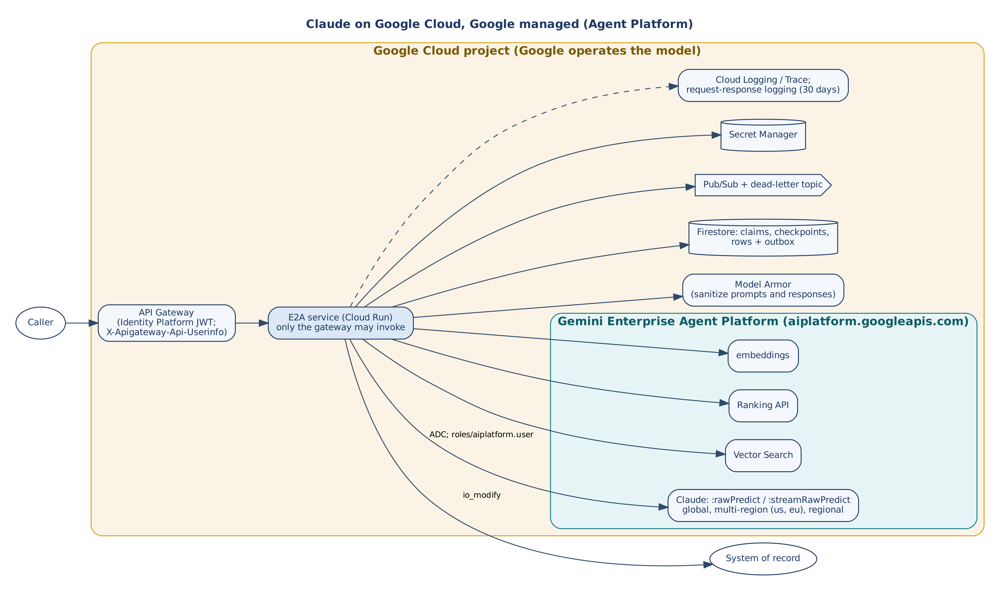

# Claude on Google Cloud (Google Managed) — Design

### Claude served by Google in Gemini Enterprise Agent Platform

*This document places Claude within E2A when Google operates Claude as part of Google Cloud's Agent Platform (formerly Vertex AI). Identity, billing, quotas, endpoints and logging are Google Cloud's. The Anthropic-operated offering on Google Cloud is covered in the "Claude operated by Anthropic" document. Like Bedrock, this offering has no Claude Managed Agents, MCP connector or server-side fallback. It records only what differs from the core design.*

| | |
|---|---|
| Framework | E2A, with `e2a-adapters` and `e2a-managed-providers` |
| Document type | Provider design document (HLD + LLD), Anthropic series |
| Author | Subham Gupta, Principal Platform Architect |
| Source baseline | `e2a-framework` `v1.7.4` (`gcp` cloud profile); `e2a-managed-providers` `main`: the Google Cloud service classes in `e2a_managed.clouds.gcp.services` |
| Date | 16 November 2026 (product facts checked on this date) |
| Status | Documented. No Claude-on-Google profile here; the Google Cloud service classes are Implemented for the `google_vertex` profile. |

> **Disclaimer.** This is independent reference material for studying software architecture. It has no affiliation with, and no endorsement by, Anthropic, Amazon / AWS, Google, Microsoft or any other company named, and it is not a substitute for any provider's products, documentation or terms. Product names are trademarks of their owners. Product facts change: they were checked on the date shown, against the sources listed in the last section; check them again before use. Provided "as is", without warranty; not legal, compliance, security or procurement advice. Full text: [DISCLAIMER.md](../DISCLAIMER.md).

## 1. Variant identity

| | Claude Models on Google Cloud (Google managed) |
|---|---|
| Operator | Google, as part of Gemini Enterprise Agent Platform |
| API | Agent Platform prediction endpoints: `…:rawPredict` (`:streamRawPredict` to stream); the model in the URL and `anthropic_version` in the body. Anthropic's SDKs support it (`anthropic[vertex]`). |
| Identity | Google Cloud credentials (ADC); an IAM role with `aiplatform.endpoints.predict`, such as `roles/aiplatform.user` |
| Endpoints | global (recommended), multi-region `us` / `eu`, or regional. Multi-region and regional cost 10 % more; regional serves Claude Sonnet 4.6 and earlier only. |
| Billing and quotas | Google Cloud (Agent Platform usage); pay as you go or provisioned throughput |
| Compliance | Google: "Accessing Claude on Google Cloud models through Agent Platform meets the FedRAMP High requirements" |
| Logging | Agent Platform request-response logging (30 days), or metadata-only logging |
| Limits | request payloads up to 30 MB |
| Pattern (core Section 3.2) | 3 |

**Not supported** (Anthropic's page):
- URL sources and the Files API;
- Agent Skills, the MCP connector and programmatic tool calling;
- the Message Batches, Models, Admin, Compliance, and Usage and Cost API endpoints;
- Claude Managed Agents;
- server-side fallback.

Google's documentation lists batch prediction, prompt caching and token counting for Claude on Agent Platform.

## 2. Profile (design)

A profile would `extend` the `gcp` cloud profile: Firestore stores and outbox, Pub/Sub, Secret Manager, and identity at ingress through `gcp_api_gateway`. It would bind:

| Seam | Binding | Status |
|---|---|---|
| `llm_service` | a `ClaudeMessagesLLMService` subclass on the SDK's Google client (ADC) | Documented (not implemented) |
| `embedding_model` | a Google embedding model (`VertexGeminiEmbeddingModel`); Anthropic offers none | Implemented class; composition To validate |
| `vector_index`, `reranker` | `VertexVectorSearchIndex`, `VertexRankingReranker` | Implemented classes |
| `guardrail_stage` | `ModelArmorStage`; Model Armor screens prompts and responses for any model, "in Google Cloud or other cloud" | Implemented class |
| `delegated_runtime` | Agent Platform's agent runtime (formerly Agent Engine; `VertexAgentEngineRuntime`) | Implemented for Gemini; with Claude To validate |
| `mcp_gateway_tool`, `observability_engine`, `infra_provisioner`, `release_pipeline` | `IAPGatewayTool`, `GCPObservability`, `GCPManagedInfraProvisioner`, `GCPReleasePipeline` | Implemented classes |

## 3. Dispositions that differ from the core

| Responsibility | Disposition | This variant |
|---|---|---|
| Refusal outcome | COMPOSE, with E2A's route authoritative | no server-side fallback: E2A's `model_routes` |
| `DelegatedRuntime` | EXTEND, or RETAIN | no Claude Managed Agents. The E2A agent keeps the loop, or a framework agent is hosted on Agent Platform's runtime (To validate with Claude). |
| `MCPToolService` transport | REPLACE transport, EXTEND policy | no MCP connector: tools are reached through an IAP- or API Gateway-fronted MCP service (`IAPGatewayTool`) |
| `ManagedGuardrailStage` | EXTEND | Model Armor sanitises prompts and responses in E2A's order and fails closed. Claude's own refusal classifier still applies. |
| `BaseRAGPipeline.retrieve` | COMPOSE | Google embeddings, Vector Search (tenant namespace), Ranking API |
| Structured output, effort, caching, refusal detection | as the core | Anthropic's request body, sent through `rawPredict` |

## 4. Sequences

As the core (Section 5), with Model Armor at the guardrail stage, and E2A's refusal route as on Bedrock (Bedrock document, Figure 2).

## 5. Error mapping

| Signal | E2A result |
|---|---|
| 429 resource exhausted (quota) | throttled: E2A's single retry authority within the deadline |
| 5xx / unavailable | transient: retried within the deadline |
| 400 invalid argument (payload over 30 MB, model not offered in the region) | deterministic: no retry |
| 403 permission denied (`aiplatform.endpoints.predict` missing) | auth: no retry, alert |
| 200 with `stop_reason: "refusal"` | `ModelRefusal`, then E2A's route, else `REFUSED` |
| Model Armor match | `GovernanceRefusal` at the guardrail stage |

## 6. Security, NFRs and cost

- **Identity.** ADC from the Cloud Run service account; no key. Callers are verified by API Gateway with Identity Platform (`gcp_api_gateway`). The gateway's service account must be the only invoker.
- **Residency.** Pick multi-region `eu` / `us` or a regional endpoint. Newer models need global or multi-region.
- **Network.** Private Service Connect and VPC Service Controls apply to Google APIs; Model Armor's regional endpoints need a PSC endpoint inside a VPC.
- **Cost drivers.** Tokens (10 % premium off global), provisioned throughput if bought, Vector Search, Ranking, Model Armor.

## 7. Evidence

| Item | Status |
|---|---|
| Google Cloud service classes (Vector Search, Ranking, Model Armor, agent runtime, IAP gateway) | Implemented for `google_vertex` (offline) |
| Claude through Agent Platform in E2A | Documented: no profile or offline replay yet |
| Live behaviour | Not covered |

## 8. Sources (checked 16 November 2026)

| Fact | Source |
|---|---|
| Google-managed offering: endpoints, regions, pricing premium, unsupported features, 30 MB limit | Anthropic, "Claude Models on Google Cloud (Google managed)"; Anthropic, "Claude Models on Google Cloud" overview |
| FedRAMP High; request-response logging; batch, caching, token counting | Google Cloud, "Anthropic's Claude models" (Agent Platform partner models) |
| Model Armor screens prompts and responses, in Google Cloud or other clouds; PSC for regional endpoints | Google Cloud, "Model Armor overview" |
| Vertex AI renamed Gemini Enterprise Agent Platform; Agent Engine renamed | Google Cloud, Agent Platform release notes |
