# E2A Managed Providers — Core Design

### High-Level and Low-Level Design: how managed AI and cloud services fit E2A

*This document is the shared basis of every provider design document in this repository. It defines how a managed service of a model provider or a cloud is placed within the E2A framework: replaced, extended, adapted, composed, or left to E2A. It also defines the E2A responsibilities, written once, that every provider document refers to instead of repeating them. Each provider document then records only what differs for that provider and hosting pattern.*

| | |
|---|---|
| Framework | E2A — Enterprise-to-Agentic Architecture Framework, with `e2a-adapters` (cloud infrastructure) and `e2a-managed-providers` (managed AI services) |
| Document type | Design Document (HLD + LLD), core of the provider design series |
| Author | Subham Gupta, Principal Platform Architect |
| Source baseline | `subhamviky/e2a-framework` `v1.7.4` (`reference/e2a/*`, `adapters/e2a_adapters/*`); `subhamviky/e2a-managed-providers` `main` (profiles under `e2a_managed/providers/*/profiles`, clouds under `e2a_managed/clouds/*`) |
| Date | 16 November 2026 |
| Status | Aligned to the reference implementation named above |

> **Disclaimer.** This is independent reference material for studying software architecture. It has no affiliation with, and no endorsement by, any company named, and it is not a substitute for any provider's products, documentation or terms. Product names are trademarks of their owners. Product facts change: check the provider's current documentation. Provided "as is", without warranty; not legal, compliance, security or procurement advice. The full text is in [DISCLAIMER.md](../DISCLAIMER.md) and in Appendix A.

## 1. Introduction

### 1.1 Purpose

Managed AI platforms now offer much of what an enterprise agent framework used to build itself, such as structured output, prompt caching, managed retrieval, safety classifiers, hosted agent loops, MCP connectivity and token verification at the gateway. E2A should **use** these capabilities, not duplicate them. It should also not give up a guarantee that a managed service does not actually provide.

This document gives the rule for that decision (Section 2), the architecture both sides share (Section 3), the E2A responsibilities and the seams through which a managed service is bound (Section 4), the sequences that are the same for every provider (Section 5), the failure and trust model (Sections 6–7), and how each claim is proven (Section 8). Section 9 is the outline every provider document follows.

### 1.2 Audience

| Reader | Read first | Use the document to |
|---|---|---|
| Enterprise architect | Sections 2, 3 | Decide which managed services a deployment uses, and what E2A keeps |
| Platform engineer | Sections 3.4, 4, 8 | Bind a provider through a profile; know which seams exist and how they are verified |
| Security and risk reviewer | Sections 2.3, 6, 7 | Check that no guarantee is lost when a managed service is used |
| Reader of a provider document | Sections 2, 4.3, 9 | Read a provider document as a set of differences from this one |

### 1.3 Status and evidence labels

Every statement about a binding carries one of these labels.

| Label | Meaning |
|---|---|
| **Implemented** | In the repositories named in the source baseline, and exercised by their tests: contract suites, emulators, offline replay of real SDK traffic. This is not proof of a provider's production behaviour. |
| **E2A contract** | The E2A port or lifecycle exists and has a contract suite; the provider binding is described, not implemented here. |
| **Documented** | The provider's own documentation describes the capability (source and date given in the provider document); not implemented in this repository. |
| **To validate** | A combination that is logically sound but not stated by the provider's documentation as supported; it must be confirmed with the provider before use. |
| **Not applicable** | No sensible fit for this combination. |

### 1.4 Terms

| Term | Meaning |
|---|---|
| Responsibility | One duty in E2A: a class, a hook (template-method step), a port, or a governance stage |
| Seam | A named place where a deployment binds an implementation of an E2A port (`e2a.bindings.SEAMS`) |
| Profile | A configuration file that binds seams and sets configuration; a provider profile `extends` a cloud profile |
| Material effect | A change in a system of record (a payment, a posting, an order state), made only through `io_modify` |
| Physical outcome | `PhysicalOutcome.COMMITTED`, `NOT_COMMITTED` or `UNKNOWN`: what is known about a material effect |
| Kernel | The E2A responsibilities a deployment keeps; its size depends on what the managed services own |

## 2. The disposition model

### 2.1 Principle

**Consume a managed capability wherever it owns the complete responsibility. Replace an E2A responsibility only when the managed service meets every point of the replacement gate. Otherwise extend, adapt or compose it, and keep the E2A guarantee where no managed service supplies it.**

E2A is a kernel of variable size, not a parallel implementation of managed AI. The kernel shrinks when a managed capability owns an invariant completely, and stays wherever business correctness, distributed-systems correctness or governance still needs an owner. Keeping E2A in a call path merely for symmetry is a defect, as is removing it where a guarantee would be lost.

### 2.2 The five dispositions

| Disposition | Decision rule | Typical result |
|---|---|---|
| **RETAIN** | No managed service supplies the enterprise guarantee | E2A's template method or port stays authoritative |
| **REPLACE** | A managed service supplies the capability and every point of the gate | Bind the managed service to the seam directly; remove E2A's duplicate |
| **EXTEND** | A managed service executes the work but does not supply the full guarantee | Managed execution, surrounded by E2A policy, state, outcome or confirmation |
| **ADAPT** | Only a format or protocol translation is needed | A thin codec or client adapter, with no business logic |
| **COMPOSE** | The responsibility spans the model provider, the cloud and E2A | One seam, with each owner's part named |

The decision is made per responsibility (often per method), not per class. A class can be retained while several of its steps are replaced by native features.

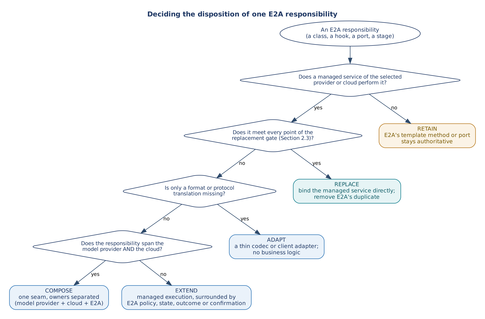

### 2.3 The replacement gate

A managed service may REPLACE an E2A responsibility only if all of the following hold for that responsibility. If one does not, the disposition is EXTEND (or ADAPT / COMPOSE), never REPLACE.

1. **Functional correctness** is equivalent or stronger.
2. **Tenant isolation** and identity propagation are explicit.
3. The **end-to-end deadline** and resource admission remain bounded.
4. **One retry authority**: throttling does not multiply traffic or corrupt circuit state.
5. **Material effects** have idempotency and commit semantics and an observable physical outcome.
6. **Approval** and four-eyes requirements cannot be bypassed.
7. **State transitions** are durable and replay-safe where required.
8. **Failure, refusal and unknown outcomes are typed**, not hidden in text.
9. **Confirmation** verifies system-of-record truth after a write.
10. **Observability** carries tenant, correlation, step and provider metadata.
11. **Secrets** use platform identity chains, never embedded credentials (E2A's literal-secret rule).
12. **Tests** exist for the contract, failure and recovery behaviour.

A provider can be technically able to perform an operation without meeting this gate. Capability alone is not grounds for REPLACE.

## 3. High-level design

### 3.1 Four owners

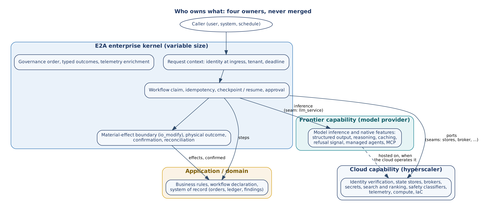

| Owner | Owns | Never owns |
|---|---|---|
| Application / domain | Business rules, workflow declaration, the system of record | Model hosting, cloud primitives |
| E2A kernel | Request context, workflow claim and idempotency, approval and resume, the material-effect boundary, physical outcome, confirmation and reconciliation, governance order, typed outcomes | Model weights or serving; physical storage engines |
| Model provider | Inference and native model features: structured output, reasoning control, caching, refusal signal, managed agent loops, MCP connectivity | Business idempotency, approval, system-of-record truth |
| Cloud | Identity verification, state stores, brokers, secrets, search and ranking, safety classifiers, telemetry, compute, infrastructure as code | Business meaning of the state it stores |

**Model host ≠ customer cloud ≠ E2A ≠ system of record.** Every provider document names each of the four for its hosting pattern.

### 3.2 Hosting patterns

A frontier model reaches an E2A service in one of five ways. They differ in operator, identity, data boundary and terms, so a provider document treats them as separate variants when its provider offers more than one.

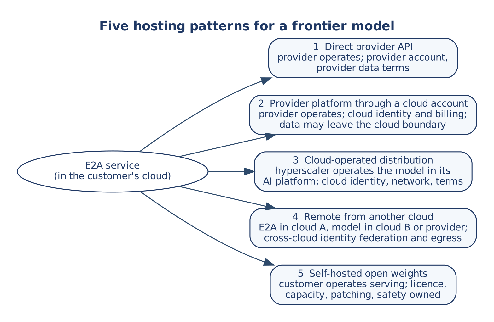

| Pattern | Operator of the model | Identity and billing | Data boundary | Example (see the provider documents) |
|---|---|---|---|---|
| 1 Direct provider API | Model provider | Provider account | Provider's terms | A provider's own API |
| 2 Provider platform through a cloud account | Model provider | Cloud account (IAM, cloud billing) | May leave the cloud boundary | Claude Platform on AWS |
| 3 Cloud-operated distribution | Cloud | Cloud identity, network, terms | Inside the cloud's AI platform | Claude, OpenAI or Llama models on Amazon Bedrock; models in Microsoft Foundry or Google Cloud's agent platform |
| 4 Remote from another cloud | Provider or another cloud | Two identities; federation | Crosses clouds; egress | Gemini used from AWS or Azure |
| 5 Self-hosted open weights | Customer | Customer | Customer | Llama on Kubernetes |

The examples are illustrative. Each provider document states the current offering, its status and its source.

### 3.3 Logical architecture

The kernel sits between the domain and two capability packs, **frontier** (a model provider's services) and **cloud** (a hyperscaler's services). Each pack is a set of seam bindings in a profile, so an application chooses its packs by configuration and never imports a provider's SDK.

| Tier | E2A responsibility | Managed-service rule |
|---|---|---|
| Ingress | Identity at ingress, request context, validation | Cloud gateway verifies the token (REPLACE); E2A resolves claims to tenant, subject and roles (RETAIN) |
| Workflow | Steps, claim, idempotency, checkpoint and resume, approval | RETAIN for material or durable workflows; a contained read-only workflow may run in a managed agent (conditional REPLACE) |
| Inference gateway | Deadline, admission, retry authority, structured-output contract, usage | Native model features REPLACE E2A's implementations; cross-request guarantees RETAIN or COMPOSE |
| Knowledge | Embedding, index, retrieval, reranking, answer evaluation | Fully managed retrieval may REPLACE; otherwise COMPOSE managed parts behind E2A's ports; answer acceptance RETAIN |
| Integration | Tool policy, `io_read` / `io_modify`, physical outcome | MCP transport may be REPLACEd; material effects RETAIN unless the gate is proven |
| Saga and messaging | Compensation, outbox, idempotent consumers, reconciliation | Cloud brokers and stores own transport and storage; E2A owns publication intent and consumer idempotency (COMPOSE) |
| Cross-cutting | Governance stages, observability, secrets, release gate | Platform services physically; E2A semantics where cross-service correctness depends on them |

### 3.4 Cloud capability packs (e2a-adapters)

The cloud profiles of `e2a-adapters` 1.7.4 bind E2A's infrastructure seams. A provider profile `extends` one of them and adds its AI services.

| Seam | `aws` | `gcp` | `azure` |
|---|---|---|---|
| `idempotency_store`, `checkpoint_store`, `transactional_store`, `lease` | DynamoDB | Firestore | Cosmos DB |
| `message_broker` | SQS / SNS | Pub/Sub | Service Bus |
| `outbox_store` | DynamoDB (in `TransactWriteItems`) | Firestore (batch / transaction) | Cosmos DB (transactional batch) |
| `credential_provider` | Secrets Manager | Secret Manager | Key Vault |
| `identity_resolver` + `identity_source` | `ClaimMapIdentityResolver`, Cognito preset; `aws_http_api` | Identity Platform preset; `gcp_api_gateway` | Entra ID preset; `azure_container_apps` |

All are **Implemented** and proven by E2A's port contracts on DynamoDB Local and the Firestore, Cosmos DB, Pub/Sub and Service Bus emulators (Section 8).

### 3.5 Provider profiles in this repository

| Profile | Model provider | Hosting pattern | Extends | Status |
|---|---|---|---|---|
| `anthropic_bedrock` | Anthropic | 3 (Amazon Bedrock) | `aws` | Implemented |
| `anthropic_claude_platform_aws` | Anthropic | 2 (Claude Platform on AWS) | `aws` | Implemented |
| `openai_azure` | OpenAI | 3 (Azure) | `azure` | Implemented |
| `google_vertex` | Google | 3 (Google Cloud) | `gcp` | Implemented |
| `ogx_aws` (alias `meta_llama_aws`) | Meta (Llama), through OGX | 3 and 5 (Bedrock behind OGX, formerly Llama Stack) | `aws` | Implemented |

Other variants described in the provider documents are labelled Documented or To validate.

## 4. Low-level design

### 4.1 Seams

A deployment binds managed services only through these seams (`e2a.bindings.SEAMS`). Application code never imports a provider SDK.

| Seam | E2A port | Bound by | Default disposition |
|---|---|---|---|
| `llm_service` | `BaseLLMAgentService` | provider profile | EXTEND (native features REPLACE E2A's implementations of them) |
| `delegated_runtime` | `DelegatedRuntime` (a `BaseLLMAgentService`) | provider profile | EXTEND; read tools only |
| `embedding_model` | `BaseEmbeddingModel` | provider profile | REPLACE implementation; port RETAIN |
| `vector_index` | `BaseVectorIndex` | provider profile | REPLACE implementation; tenant namespace RETAIN |
| `reranker` | a reranker for `BaseRAGPipeline._rerank` | provider profile | REPLACE |
| `rag_pipeline` | `BaseRAGPipeline` | provider profile | REPLACE when the gate holds, else COMPOSE |
| `guardrail_stage` | `ManagedGuardrailStage` (an ingress stage) | provider profile | EXTEND: E2A decides order, fail-closed and the typed outcome |
| `prompt_registry` | `BasePromptRegistry` | provider profile | REPLACE |
| `mcp_gateway_tool` | MCP tool service through a managed gateway | provider profile | REPLACE transport; EXTEND with tenant and tool policy |
| `observability_engine` | `BaseObservability` | provider profile | EXTEND: provider and cloud telemetry enriched with E2A context |
| `idempotency_store`, `checkpoint_store`, `transactional_store`, `lease` | `BaseIdempotencyStore`, `BaseCheckpointStore`, `BaseTransactionalStore`, `BaseDistributedLock` | cloud profile | REPLACE storage; state machine RETAIN |
| `message_broker`, `outbox_store` | `BaseMessageBroker`, `BaseOutboxStore` | cloud profile | COMPOSE |
| `credential_provider` | `BaseCredentialProvider` | cloud profile | REPLACE |
| `identity_resolver` | `BaseIdentityResolver` | cloud profile | COMPOSE (verification REPLACE, resolution RETAIN) |
| `infra_provisioner`, `release_pipeline` | `BaseInfraProvisioner`, `BasePipeline` | provider profile | REPLACE physical rendering; intent and evidence gates RETAIN |

### 4.2 Profile composition

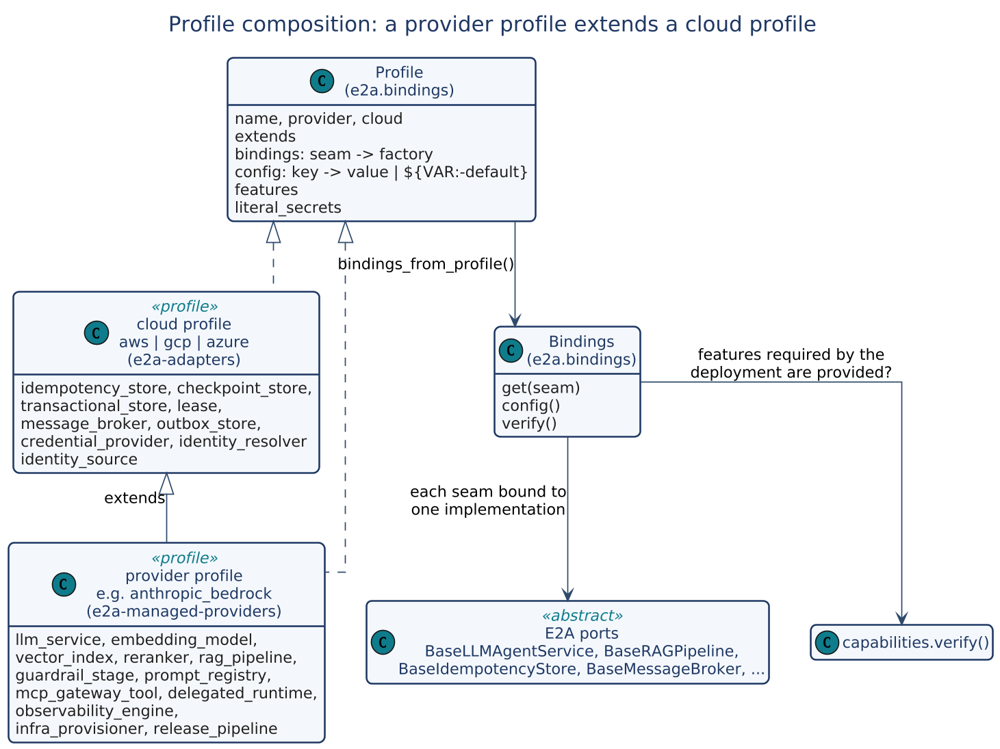

`bindings_from_profile(Profile.load(name))` resolves the `extends` chain, substitutes `${VAR:-default}` placeholders, and binds each seam. `Bindings.verify()` checks that the deployment's required features are provided (`capabilities.verify`) and fails when a secret-named key carries a literal value (the N2 rule). A provider profile states only its decisions. Deployment values are `${VAR}` placeholders.

### 4.3 The kernel: responsibilities written once

This table is the default disposition of every E2A responsibility. A provider document lists only the rows where its provider changes the default.

| Class · method | Invariant | Default | Why |
|---|---|---|---|
| `BaseWorkflow.execute` | End-to-end template method: context, deadline, steps, claim and replay, checkpoint and resume | RETAIN (conditional REPLACE) | Material or durable workflows keep it; a contained read-only workflow may run entirely in a managed agent |
| `BaseWorkflow._generate_idempotency_key` | Stable business key | RETAIN | A provider request or session id is a correlation id, not a business key |
| `BaseWorkflow.resume` · `_authorize_decision` | Authorised continuation after approval | RETAIN | Decision authority stays outside model reasoning |
| `BaseWorkflow._physical_outcome` | Certainty of an effect, for retry and reconciliation | RETAIN | No provider reports system-of-record truth |
| `BaseAgent.run` | Fixed lifecycle: screening → `_prepare` → approval → `_apply_policy` → build → infer → evaluate → `_act` → `_confirm` | RETAIN (conditional REPLACE) | Kept for action agents; a bounded read-only agent may be a managed runtime |
| `BaseAgent._prepare` · `_apply_policy` | Domain facts and business authorisation | RETAIN | Provider safety is not business policy |
| `BaseAgent._build_messages` | Canonical reasoning input | ADAPT | Native message or session formats; the domain context stays the application's |
| `BaseAgent._evaluate_output` · `_fallback` | Domain acceptance of a model result | RETAIN / EXTEND | Provider evaluation signals may contribute; acceptance stays local |
| `BaseAgent._act` | Material effect through `io_modify` | RETAIN | Only if a runtime proves approval, idempotency, commit, outcome and audit (gate points 5, 6, 9) |
| `BaseAgent._confirm` | System-of-record truth | RETAIN | Never inferred from model output |
| `LLMOnlyAgent.run` | Reasoning-only lifecycle | REPLACE candidate | No material invariant to keep |
| `BaseLLMAgentService.process_inference` | Canonical entry, deadline, typed result | EXTEND | Outer contract kept; native features delegated |
| … `_format_and_validate_output` | Schema-constrained output | REPLACE implementation | Native structured output; E2A still validates the contract |
| … `_apply_kv_caching` | Prompt caching | REPLACE | The provider owns the cache mechanism |
| … reasoning control | Reasoning depth | REPLACE | Canonical `reasoning_effort` mapped to the native control |
| … `_classify_error` · retry · circuit | One retry authority within the deadline | RETAIN / COMPOSE | Provider SDK retries are set to 0; exactly one authority |
| … refusal detection | Provider refusal signal | ADAPT | Mapped to `ModelRefusal` |
| … refusal outcome · `model_routes` | REFUSED vs FAILED; fallback | COMPOSE | A provider-native fallback (`refusal_fallback_server`) first, then E2A routes |
| `DelegatedRuntime.bind_tool` · `run_tool` | Managed agent loop with host-side tools | EXTEND | Read tools only (`MaterialToolRefused`); `delegated_max_turns` bounds the loop |
| `ManagedGuardrailStage` | Managed safety classifier in E2A's order | EXTEND | Classifier provider-owned; order, fail-closed and typed outcome E2A-owned |
| `BaseRAGPipeline.retrieve` | Tenant-scoped evidence retrieval | REPLACE or COMPOSE | Figure 11 |
| `BaseRAGPipeline.evaluate_answer` | Grounding and acceptance threshold | RETAIN / EXTEND | The application defines acceptance |
| `BaseIndexingPipeline.ingest` | Idempotent indexing with reported failures | REPLACE or EXTEND | Managed ingestion if tenancy and reconciliation hold |
| `BaseToolService.execute` | Typed tool call with physical outcome | RETAIN / EXTEND | Provider tool calling chooses; E2A executes and records the outcome |
| `BaseMCPServer` | MCP surface of the service's tools | REPLACE transport candidate | Native connectors or a managed gateway |
| `BaseIdempotencyStore` · `BaseCheckpointStore` · `BaseTransactionalStore` | Claims, checkpoints, versioned rows | REPLACE storage, RETAIN semantics | Cloud databases supply compare-and-set; E2A owns the state machines |
| `IdempotentConsumer.settle` · `BrokerOutboxSweeper` | Effectively-once consumption; publication | COMPOSE | Broker owns transport; E2A owns intent and consumer idempotency |
| `BaseIdentityResolver.resolve` | Verified claims → tenant, subject, roles | COMPOSE | Gateway verifies; E2A maps and refuses mismatches |
| `BaseObservability.record_telemetry` | Correlation and lifecycle telemetry | EXTEND | Provider and cloud spans enriched |
| `BaseInfraProvisioner` · `BasePipeline.run_pipeline` | Landing zone intent; release evidence | RETAIN logical, REPLACE physical | Cloud IaC and CI/CD execute E2A's gates |

### 4.4 What never moves

These remain with E2A in every provider document unless that document proves the gate for the specific item:
- the business idempotency key;
- approval authorisation;
- the material-effect boundary (`_act` through `io_modify`);
- confirmation against the system of record;
- the typed outcome (`SUCCESS` / `REFUSED` / `FAILED`, `PhysicalOutcome`);
- tenant resolution from verified claims.

## 5. Dynamic behaviour (common to every provider)

Each provider document refers to these sequences and shows only its own variations, such as a native fallback, a managed retrieval service or a gateway.

### 5.1 Transactional agent

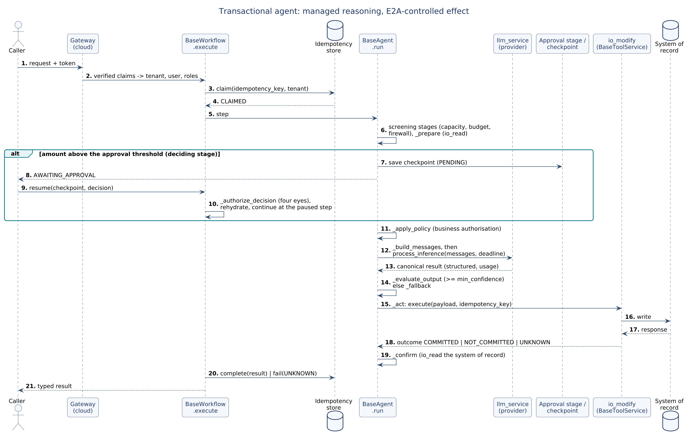

The model reasons; E2A decides and acts. The order follows `BaseAgent.run`:
1. screening stages and `_prepare`;
2. the approval stage, which pauses with a checkpoint and resumes through `BaseWorkflow.resume`;
3. `_apply_policy`;
4. inference;
5. evaluation;
6. `_act` through `io_modify`, then `_confirm`.

### 5.2 Managed agent runtime, read-only

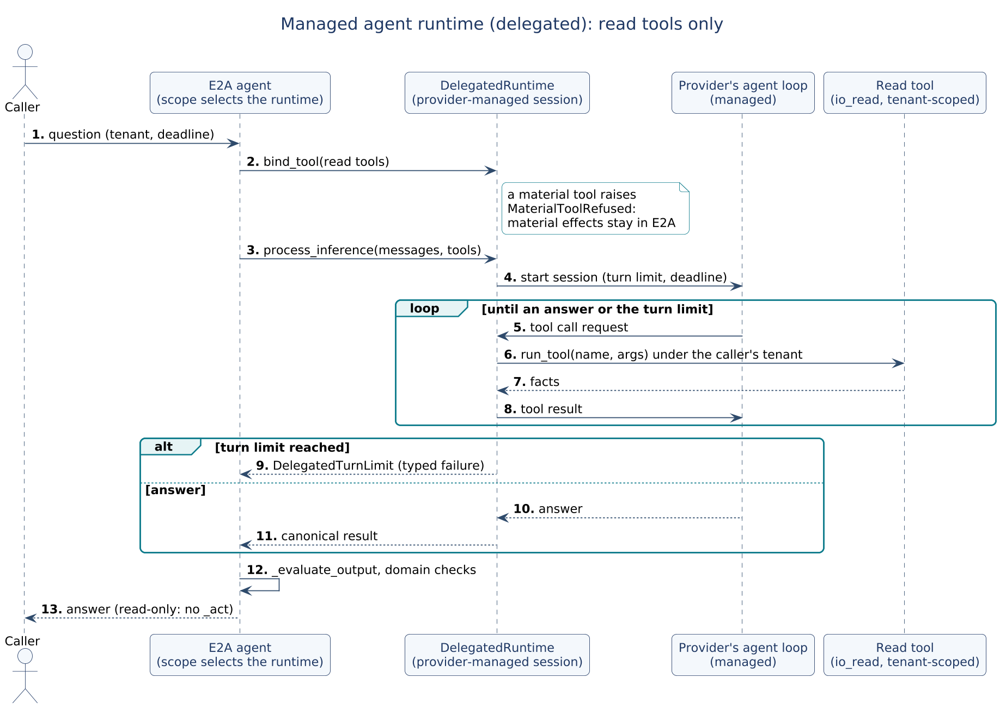

The provider's agent loop selects and sequences tools. E2A runs each tool host-side under the caller's tenant, bounds the loop, and refuses to offer a material tool.

### 5.3 Model failures and refusals

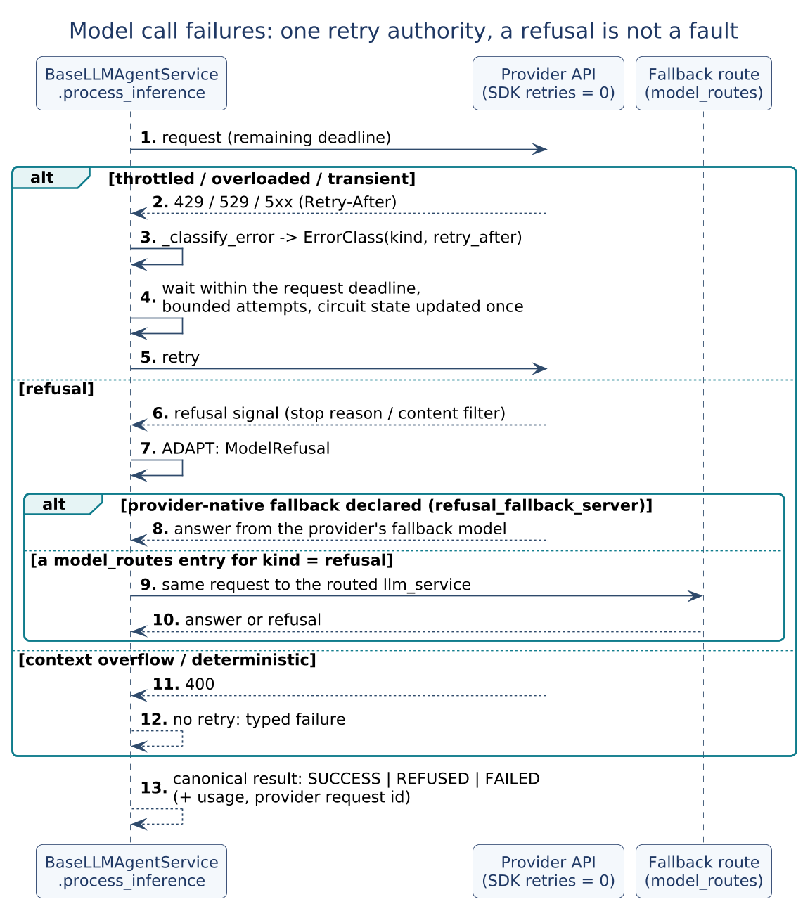

### 5.4 Unknown effects

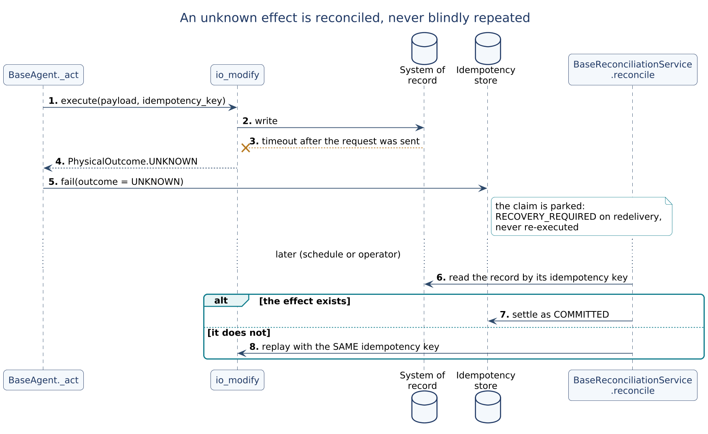

### 5.5 Events: transactional outbox and idempotent consumer

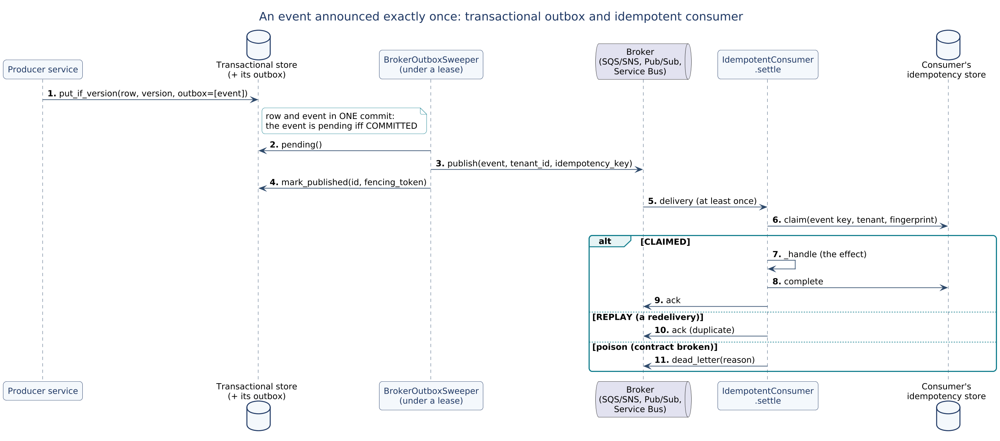

Since E2A v1.7.3, the row and its event are written in one commit (`put_if_version(..., outbox=[...])`) on DynamoDB, Firestore and Cosmos DB. The consumer (`IdempotentConsumer`, v1.7.2) settles each delivery under a claim.

### 5.6 Identity at ingress

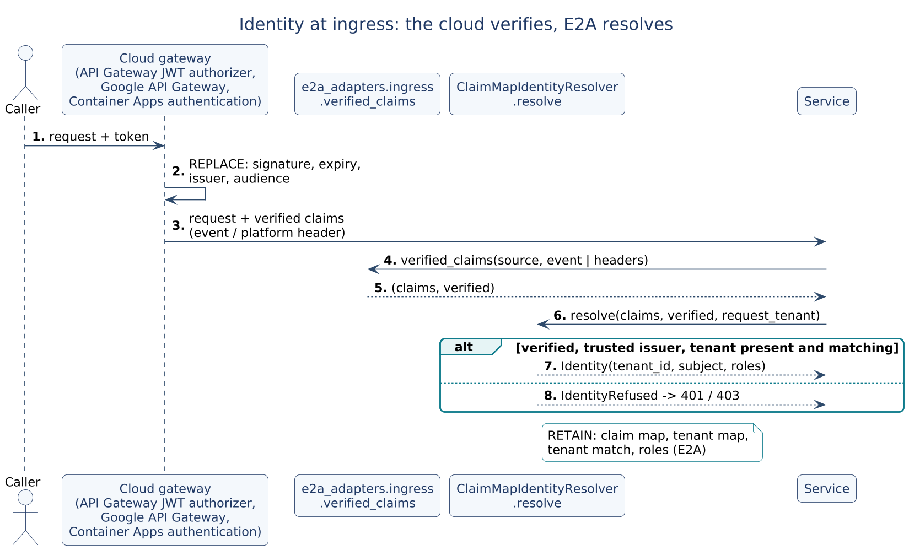

Since E2A v1.7.4, `e2a_adapters.ingress` reads the verified claims where each cloud places them. Resolution fails closed when an identity source is configured.

### 5.7 Retrieval

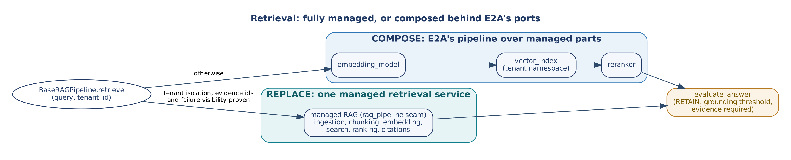

## 6. Failure model

| Failure | Owner and action | Typed result |
|---|---|---|
| Throttled, overloaded, transient | The single retry authority honours `Retry-After` within the deadline; provider SDK retries are 0 | Success, or `FAILED` / `NFRViolationError` at the deadline |
| Context overflow, deterministic 4xx | No retry | `FAILED` |
| Provider refusal | `ModelRefusal`; native fallback, then `model_routes` | `REFUSED` (never counted as an infrastructure fault) |
| Structured output invalid | E2A validation of the contract | `StructuredOutputInvalid` |
| Managed agent loop too long | `delegated_max_turns` | `DelegatedTurnLimit` |
| Material tool offered to a managed runtime | `bind_tool` | `MaterialToolRefused` |
| Tool 4xx on a material call | Definitive | `NOT_COMMITTED` |
| Timeout after a material request was sent | Never repeated blindly; reconciled | `UNKNOWN` → `RECOVERY_REQUIRED` → reconciliation |
| Stale resume or decision | Checkpoint compare-and-set | refused |
| Identity not verified, foreign tenant | `identity_at_ingress` | `IdentityRefused` → 401 / 403 |
| Poison message | `IdempotentConsumer` | dead-lettered with the reason |
| Partial indexing failure | `BaseIndexingPipeline.ingest` | `failed_keys` reported, never dropped |

## 7. Security and trust boundaries

| Boundary | Rule |
|---|---|
| Caller → service | The cloud gateway verifies the token. The service resolves the verified claims and never trusts tenant or role headers in the cloud. |
| Service → model provider | Platform identity chain: IAM role, managed identity or workload identity. A provider API key only through a secret store. No literal secret in any profile (N2). |
| Cloud A → model in cloud B or a provider | Explicit federation (workload identity federation) and an approved egress path; the data boundary is named in the provider document. |
| Model → tools | Read tools only for managed runtimes; material tools stay behind `io_modify`, with approval, idempotency and confirmation. |
| Tenant | Carried in E2A's request context to every store, index, tool and telemetry record; vector indexes are namespaced by tenant. |
| Safety | Provider safety and cloud classifiers are governance stages in E2A's order. They do not replace domain policy. |

## 8. Verification and evidence

| Evidence | What it proves | Where |
|---|---|---|
| Port contracts: `check_idempotency_store`, `check_transactional_store`, `check_lease`, `check_checkpoint_store`, `check_outbox_store`, `check_transactional_outbox` | Store semantics, including races | e2a-framework, on DynamoDB Local and the Firestore and Cosmos DB emulators |
| `check_message_broker` | Delivery, dead letters, effectively-once effects | SQS (moto), Pub/Sub and Service Bus emulators |
| `check_llm_service` | Every provider profile meets E2A's model contract | e2a-managed-providers |
| Offline replay | Real provider SDKs build and parse real wire traffic, without an account | e2a-managed-providers |
| Project suites | Three projects' own tests pass with their model swapped to every profile | e2a-managed-providers CI |
| Terraform `test` and moto `apply` | Infrastructure declarations | each repository |

Not covered by this evidence:
- live provider behaviour;
- quotas, latency and cost;
- regional availability.

A deployment needs live smoke, failure-injection, security, evaluation and load tests before any production claim.

## 9. How the provider documents are organised

Each provider has a folder in `docs/design/` with a README listing its variants. A variant has its own document when its operator, data boundary, identity or managed services differ materially; otherwise it is a section of a shared document. Every variant follows this outline:

1. **Variant identity:** model host, operator, contract and billing party, data boundary, status, with sources and the date checked.
2. **Profile:** the bindings and configuration, as a profile file.
3. **Dispositions:** only the rows of Section 4.3 this variant changes, and why.
4. **HLD:** deployment diagram (network, identity, private connectivity).
5. **Sequences:** only the differences from Section 5.
6. **Error mapping:** provider status and stop reasons mapped to E2A's typed results.
7. **Security, NFRs, cost drivers.**
8. **Evidence:** what is Implemented, Documented or To validate.

## Appendix A — Disclaimer (full text)

1. **Independent reference material.** This repository and its design documents are independent, personal reference material for studying software architecture: how managed AI and cloud services can be placed within the E2A framework. They are not a product, a service offering or a commercial recommendation.
2. **No affiliation or endorsement.** There is no affiliation with, sponsorship by, endorsement by or partnership with Anthropic, OpenAI, Google, Meta, Amazon / Amazon Web Services, Microsoft, or any other company whose products are named. Nothing here states or implies that any of them has reviewed, approved or supports this material.
3. **Not a substitute.** Nothing here replaces, competes with or substitutes for any provider's products, services, documentation, terms, support or professional advice. Where a document says a managed service "replaces" or is "extended by" an E2A responsibility, it describes an architectural decision inside an application. It does not compare products or judge their quality.
4. **Trademarks.** Product and company names are trademarks or registered trademarks of their respective owners. They are used only to identify the services discussed (nominative use).
5. **Facts change.** Product names, features, availability, regions, preview or general-availability status, quotas, pricing and terms change often. Each document records the date and source of the facts it states. Before relying on any of them, check the provider's current official documentation and your own agreements.
6. **No warranty.** Everything is provided "as is", without warranty of any kind, express or implied, including fitness for a particular purpose, accuracy, completeness or non-infringement. The licence of this repository (Apache 2.0) governs the code.
7. **Not advice.** Nothing here is legal, regulatory, compliance, security, privacy, procurement or financial advice. Data residency, retention, model licences, export rules and the suitability of any service for a given workload must be assessed by qualified people for each deployment.
8. **Provider terms govern.** Use of any provider's service is governed solely by that provider's terms, policies and acceptable-use rules and by the user's own agreements with that provider. The code in this repository makes calls only with the user's own credentials, at the user's own responsibility.
9. **No live proof.** Unless a document states otherwise for a specific item, the evidence in this repository comes from contract tests, emulators and recorded or replayed wire traffic. It is not evidence of production behaviour of any provider's service.
