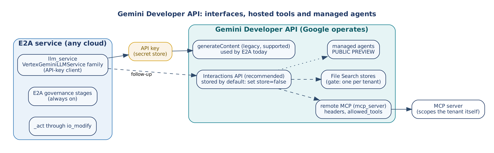

# Gemini Developer API — Design

### Gemini operated by Google through the Gemini Developer API: the Interactions API, managed agents, remote MCP and File Search

*This document places Gemini within E2A when the E2A service calls the Gemini Developer API with an API key. Google operates the service. The Interactions API is now Google's recommended interface; `generateContent` remains fully supported as the legacy one. It records only what differs from the core design. The enterprise route, Gemini on Google Cloud, is a separate document.*

| | |
|---|---|
| Framework | E2A, with `e2a-adapters` and `e2a-managed-providers` |
| Document type | Provider design document (HLD + LLD), Google Gemini series |
| Author | Subham Gupta, Principal Platform Architect |
| Source baseline | `e2a-framework` `v1.7.4`; `e2a-managed-providers` `main`: `VertexGeminiLLMService` (the `google-genai` SDK, which also reaches this API) |
| Date | 16 November 2026 (product facts checked on this date) |
| Status | Documented. The `generateContent` wire is Implemented for Agent Platform; no profile here uses the Developer API. |

> **Disclaimer.** This is independent reference material for studying software architecture. It has no affiliation with, and no endorsement by, Google, Amazon / AWS, Microsoft or any other company named, and it is not a substitute for any provider's products, documentation or terms. Product names are trademarks of their owners. Product facts change: they were checked on the date shown, against the sources listed in the last section; check them again before use. Provided "as is", without warranty; not legal, compliance, security or procurement advice. Full text: [DISCLAIMER.md](../DISCLAIMER.md).

## 1. Variant identity

| | Gemini Developer API |
|---|---|
| Operator and data processor | Google |
| Identity | API key from a secret store (OAuth also documented) |
| Interfaces | **Interactions API** (GA since June 2026; recommended; new capabilities launch there). `generateContent` (legacy, fully supported). Both through the unified `google-genai` SDK. |
| Models (stable) | `gemini-4-carbon`, `gemini-4-argon`, `gemini-4-hydrogen` (1,048,576-token context; explicit caching not supported), `gemini-3.8-flash`, and others. `gemini-2.5-pro` is deprecated; from 1 December 2026 its requests route to `gemini-3.8-flash`. |
| Agent runtime | **Managed agents (public preview)**: the Antigravity agent and Deep Research run in a Google-hosted Linux sandbox; custom agents add instructions, skills, files, remote MCP servers and functions. The sandbox has unrestricted outbound network by default. |
| Data | **Paid services:** Google's paid-service terms apply. **Unpaid services:** content may be used to improve products, and human reviewers may read it; apps for users in the EEA, Switzerland or the UK must use only paid services. Interactions are **stored by default** (`store=false` opts out). API logging is on by default for billed projects, kept up to 55 days, and is shared with Google only if the owner shares a dataset. |
| Pattern (core Section 3.2) | 1, or 4 when called from AWS or Azure |

## 2. Profile

No profile here targets the Developer API. The `google-genai` SDK reaches both the Developer API and Agent Platform, so a profile would bind a subclass of `VertexGeminiLLMService` that builds the client with an API key (from Secret Manager, AWS Secrets Manager or Key Vault, by the cloud profile the service runs on) instead of `vertexai=True`. Everything else would come from that cloud profile.

## 3. Dispositions that differ from the core

| Responsibility | Disposition | This variant |
|---|---|---|
| Model-call interface | ADAPT (decision) | **Keep `generateContent`** for E2A's model step: it is stateless and fully supported. Move to the Interactions API when a needed capability is Interactions-only, with `store=false` set explicitly, since storing is the default. Tracked as a follow-up. |
| `_format_and_validate_output` | REPLACE implementation | `response_mime_type` `application/json` with `response_json_schema`; E2A still validates |
| Reasoning control | REPLACE | `thinking_level` per model (Gemini 3 and later), lowered to a level the model accepts; `thinking_budget` on Gemini 2.5 |
| `_apply_kv_caching` | REPLACE (implicit) | implicit caching. Explicit caches (`cached_content`) are not supported on Gemini 4, so E2A sends one only when given per call. |
| Sampling | ADAPT | temperature is sent; the Gemini 4 models on Agent Platform ignore custom sampling values |
| Refusal detection | ADAPT | `generateContent`: finish reason `SAFETY`, `PROHIBITED_CONTENT` or `BLOCKLIST` → `ModelRefusal` (codec). Interactions API: a block is **HTTP 400** with code `safety`, `prohibited_content`, `blocklist` or `jailbreak`; E2A must map those codes to `REFUSED` before adopting it. |
| Refusal outcome | COMPOSE | no server-side fallback; E2A's `model_routes` |
| Content safety | COMPOSE | adjustable `safety_settings`; the default threshold is **Off** for Gemini 2.5 and later, so E2A's own governance stages are the control that is always on |
| `DelegatedRuntime` | EXTEND (preview) | managed agents. Preview fails the gate's "generally available" item; if used for evaluation, E2A binds read tools only, locks the sandbox's egress allowlist, and keeps `_act`. |
| `MCPToolService` transport | REPLACE transport, EXTEND policy | Interactions API remote MCP (`type: "mcp_server"`, Streamable HTTP only, `headers` for the token, `allowed_tools` to restrict). No approval step is documented, so only read tools are listed, and the server scopes the tenant itself. |
| Retrieval | conditional REPLACE (gate) | File Search stores; one store per tenant, E2A keeps `evaluate_answer` |
| Batches | REPLACE (offline only) | Batch API for evaluation runs |

Everything else keeps the core default: the business idempotency key, approval, `_act` through `io_modify`, `_confirm`, and tenant resolution at ingress.

## 4. Sequences that differ

None beyond the core's Section 5 while E2A uses `generateContent`. With remote MCP, the shape is the core's Section 5.2 with the Gemini service as the caller of the server.

## 5. Error mapping

| Signal (Gemini "API errors") | E2A result today | Design intent |
|---|---|---|
| 429 `rate_limit_exceeded`, `too_many_requests` | throttled: retried within the deadline | same |
| 429 `quota_exceeded` (daily quota) | throttled: retried | no retry: the quota resets later (follow-up) |
| 402 `payment_required` (prepay credit depleted) | deterministic: no retry, `FAILED` | same, with an alert |
| 500 `api_error`, 503 `service_unavailable`, 504 `deadline_exceeded` | transient or overloaded: retried within the deadline | same |
| 400 `invalid_request`, `failed_precondition`; 404 `model_not_found` | deterministic: no retry, `FAILED` | same (a retired model id surfaces here) |
| 401 `authentication`, 403 `permission_denied` | auth: no retry, alert | same |
| `generateContent` finish reason `SAFETY` and similar | `ModelRefusal`, then `model_routes`, else `REFUSED` | same |
| Interactions 400 `safety`, `prohibited_content`, `blocklist`, `jailbreak` | deterministic → `FAILED` | `REFUSED` (follow-up, before any Interactions adoption) |
| `malformed_function_call`, `unexpected_tool_call` | deterministic | same; E2A never runs an undeclared tool |

## 6. Security, NFRs and cost

- **Identity.** The API key is a long-lived secret: kept in a secret store, injected by the platform, rotated. For enterprise identity (IAM, no key), use Agent Platform.
- **Data.** Use paid services only for anything carrying business data. Set `store=false` on Interactions; review the AI Studio logging setting for the project.
- **Tenancy.** Remote MCP servers and File Search stores are outside E2A's call path: each scopes the tenant itself.
- **Cost drivers.** Tokens by model (implicit cache hits cheaper), File Search indexing at upload, managed-agent sandbox time, Batch API for offline evaluation.

## 7. Evidence

| Item | Status |
|---|---|
| `generateContent` wire, structured output, thinking levels (lowered per model), refusal finish reasons | Implemented on Agent Platform (offline replay, `check_llm_service`); the same SDK reaches this API |
| A Developer API profile | Documented (Section 2) |
| Interactions API transport, safety-code mapping, daily-quota classification | Documented: follow-ups |
| Managed agents, remote MCP, File Search | Documented (managed agents in preview) |
| Live behaviour, quotas, latency | Not covered: needs live tests |

## 8. Sources (checked 16 November 2026)

| Fact | Source |
|---|---|
| Interactions API status, `store` default, legacy `generateContent`, remote MCP limitation on Gemini 3 | Google, "Interactions API" (aistudio.google.com/docs/interactions-overview) |
| Models; Gemini 4 model cards (context, caching, features) | Google, "Models" and the model pages |
| `gemini-2.5-pro` deprecation and routing from 1 Dec 2026 | Google, "Deprecations" |
| Thinking levels per model | Google, "Thinking" |
| Safety settings, default threshold, blocked interactions | Google, "Safety settings" |
| Error codes | Google, "API errors" |
| Managed agents, preview, sandbox egress; custom agents | Google, "Agents overview" and "Custom agents" |
| Remote MCP tool fields | Google, "Function calling" |
| Paid and unpaid terms, EEA / Switzerland / UK | Google, "Gemini API Additional Terms of Service" |
| Logging default and retention | Google, "Data logging and sharing" |
| File Search | Google, "File Search" |
