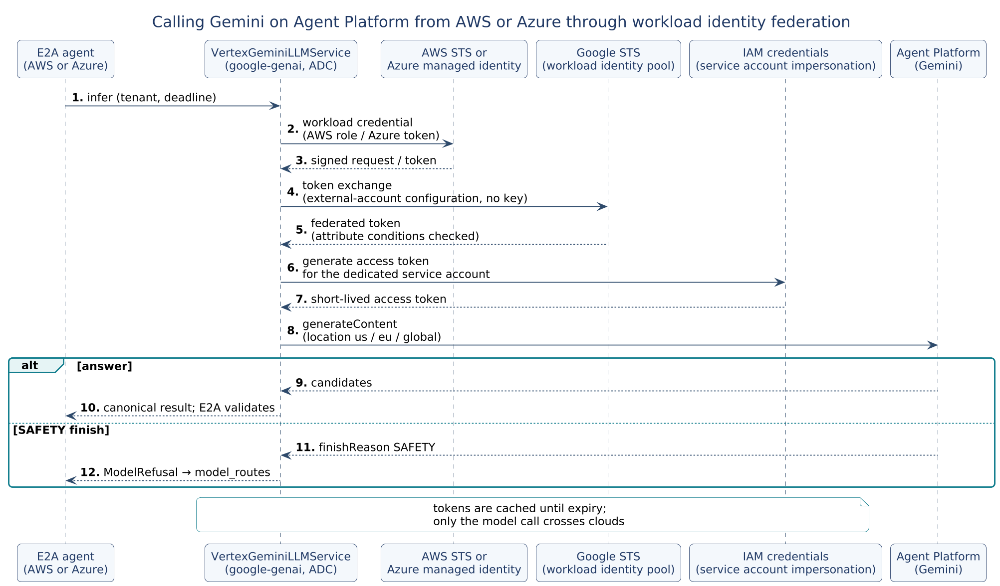

# Gemini on Google Cloud — Design

### Gemini on Gemini Enterprise Agent Platform (formerly Vertex AI), from Google Cloud and from AWS or Azure

*This document places Gemini within E2A when it is called through Google Cloud's Gemini Enterprise Agent Platform, the evolution of Vertex AI. Google operates the service under Google Cloud terms. Identity is Google Cloud IAM, and Google's own services (Vector Search, Ranking, Model Armor, Agent Runtime) are composed around the model. This is the implemented profile `google_vertex`. Section 4 covers the same platform called from AWS or Azure through workload identity federation. It records only what differs from the core design.*

| | |
|---|---|
| Framework | E2A, with `e2a-adapters` and `e2a-managed-providers` |
| Document type | Provider design document (HLD + LLD), Google Gemini series |
| Author | Subham Gupta, Principal Platform Architect |
| Source baseline | `e2a-framework` `v1.7.4` (`gcp` cloud profile); `e2a-managed-providers`: `VertexGeminiLLMService`, `VertexGeminiEmbeddingModel`, the Google service classes; profile `google_vertex` (default model corrected in this step) |
| Date | 16 November 2026 (product facts checked on this date) |
| Status | From Google Cloud: Implemented (`google_vertex`). From AWS or Azure: Documented. |

> **Disclaimer.** This is independent reference material for studying software architecture. It has no affiliation with, and no endorsement by, Google, Amazon / AWS, Microsoft or any other company named, and it is not a substitute for any provider's products, documentation or terms. Product names are trademarks of their owners. Product facts change: they were checked on the date shown, against the sources listed in the last section; check them again before use. Provided "as is", without warranty; not legal, compliance, security or procurement advice. Full text: [DISCLAIMER.md](../DISCLAIMER.md).

## 1. Variant identity

| | From Google Cloud | From AWS or Azure |
|---|---|---|
| Operator and data processor | Google (Google Cloud terms) | the same |
| Identity | ADC: the workload's service account (Cloud Run, GKE), IAM roles such as `roles/aiplatform.user` | **Workload identity federation**: AWS IAM roles (verified through `GetCallerIdentity`) or Azure managed identities exchange their credentials for short-lived Google credentials; no service-account key |
| Interfaces | `generateContent` and the **Interactions API** (supported on Gemini 4 Carbon; not on 2.5 Pro) | the same |
| Models and lifecycle | `gemini-3.8-flash` (stable; retirement no sooner than September 2027), `gemini-4-carbon` (GA 10 Nov 2026; verified enterprise customers in select regions; `global`, `us`, `eu`). `gemini-2.5-pro`, `-flash` and `-flash-lite` were **retired on 20 Oct 2026**. | the same |
| Training and retention | Google does not train on customer data without permission. Zero data retention needs explicit actions: `store=false` on Interactions (the default is `true`), caching controls per project, no grounding with Search or Maps, no Sandbox snapshots. | the same; prompts also cross the network from the other cloud |
| Governance services | **Model Armor**; **Agent Gateway** (with Model Armor; for agents on Agent Platform and GKE, Cloud Run in Limited Preview); Agent Identity; Agent Runtime | reachable, but the gateway governs Google-side agents only |
| Pattern (core Section 3.2) | 3 | 4 |

## 2. Profile

`google_vertex` `extends` the `gcp` cloud profile, so claims, checkpoints, rows, outbox, broker, secrets and identity come from Firestore, Pub/Sub, Secret Manager and API Gateway:

| Seam | Binding |
|---|---|
| `llm_service` | `VertexGeminiLLMService` (`google-genai`, `vertexai=True`, ADC). Default model **`gemini-3.8-flash`**: this step replaces `gemini-2.5-pro`, which Agent Platform retired on 20 Oct 2026. |
| `embedding_model` | `VertexGeminiEmbeddingModel` (`gemini-embedding-001`, retirement no sooner than May 2028; `RETRIEVAL_DOCUMENT` / `RETRIEVAL_QUERY`) |
| `vector_index`, `reranker` | `VertexVectorSearchIndex` (hybrid), `VertexRankingReranker` |
| `guardrail_stage` | `ModelArmorStage` |
| `delegated_runtime` | `VertexAgentEngineRuntime` (an ADK agent deployed to the platform's agent runtime; the class name predates the platform's current naming, "Agent Runtime") |
| `mcp_gateway_tool` | `IAPGatewayTool` (MCP servers on Cloud Run behind IAP) |
| `observability_engine`, `infra_provisioner`, `release_pipeline` | the GCP substrate classes |

From AWS or Azure, the same `llm_service` and `embedding_model` bind inside the `aws` or `azure` profile. Only the credential changes: an external-account credential configuration (no secret in it) that ADC reads.

## 3. Dispositions that differ from the core

| Responsibility | Disposition | This variant |
|---|---|---|
| Output format, sampling, refusal finish reasons | as the Developer API document | the same `generateContent` wire |
| Reasoning control | REPLACE | `thinking_level`, **lowered to a level the model accepts**. `gemini-3.8-flash` and Gemini 4 Carbon accept low, medium and high only. Before this step, E2A's `max` was sent as `XHIGH` and rejected. |
| `_apply_kv_caching` | REPLACE (implicit) | implicit caching, in memory and durable. Explicit caches are not supported on Gemini 4. For zero retention, turn durable caching off per project. |
| Refusal outcome | COMPOSE | no server-side fallback; E2A's `model_routes` |
| Content safety | REPLACE (stage) | Model Armor as a fail-closed governance stage on prompts, retrieved text and tool output. Agent Gateway can apply Model Armor to Google-side agent traffic; E2A's own stage stays for its own calls. |
| `DelegatedRuntime` | EXTEND | an ADK agent on Agent Runtime: read tools only, bounded by E2A's deadline; `_act` stays in E2A |
| `MCPToolService` | REPLACE transport, EXTEND policy | MCP servers on Cloud Run behind IAP (`IAPGatewayTool`), called host-side. **Agent Gateway** is the managed alternative for egress policy, but for Cloud Run agents it is in Limited Preview, so it is not bound. |
| Retrieval | REPLACE | Vector Search and Ranking, tenant-filtered; E2A keeps `evaluate_answer` |
| Model lifecycle | ADAPT (new) | model ids are configuration (`LLM_MODEL_ID`), and the release pipeline should check them against the lifecycle table. A retired id surfaces only as a 404 at run time. |

Everything else keeps the core default, including tenant resolution at ingress (`gcp_api_gateway` on Google Cloud; the other cloud's source when called from AWS or Azure).

## 4. Use from AWS or Azure

| Concern | Design |
|---|---|
| Identity | a workload identity pool trusting the AWS account or the Azure tenant; attribute conditions bind the pool to the service's role or managed identity; impersonation of a dedicated service account with `roles/aiplatform.user` only |
| Secrets | none: the credential configuration file names the pool and provider, not a key |
| Network | egress from the other cloud to `aiplatform.googleapis.com` (or the regional endpoint); latency and egress cost per call |
| Data | prompts leave the calling cloud; residency is decided by the Agent Platform location (`us`, `eu` or a region), not by the caller's region |
| What stays local | every E2A port (stores, broker, outbox, secrets, identity) comes from the calling cloud's profile; only the model and embeddings cross |
| Retrieval | keep the calling cloud's index (S3 Vectors, Azure AI Search) next to the data. Vector Search would move the corpus across clouds. |

## 5. Error mapping

| Signal | E2A result |
|---|---|
| 429 `RESOURCE_EXHAUSTED` | throttled: retried within the deadline (SDK retries 0) |
| 5xx, `UNAVAILABLE` | transient or overloaded: retried within the deadline |
| 400 `INVALID_ARGUMENT` (for example a thinking level the model does not accept) | deterministic: no retry, `FAILED` |
| 404 (a retired or unknown model id) | deterministic: no retry, `FAILED`, alert |
| 401 / 403 (ADC, federation, IAM, organisation policy) | auth: no retry, alert |
| finish reason `SAFETY`, `PROHIBITED_CONTENT`, `BLOCKLIST` | `ModelRefusal`, then `model_routes`, else `REFUSED` |
| Model Armor match | `GovernanceRefusal` at the guardrail stage |

## 6. Security, NFRs and cost

- **Identity.** ADC on Google Cloud; federation from AWS or Azure. Never a service-account key.
- **Data.** Training restriction by default. For zero retention, follow Google's list: `store=false` on Interactions, no grounding with Search or Maps, and caching settings as policy requires.
- **Location.** `global` gives the widest availability; `us` or `eu` multi-region endpoints, or a region, when residency matters.
- **Lifecycle.** Pin model ids in configuration and alert on retirement dates; the retired `gemini-2.5-pro` default shows why.
- **Cost drivers.** Tokens per model (implicit cache hits cheaper); Vector Search nodes; Ranking calls; Model Armor; Agent Runtime; cross-cloud egress when called from AWS or Azure.

## 7. Evidence

| Item | Status |
|---|---|
| `google_vertex` model calls, structured output, tools, refusal route, embeddings | Implemented: offline replay of the real SDK; `check_llm_service`; the three projects' suites run on this profile |
| Default model `gemini-3.8-flash`; thinking levels lowered per model | Implemented in this step, with tests (provider suite 108 passed) |
| Vector Search, Ranking, Model Armor, Agent Runtime, IAP gateway | Implemented: Google service classes, offline |
| Use from AWS or Azure (federation) | Documented |
| Interactions API transport | Documented: follow-up |
| Live behaviour, quotas, latency | Not covered: needs live tests |

## 8. Sources (checked 16 November 2026)

| Fact | Source |
|---|---|
| Agent Platform as the evolution of Vertex AI; Agent Identity, Agent Gateway, Model Armor | Google Cloud, "Agent Platform overview" |
| Model release and retirement dates (`gemini-2.5-*` 20 Oct 2026, `gemini-3.8-flash`, `gemini-4-carbon`, embeddings) | Google Cloud, "Model versions and lifecycle" |
| Gemini 4 Carbon: access, thinking levels, regions, Interactions API, caching, sampling ignored | Google Cloud, "Gemini 4 Carbon" |
| Training restriction; zero data retention actions; caching tiers; Interactions `store` default | Google Cloud, "Gemini Enterprise Agent Platform and zero data retention" |
| Agent Gateway scope and Cloud Run Limited Preview | Google Cloud, "Agent Gateway overview" |
| Federation from AWS and Azure | Google Cloud, "Configure Workload Identity Federation with AWS or Azure" |
| Thinking levels per model | Google, "Thinking" (Gemini API documentation) |
