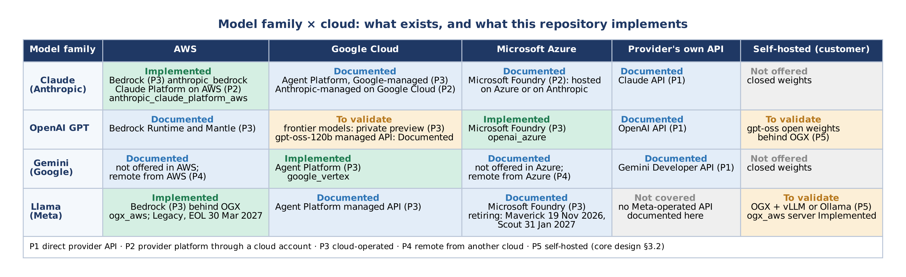
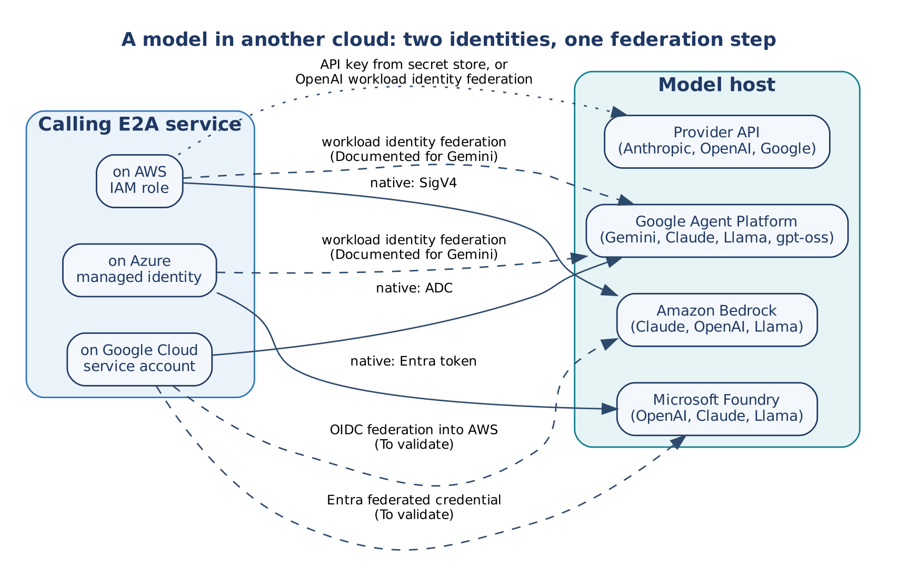

# Models × Clouds — Combination Matrix

### Which frontier model families run on which cloud, how an E2A service reaches each one, and what each cloud adds around the model

*This document is the map across the provider design series. E2A keeps two choices independent: the model family, chosen by binding a model service, and the cloud, chosen by binding a cloud capability pack. This document shows every combination of the four model families with the three clouds, the provider's own API and self-hosting, with each combination's hosting pattern, status, profile and governing document. It also covers calling a model in another cloud, and the managed services each cloud contributes around the model. It replaces the E2A Multi-Cloud AI Ecosystem Reference, which had grown out of date; Section 7 records where each of its parts now lives.*

| | |
|---|---|
| Framework | E2A — Enterprise-to-Agentic Architecture Framework, with `e2a-adapters` (cloud infrastructure) and `e2a-managed-providers` (managed AI services) |
| Document type | Design Document, map of the provider design series |
| Author | Subham Gupta, Principal Platform Architect |
| Source baseline | `subhamviky/e2a-framework` `v1.8.0`; `subhamviky/e2a-managed-providers` `main` (profiles under `e2a_managed/providers/*/profiles`, cloud service classes under `e2a_managed/clouds/*`); the provider documents in this folder's siblings, checked on 16 November 2026 |
| Date | 19 November 2026 |
| Status | Every cell links to the provider document that states its facts and sources |

> **Disclaimer.** This is independent reference material for studying software architecture. It has no affiliation with, and no endorsement by, any company named, and it is not a substitute for any provider's products, documentation or terms. Product names are trademarks of their owners. Product facts change: check the provider's current documentation. Provided "as is", without warranty; not legal, compliance, security or procurement advice. The full text is in [DISCLAIMER.md](../DISCLAIMER.md).

## 1. Introduction

### 1.1 Purpose

A team adopting E2A asks two questions that are easy to confuse: which model family to use, and which cloud to run on. The answers combine in many ways. Claude, for example, can be reached from AWS through Amazon Bedrock or through Claude Platform on AWS, from Google Cloud, from Microsoft Foundry, or directly. Each route has its own operator, identity, data boundary and managed services. This document lays out every combination once, so that:
- a reader can find the route that fits a deployment, and the document that governs it;
- the repository's implementation coverage is visible at a glance: what is implemented, what is documented, what is still to validate;
- nothing about a single provider is repeated here. The provider documents remain the source of every fact.

### 1.2 Audience

| Reader | Read |
|---|---|
| Architects choosing a model and a cloud | Sections 2, 3 and 6 |
| Platform engineers wiring identity across clouds | Section 4 |
| Engineers binding a cloud's AI services | Section 5 |
| Readers of the former Multi-Cloud Reference | Section 7 |

### 1.3 Status labels

The labels are those of the series (core design, Section 1.3):

| Label | Meaning |
|---|---|
| **Implemented** | In this repository or E2A, exercised by contract tests, emulators or offline replay (not proof of production behaviour) |
| **Documented** | Described by the provider's own documentation (source and date in the provider document); not implemented here |
| **To validate** | Logically sound, but not stated as supported by the provider, or in preview; confirm before use |
| **Not offered** | The provider or cloud does not offer this combination |

## 2. Two independent axes

The E2A agent never names a model provider or a cloud. It reaches a model through `config['llm_service']` and cloud infrastructure through its seams (stores, broker, secrets, identity). Both are bound by a **profile**:
- **The model axis.** A provider profile binds an `llm_service` and the provider's native features (structured output, caching, managed agent runtime). Switching model within one service is a configuration value; switching provider is another binding.
- **The cloud axis.** A cloud profile of `e2a-adapters` (`aws`, `gcp`, `azure`) binds the infrastructure seams. A provider profile `extends` one cloud profile (core design, Sections 3.4 and 3.5).

The two axes meet in the **hosting pattern**, which decides who operates the model, whose identity and billing apply, and where the data goes (core design, Section 3.2):

| Pattern | Operator of the model | Identity and billing |
|---|---|---|
| P1 Direct provider API | Model provider | Provider account |
| P2 Provider platform through a cloud account | Model provider | Cloud account |
| P3 Cloud-operated distribution | Cloud | Cloud identity, network and terms |
| P4 Remote from another cloud | Provider or another cloud | Two identities, joined by federation |
| P5 Self-hosted open weights | Customer | Customer |

Meta Llama is a **model family**, not a cloud. It is reached through the same three clouds and through self-hosting, like the other families. The former reference treated it as a fourth cloud; this document does not.

## 3. The combination matrix



### 3.1 Every combination, with its document

| Model family | AWS | Google Cloud | Microsoft Azure | Provider's own API | Self-hosted |
|---|---|---|---|---|---|
| **Claude** (Anthropic) | <ul><li>**Amazon Bedrock** (P3): Implemented, `anthropic_bedrock`; [Claude on Amazon Bedrock](../anthropic/CLAUDE_ON_AMAZON_BEDROCK_DESIGN.md)</li><li>**Claude Platform on AWS** (P2): Implemented, `anthropic_claude_platform_aws`; [Claude operated by Anthropic](../anthropic/ANTHROPIC_OPERATED_CLAUDE_DESIGN.md)</li></ul> | <ul><li>**Agent Platform, Google-managed** (P3): Documented; [Claude on Google Cloud](../anthropic/CLAUDE_ON_GOOGLE_CLOUD_DESIGN.md)</li><li>**Anthropic-managed on Google Cloud** (P2): Documented; [Claude operated by Anthropic](../anthropic/ANTHROPIC_OPERATED_CLAUDE_DESIGN.md)</li></ul> | **Microsoft Foundry** (P2), hosted on Azure or on Anthropic: Documented; [Claude in Microsoft Foundry](../anthropic/CLAUDE_IN_MICROSOFT_FOUNDRY_DESIGN.md) | **Claude API** (P1): Documented; [Claude operated by Anthropic](../anthropic/ANTHROPIC_OPERATED_CLAUDE_DESIGN.md) | Not offered (closed weights) |
| **OpenAI GPT** | **Bedrock Runtime and Mantle** (P3): Documented; [OpenAI on Amazon Bedrock](../openai/OPENAI_ON_AMAZON_BEDROCK_DESIGN.md) | <ul><li>**Frontier models** (P3): private preview, To validate</li><li>**gpt-oss-120b managed API** (P3): Documented</li><li>[OpenAI on Google Cloud](../openai/OPENAI_ON_GOOGLE_CLOUD_DESIGN.md)</li></ul> | **Microsoft Foundry** (P3): Implemented, `openai_azure`; [OpenAI in Microsoft Foundry](../openai/OPENAI_IN_MICROSOFT_FOUNDRY_DESIGN.md) | **OpenAI API** (P1): Documented; [OpenAI API](../openai/OPENAI_API_DESIGN.md) | gpt-oss open weights behind OGX (P5): To validate |
| **Gemini** (Google) | Not offered in AWS. **Remote from AWS** (P4) through workload identity federation: Documented; [Gemini on Google Cloud](../gemini/GEMINI_ON_GOOGLE_CLOUD_DESIGN.md) | **Agent Platform** (P3): Implemented, `google_vertex`; [Gemini on Google Cloud](../gemini/GEMINI_ON_GOOGLE_CLOUD_DESIGN.md) | Not offered in Azure. **Remote from Azure** (P4): Documented; [Gemini on Google Cloud](../gemini/GEMINI_ON_GOOGLE_CLOUD_DESIGN.md) | **Gemini Developer API** (P1): Documented; [Gemini Developer API](../gemini/GEMINI_API_DESIGN.md) | Not offered (closed weights) |
| **Llama** (Meta) | **Amazon Bedrock** (P3), used through OGX: Implemented, `ogx_aws`. Legacy: end of life 30 March 2027. [Llama on cloud AI platforms](../meta/LLAMA_ON_CLOUD_PLATFORMS_DESIGN.md) | **Agent Platform managed API** (P3): Documented; [Llama on cloud AI platforms](../meta/LLAMA_ON_CLOUD_PLATFORMS_DESIGN.md) | **Microsoft Foundry** (P3): Documented; retirements published (Maverick 19 November 2026, Scout and Llama 3.3 70B 31 January 2027); [Llama on cloud AI platforms](../meta/LLAMA_ON_CLOUD_PLATFORMS_DESIGN.md) | Not covered: no Meta-operated API is documented in this series | **OGX in front of vLLM or Ollama** (P5): the `ogx_aws` server profile is Implemented; self-hosted weights To validate; [OGX and self-hosted Llama](../meta/OGX_SELF_HOSTED_LLAMA_DESIGN.md) |

### 3.2 Reading the matrix

- **Five combinations are implemented**: Claude on Bedrock and through Claude Platform on AWS, OpenAI in Foundry, Gemini on Agent Platform, and Llama on Bedrock through OGX. Each has a profile and is exercised by the provider repository's CI, including the three projects' test suites run on every profile.
- **Every implemented cloud has its service classes**, so a documented combination on the same cloud reuses them. Claude on Google Cloud, for example, uses the Google classes built for `google_vertex`; only a profile and a model service are missing.
- **Gemini never runs inside AWS or Azure.** From those clouds it is pattern P4: prompts cross clouds, and data residency is decided by the Agent Platform location, not by the caller's region.
- **Llama on the clouds is being wound down.** Microsoft Foundry has published retirement dates, the first of them today. Bedrock lists Llama models as Legacy. The provider documents add a lifecycle check to the release pipeline; self-hosting through OGX is the long-term route for open weights.
- **Third-party hosts** of open models (for example Together AI or Groq) are outside this series. OGX can route to them as inference providers.

## 4. A model in another cloud



An E2A service may run in one cloud and call a model hosted in another (pattern P4). The rules are the same for every pair:

| Concern | Rule |
|---|---|
| Identity | No stored secret. The calling workload's own identity (IAM role, service account, managed identity) is exchanged for a token of the model's cloud by workload identity federation. The same approach carries service-to-service identity in the projects (hub design note SI-01, `e2a_adapters.workload`). |
| Data and residency | Prompts and outputs leave the calling cloud. Residency is decided by the model host's location. |
| Retrieval | Keep the index next to the data, in the calling cloud (for example S3 Vectors or Azure AI Search). Moving the corpus to the model's cloud doubles the data boundary. |
| Cost | Cross-cloud egress is added to model and retrieval costs. |
| Failure | A federation failure is a transport failure: retried for a read, UNKNOWN for a material call (core design, Section 5.4). |

| Calling cloud → model host | Path | Status |
|---|---|---|
| AWS or Azure → Gemini on Agent Platform | Google workload identity federation | Documented ([Gemini on Google Cloud](../gemini/GEMINI_ON_GOOGLE_CLOUD_DESIGN.md)) |
| AWS, Azure or Google Cloud → OpenAI API | OpenAI workload identity federation, or an API key from the secret store | Documented ([OpenAI API](../openai/OPENAI_API_DESIGN.md)) |
| Google Cloud → Microsoft Foundry | Entra federated credential trusting the Google service account | To validate |
| Google Cloud or Azure → Amazon Bedrock | OIDC federation into an AWS role | To validate |

## 5. What each cloud contributes around the model

Beyond the model, each cloud offers managed services that an E2A profile binds to E2A's seams. The model axis does not change these: Claude on Bedrock and Llama on Bedrock use the same AWS services. The disposition of each (replace, extend, compose, retain) is decided per provider document; this table only says what exists and what is implemented.

| E2A seam | AWS | Google Cloud | Microsoft Azure |
|---|---|---|---|
| `guardrail_stage` (content safety, fail closed) | Bedrock Guardrails through `ApplyGuardrail`: `BedrockGuardrailStage` | Model Armor: `ModelArmorStage` | Azure AI Content Safety with Prompt Shields: `AzureContentSafetyStage`; Foundry also applies its DefaultV2 guardrails to OpenAI deployments |
| `vector_index`, `reranker` | S3 Vectors and Bedrock Rerank: `S3VectorsIndex`, `BedrockReranker` | Vector Search (hybrid) and Ranking: `VertexVectorSearchIndex`, `VertexRankingReranker` | AI Search (hybrid) and semantic ranker: `AzureAISearchIndex`, `AzureSemanticRanker` |
| `embedding_model` | Titan Embeddings: `TitanEmbeddingModel` (through OGX in `ogx_aws`) | Gemini embeddings: `VertexGeminiEmbeddingModel` | Azure OpenAI embeddings: `AzureOpenAIEmbeddingModel` |
| `rag_pipeline` (fully managed, optional) | Bedrock Knowledge Bases: `BedrockKnowledgeBaseRAGPipeline` | composed from the services above | composed from the services above |
| `delegated_runtime` (managed agent runtime, read tools only) | AgentCore Runtime: `AgentCoreRuntime` | Agent Platform Agent Runtime: `VertexAgentEngineRuntime` | Foundry Agent Service: Documented; today `ResponsesAgentRuntime` on the Responses API |
| MCP gateway | AgentCore Gateway: `AgentCoreGatewayTool` | IAP-fronted gateway: `IAPGatewayTool`; Agent Gateway Documented | API Management: `APIMGatewayTool`; Foundry toolboxes Documented |
| `observability_engine`, `infra_provisioner`, `release_pipeline` | CloudWatch and X-Ray (OpenTelemetry), Terraform, CI: `AWSObservability`, `AWSInfraProvisioner`, `AWSReleasePipeline` | Cloud Monitoring and Trace: `GCPObservability`, `GCPManagedInfraProvisioner`, `GCPReleasePipeline` | Azure Monitor and Application Insights: `AzureObservability`, `AzureInfraProvisioner`, `AzureReleasePipeline` |
| Infrastructure seams (stores, lease, broker, outbox, secrets, identity at ingress) | DynamoDB, SQS/SNS, Secrets Manager, Cognito or API Gateway claims | Firestore, Pub/Sub, Secret Manager, Identity Platform or API Gateway claims | Cosmos DB, Service Bus, Key Vault, Entra ID or Container Apps claims |

All the classes named are **Implemented** and exercised offline or on emulators. The infrastructure seams are proven by E2A's port contracts (core design, Section 3.4). The mechanisms behind them, and where they differ between clouds, are in E2A's [Cloud Landing Zone](https://github.com/subhamviky/e2a-framework/blob/main/docs/CLOUD_LANDING_ZONE.md), Section 8.1.6.

Model providers also offer managed agent runtimes of their own, outside the clouds' services: Claude Managed Agents, the OpenAI Agents API and Gemini's managed agents (preview). They are described in the provider documents. As with the cloud runtimes, E2A delegates only read-only work to them and keeps material effects.

## 6. Choosing a combination

| If | Then |
|---|---|
| The system of record and its data already live in one cloud | Prefer a P3 or P2 route in that cloud. Identity, network and audit stay native, and retrieval stays next to the data. |
| The chosen model family is not offered in that cloud (Gemini from AWS or Azure) | Use P4 with workload identity federation. Accept that prompts leave the cloud, and keep retrieval local (Section 4). |
| A managed agent runtime is wanted | Delegate read-only work to the cloud's or the provider's runtime. Workflows with material effects stay in E2A on every route. |
| Data must stay on the customer's infrastructure | Use open weights behind OGX (P5); Llama on the clouds is being retired. |
| Several model families should be available at once | Bind one model service per family and choose by configuration (model routes). The agent code does not change; the release pipeline evaluates each route. |
| A combination is labelled To validate | Validate it on a sandbox account with the provider's current documentation before relying on it. |

Switching between combinations changes a profile and its configuration, never an agent. The release pipeline re-runs the evaluation sets on the new route before it ships.

## 7. Where the former Multi-Cloud Reference went

The E2A Multi-Cloud AI Ecosystem Reference (e2a-framework, `docs/E2A_MultiCloud_Reference`) was written before E2A v1.2 and before the provider series. Much of it was no longer accurate:
- it named transport subclasses that E2A no longer has (`BedrockLLMService` and others, inside E2A);
- it used the v1.1 agent API (private step methods, the agent constructor taking the configuration);
- it presented LangGraph as E2A's reference orchestrator, which E2A's own `BaseWorkflow` replaced in v1.2;
- it cited model identifiers that have since been retired;
- it treated Meta Llama as a fourth cloud.

It has been removed, and each part is now covered here or elsewhere:

| Former section | Now |
|---|---|
| 1. Six-pillar structure | Section 5 of this document, organised by E2A seam; the core design's logical architecture (Section 3.3) |
| 2. Core portability principle; 2.1 provider transport subclasses | Section 2 of this document; the provider profiles (core design, Section 3.5) and each provider document's Profile section |
| 3–5.1 AWS, GCP, Azure six-pillar breakdowns | Section 5 of this document; each provider document's Variant identity and Profile sections |
| 3–5.2 Eleven-step execution mappings | The core design's dynamic behaviour (Section 5) and each provider document's Dispositions section. The step names were v1.1's. |
| 3.3, 4.3, 5.3, 7.2 LangGraph against Bedrock Flows, ADK, Agent Service and Semantic Kernel | Dropped: E2A's `BaseWorkflow` is the orchestrator, and managed agent runtimes are delegated runtimes (Section 5; core design, Section 5.2) |
| 3.4, 4.4, 5.4, 6.4 RefundAgent code examples | Dropped: written for the v1.1 API. The current API is in E2A's Implementation Playbook and design documents, and the three projects are working examples. |
| 6. Meta Llama (six pillars, standalone against cloud, Llama Stack) | Llama is a model family in Section 3; [Llama on cloud AI platforms](../meta/LLAMA_ON_CLOUD_PLATFORMS_DESIGN.md); [OGX and self-hosted Llama](../meta/OGX_SELF_HOSTED_LLAMA_DESIGN.md) (Llama Stack is now OGX) |
| 7.1 Six-pillar side by side; model quota, compute, writes, leases, queues | AI services: Section 5. Infrastructure mechanisms: E2A's Cloud Landing Zone, Section 8.1.6 |
| 7.3 Anti-lock-in strategy; runtime vendor arbitrage | Sections 2 and 6 of this document; the core design's seams (Section 4.1) |
| 7.4 Concurrency mechanisms by cloud | E2A's Cloud Landing Zone, Section 8.1.6, and its CQRS counterpart |

## 8. Keeping this document current

- **Source of facts.** Product facts live in the provider documents, each with its sources and the date checked. When a provider document changes a status or an offering, update the matching cell here in the same change.
- **New combinations.** A new combination gets a provider document first (or a variant section in one), then a row or cell here.
- **Status changes.** A combination becomes Implemented only with a profile and passing CI, including the project suites.
- **Rendering.** The figures are rendered from `diagrams/` (Graphviz); the PDF is built with the hub's `tools/docx` converter.

```bash
dot -Tpng -Gdpi=200 diagrams/<name>.dot -o images/<name>.png
```
