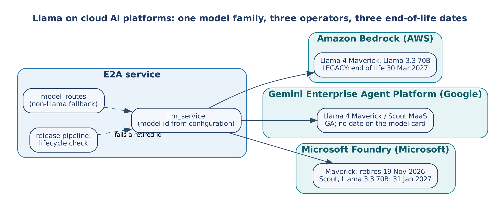

# Llama on Cloud AI Platforms — Design

### Meta Llama models operated by AWS, Google Cloud and Microsoft: Amazon Bedrock, Gemini Enterprise Agent Platform, Microsoft Foundry

*This document places Meta's Llama models within E2A when a cloud operates them as a managed API. On all three platforms the current Llama models are generally available but are being wound down, with published end-of-life dates. The design therefore treats Llama as a model behind E2A's existing cloud bindings, routed by configuration and protected by a lifecycle check, rather than as a separate stack. It records only what differs from the core design.*

| | |
|---|---|
| Framework | E2A, with `e2a-adapters` and `e2a-managed-providers` |
| Document type | Provider design document (HLD + LLD), Meta series |
| Author | Subham Gupta, Principal Platform Architect |
| Source baseline | `e2a-framework` `v1.7.4`; `e2a-managed-providers` `main`: the cloud service classes; profile `meta_llama_aws` (Llama on Bedrock through OGX, see the OGX document) |
| Date | 16 November 2026 (product facts checked on this date) |
| Status | Documented. Bedrock Llama is used today through the OGX profile. |

> **Disclaimer.** This is independent reference material for studying software architecture. It has no affiliation with, and no endorsement by, Meta, Amazon / AWS, Google, Microsoft, the OGX project or any other company or project named, and it is not a substitute for any provider's products, documentation or terms. Product names are trademarks of their owners. Product facts change: they were checked on the date shown, against the sources listed in the last section; check them again before use. Provided "as is", without warranty; not legal, compliance, security or procurement advice. Full text: [DISCLAIMER.md](../DISCLAIMER.md).

## 1. Variant identity

| | Amazon Bedrock | Google Cloud Agent Platform | Microsoft Foundry |
|---|---|---|---|
| Operator | AWS | Google | Microsoft (Foundry Models sold by Azure) |
| Llama models listed | Llama 4 Maverick 17B (`meta.llama4-maverick-17b-instruct-v1:0`, 1M context), Llama 4 Scout, Llama 3.3 70B | Llama 4 Maverick 17B-128E (`llama-4-maverick-17b-128e-instruct-maas`), Llama 4 Scout 17B-16E | Llama-4-Maverick-17B-128E-Instruct-FP8, Llama-4-Scout-17B-16E-Instruct, Llama-3.3-70B-Instruct |
| Lifecycle (checked today) | Maverick and Llama 3.3 70B: **Legacy**, end of life **30 March 2027** | Maverick: GA; no retirement date shown on the model card | Maverick: retirement **19 November 2026**; Scout and Llama 3.3 70B: **31 January 2027**; no replacement listed |
| Interface | `bedrock-runtime` (Converse, InvokeModel); `us.` geo inference profile | Agent Platform managed API (Chat Completions, OpenAI-compatible); Maverick in `us-east5` | Foundry chat completions |
| Notable limits | Maverick: tool use and response streaming are supported, **but not together** (ConverseStream with `toolConfig` fails) | managed endpoint serves FP8 only; Llama Guard is not included (deploy it separately) | Meta's licence terms apply (for example, multimodal Llama not available to EU-domiciled customers through Foundry) |
| Identity | IAM (SigV4) | ADC, IAM | Entra ID |
| Pattern (core Section 3.2) | 3 | 3 | 3 |

**Meta's own APIs are not covered.** Meta's developer pages render only in a browser, so they could not be checked on the official site for this document, and secondary reports describe Meta's current API offering as a preview built on a proprietary (non-Llama) model line. Until Meta's own documentation can be read and confirms a generally available service, no design is given for it.

## 2. Profile

No separate profile is proposed per cloud. Llama is reached the way each cloud's other models are:

| Cloud | Binding |
|---|---|
| AWS | today through `meta_llama_aws` (OGX in front of Bedrock). A direct option is a Converse-based service like the Bedrock classes already in the repository. |
| Google Cloud | the Chat Completions transport with a Google client (the same gap as gpt-oss in the OpenAI series): `LlamaStackLLMService`'s wire with an ADC-token client |
| Azure | the Foundry chat-completions endpoint with an Entra token |

In every case the model id is configuration (`LLM_MODEL_ID`) and a `model_routes` entry names the fallback, so a retired Llama id can be replaced without code.

## 3. Dispositions that differ from the core

| Responsibility | Disposition | This variant |
|---|---|---|
| Model choice | ADAPT (new) | the **lifecycle check** (release pipeline) fails a build whose configured Llama id is past, or within a set window of, its published end of life. Azure Maverick (19 Nov 2026) would fail today. |
| Structured output | RETAIN (E2A validates) | function calling and structured output are listed on Agent Platform. Through OGX, E2A sends `response_format` with a JSON schema; whether the backing platform enforces it varies by platform and model, so E2A's validation is the control in every case. |
| Tools with streaming (Bedrock Maverick) | ADAPT | E2A does not stream a step that offers tools on this model; it streams only answer-only steps |
| Refusal | ADAPT | no structured refusal signal is documented for Llama on these platforms; E2A's governance stages and output evaluation decide, and a platform content-filter block maps to `REFUSED` |
| Guardrail | REPLACE (stage) | the cloud's guardrail (Bedrock Guardrails, Model Armor, Azure AI Content Safety). Llama Guard needs its own deployment (not part of the managed endpoints). |
| Refusal outcome, fallback | COMPOSE | `model_routes` to a non-Llama model on the same cloud: the planned exit as Llama endpoints retire |
| Managed agents, MCP, retrieval | RETAIN / cloud | as each cloud's other documents: Llama adds no agent runtime of its own on these platforms |

Everything else keeps the core default.

## 4. Sequences that differ

None beyond the core's Section 5. The lifecycle check runs in the release pipeline (core Section 8), before deployment.

## 5. Error mapping

| Signal | E2A result |
|---|---|
| 429 / throttling | throttled: retried within the deadline |
| 5xx | transient or overloaded: retried within the deadline |
| 400 validation (for example tools with streaming on Bedrock Maverick) | deterministic: no retry, `FAILED` |
| 404 or "model not found / retired" | deterministic, alert; `model_routes` covers it only if configured for that class |
| 401 / 403 | auth: no retry, alert |
| cloud guardrail or content-filter block | `REFUSED` (governance) |

## 6. Security, NFRs and cost

- **Licence.** Llama models are used under Meta's licence terms as passed through by each cloud; check them per model and per region.
- **Data.** Each cloud is the processor under its own terms, as for its other models.
- **Lifecycle risk.** Every listed Llama endpoint has an end-of-life date within five months, or none published. Plan a non-Llama route, or self-host the weights (OGX document, pattern 5).
- **Cost drivers.** Tokens per platform; the cloud guardrail; a separate Llama Guard deployment if wanted.

## 7. Evidence

| Item | Status |
|---|---|
| Llama on Bedrock through OGX | Implemented (`meta_llama_aws`, offline replay) |
| Direct Llama bindings on Google Cloud and Azure | Documented |
| Release-pipeline lifecycle check | Documented: follow-up (shared with the Gemini series) |
| Meta's own APIs | Not covered (official pages not readable here) |
| Live behaviour | Not covered: needs live tests |

## 8. Sources (checked 16 November 2026)

| Fact | Source |
|---|---|
| Bedrock Llama 4 Maverick: id, endpoints, 1M context, Legacy, EOL 30 Mar 2027, tools-with-streaming limit | AWS, "Llama 4 Maverick 17B Instruct" model card |
| Bedrock Llama 3.3 70B: Legacy, EOL 30 Mar 2027 | AWS, "Llama 3.3 70B Instruct" model card |
| Agent Platform managed Llama models, Maverick spec (GA, `us-east5`, FP8), Llama Guard separate | Google Cloud, "Fully-managed Llama models"; "Llama 4 Maverick 17B-128E" |
| Foundry Llama models and terms | Microsoft Learn, "Foundry Models sold by Azure" |
| Foundry Llama retirement dates | Microsoft Learn, "Model retirement schedule" |
