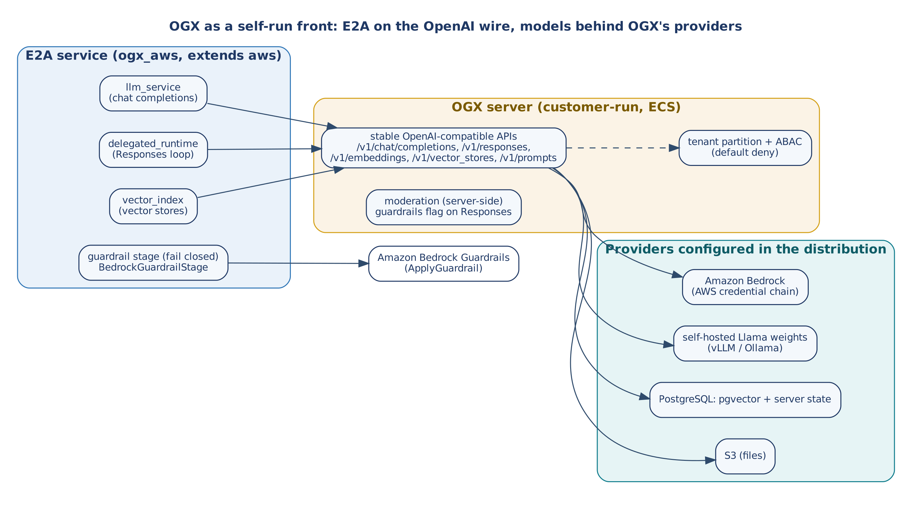
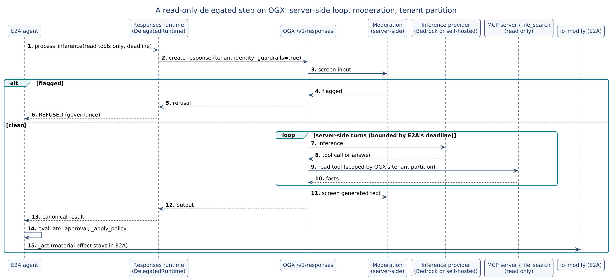

# OGX (formerly Llama Stack) and Self-Hosted Llama — Design

### An open, self-hosted agentic API server in front of Llama or any model: the `ogx_aws` profile

*This document places OGX within E2A. OGX is the open-source server formerly called Llama Stack, renamed in April 2026, which now speaks the OpenAI, Anthropic and Google APIs in front of 23 inference providers. The customer runs it, so it is the route for self-hosted Llama weights (pattern 5) and a portable front for managed models. The repository's profile, first built on the Llama Stack client, is migrated to OGX 1.x as `ogx_aws` (with `meta_llama_aws` kept as an alias for one release); Section 2 records what changed and why. It records only what differs from the core design.*

| | |
|---|---|
| Framework | E2A, with `e2a-adapters` and `e2a-managed-providers` |
| Document type | Provider design document (HLD + LLD), Meta series |
| Author | Subham Gupta, Principal Platform Architect |
| Source baseline | `e2a-framework` `v1.7.4`; `e2a-managed-providers`: `OGXLLMService`, `OGXEmbeddingModel`, `OGXVectorIndex`, `OGXPromptRegistry`, `OGXResponsesRuntime`; profile `ogx_aws` (alias `meta_llama_aws`); `providers/ogx/distribution/config.yaml` |
| Date | 16 November 2026 (product facts checked on this date; OGX docs current release v1.5.0) |
| Status | Implemented on OGX 1.x's stable endpoints (offline replay and recorded shapes; the three projects' suites pass on `ogx_aws`). Live OGX server: To validate. |

> **Disclaimer.** This is independent reference material for studying software architecture. It has no affiliation with, and no endorsement by, Meta, Amazon / AWS, Google, Microsoft, the OGX project or any other company or project named, and it is not a substitute for any provider's products, documentation or terms. Product names are trademarks of their owners. Product facts change: they were checked on the date shown, against the sources listed in the last section; check them again before use. Provided "as is", without warranty; not legal, compliance, security or procurement advice. Full text: [DISCLAIMER.md](../DISCLAIMER.md).

## 1. Variant identity

| | OGX |
|---|---|
| What it is | "a server-side agentic loop that speaks any frontier lab API": an HTTP server with pluggable providers. Not an inference engine: it routes to vLLM, Ollama, Bedrock and others (23 inference providers, 21 vector store backends). |
| Operator | the customer (it is open-source software, run on the customer's compute) |
| History | Llama Stack, started around Meta's Llama models; renamed **OGX** on 28 April 2026 (package `ogx`, CLI `ogx`, `OGX_*` variables, `x-ogx-*` headers, GitHub organisation `ogx-ai`); **OGX 1.0** declared the APIs stable. The Python client is now `ogx_client` (from 1.1.4 generated with OpenAPI Generator). |
| Stable APIs | `/v1/chat/completions`, `/v1/completions`, `/v1/embeddings`, `/v1/responses`, `/v1/models`, `/v1/files`, `/v1/vector_stores`, `/v1/batches`, `/v1/admin/tools`, `/v1/conversations`, `/v1/prompts`; semantic versioning within a major version |
| Experimental | `/v1alpha/inference/rerank`, `/v1alpha/file_processors`, `/v1alpha/interactions` (Google), admin and connectors |
| Removed in 1.0 | the agents API, fine-tuning API, `knowledge_search` tool, the TGI and Hugging Face providers. Guardrails changed from client-listed shield ids to **one server-side moderation configuration, switched on by a boolean** on the Responses API. |
| Multi-tenancy | a hard `tenant_id` partition on every stored row (default deny without one), plus ABAC within a tenant, for files, vector stores, conversations and responses |
| Pattern (core Section 3.2) | 5 (self-hosted weights behind it), or a self-run front for patterns 1 to 3 |

## 2. Profile

`ogx_aws` `extends` the `aws` cloud profile and runs the server as an ECS service (private subnets, reachable only from the E2A services' security group). Its providers are Bedrock for inference, pgvector for vector stores, S3 for files, and PostgreSQL for server state (`providers/ogx/distribution/config.yaml`). `meta_llama_aws` is an alias with the same bindings, kept for one release.

| Seam | Binding | OGX endpoint (stable in 1.x) | Change from the Llama Stack version |
|---|---|---|---|
| `llm_service` | `OGXLLMService` | `/v1/chat/completions` | the OpenAI SDK instead of `llama-stack-client` |
| `embedding_model` | `OGXEmbeddingModel` | `/v1/embeddings` | client only |
| `vector_index` | `OGXVectorIndex` | `/v1/files`, `/v1/vector_stores` (search with `search_mode`) | `vector_io.insert` / `query` (not stable) replaced. Each chunk is one file, so replace and **delete now work** (the old API had no delete). OGX embeds with the store's embedding model. |
| `guardrail_stage` | `BedrockGuardrailStage` | — | Llama Stack shields were removed by OGX 1.x; E2A's always-on stage is the cloud's guardrail |
| `prompt_registry` | `OGXPromptRegistry` | `/v1/prompts` | client only (a generic GET: the OpenAI SDK has no prompts resource) |
| `delegated_runtime` | `OGXResponsesRuntime` | `/v1/responses` | adds the tenant header and, when `ogx_guardrails` is set, OGX's `guardrails` flag |
| distribution | `config.yaml` (OGX format) | — | `agents` and `safety` dropped; files in S3 and state in PostgreSQL (the service runs more than one task); `server.tenancy.mode: multi` with an upstream-header tenant |
| package extra | `[ogx]` (`openai`, `boto3`) | — | `[meta-llama]` kept as an alias |

**Tenancy on the wire.** Every call carries `x-tenant-id`: the request's tenant for model calls and the Responses runtime, the namespace for vector stores, and `ogx_service_tenant` for calls with no tenant (embeddings, prompts). The server trusts the header because only the E2A services can reach it; a request without a tenant is refused (401) in `multi` mode.

## 3. Dispositions that differ from the core

| Responsibility | Disposition | This variant |
|---|---|---|
| Model access | REPLACE transport | OGX's OpenAI-compatible endpoints in front of the chosen provider; the model id is whatever the distribution registers |
| `DelegatedRuntime` | EXTEND | OGX's server-side Responses loop (MCP tools, `file_search`), bounded by E2A's deadline, read tools only; `_act` stays in E2A. OGX's own agents API is gone, so nothing else is bound. |
| Guardrail | COMPOSE | OGX's moderation inside the Responses loop (input, generated text and reasoning) **plus** E2A's fail-closed stage on its own model calls. Llama Guard can be the moderation backend when self-hosted. |
| Tenancy | EXTEND | OGX's tenant partition is enabled (`multi`) and fed from E2A's verified tenant through the upstream header, on a network only E2A's services can reach. Files, vector stores and conversations are then tenant-scoped by the server. E2A's own tenant scoping stays. |
| Retrieval | REPLACE (gate) | `/v1/vector_stores` with `file_search` on the stable API, one store per tenant (as today) or the tenant partition; E2A keeps `evaluate_answer` |
| Self-hosted weights | RETAIN responsibility | the customer owns the model lifecycle, capacity, patching and licence compliance (Meta's licence) |

Everything else keeps the core default.

## 4. Sequences that differ

## 5. Error mapping

| Signal | E2A result |
|---|---|
| 429 from OGX or its provider | throttled: retried within the deadline |
| 5xx, provider unreachable | transient: retried within the deadline |
| 400 (unknown model, unsupported parameter for the provider) | deterministic: no retry, `FAILED` |
| 401 / 403 (OGX authentication, tenant missing) | auth: no retry, alert. A request with no tenant sees nothing (OGX's default deny). |
| moderation flags content inside the Responses loop | `REFUSED` (governance) |
| a removed API (agents, shields) called by an old client | deterministic: the reason for the migration step |

## 6. Security, NFRs and cost

- **Operation.** The customer runs OGX: patching, scaling, high availability and its storage (SQL store, vector backend) are the customer's, unlike the managed routes.
- **Identity.** Workload identity to the inference provider (the Bedrock provider uses the AWS credential chain by default); OGX's own API authenticated per tenant. No provider key in a profile.
- **Tenancy.** Turn on the tenant partition; never run a shared OGX for several tenants without it.
- **Licence.** Self-hosted Llama weights are used under Meta's licence; check its terms for the deployment.
- **Cost drivers.** Compute for OGX and any self-hosted models (GPU), the vector backend, and provider tokens where a managed model sits behind OGX.

## 7. Evidence

| Item | Status |
|---|---|
| `ogx_aws` model calls, structured output, tools, embeddings, refusal route | Implemented: offline replay of the real OpenAI SDK; `check_llm_service` |
| Vector stores (search, replace, delete), prompts, Responses runtime with tenant header and guardrails flag, tenant ids | Implemented: tests against recorded shapes of OGX's endpoints |
| The three projects' suites on `ogx_aws` | Implemented: O2C 56 passed (in memory and on the Firestore emulator), reconciliation 50 passed, audit-ai 36 and 39 passed (in memory and on the Cosmos emulator) |
| Terraform (private ECS service, S3 files bucket, PostgreSQL state) | Implemented: `terraform validate` and plan tests |
| Behaviour against a live OGX server; the PostgreSQL storage type names; the prompts response shape | To validate |

## 8. Sources (checked 16 November 2026)

| Fact | Source |
|---|---|
| Rename, mission, migration (package, CLI, variables, headers, client) | OGX blog, "From Llama Stack to OGX: A New Name, A Sharper Mission" (28 Apr 2026) |
| OGX 1.0: stable APIs, removed APIs, providers, multi-tenancy | OGX blog, "OGX 1.0: The Open Agentic API Server is Production-Ready" |
| Stable and experimental API lists; semantic versioning | OGX docs, "API overview" |
| Guardrails as a Responses boolean; shields replaced | OGX blog, "Under the Hood: How OGX Enforces Guardrails Inside the Agentic Loop" |
| Tenant partition and ABAC | OGX blog, "Multi-Tenant AI Infrastructure with OGX" |
| `ogx_client` and its changes | OGX blog, "The OGX Python SDK Has a New Foundation" |
| Bedrock provider: credential chain, optional bearer token | OGX docs, "remote::bedrock" provider |
| Tenancy modes, upstream-header auth; Safety and Shields removed, `moderation_endpoint` | OGX docs, "Configuring a Stack" (config.yaml) |
| S3 files provider; PostgreSQL storage for production | OGX docs, "remote::s3" files provider; "starter" distribution |
| Vector store search modes, embedding model per store | OGX docs, "File Operations and Vector Store Integration" |
