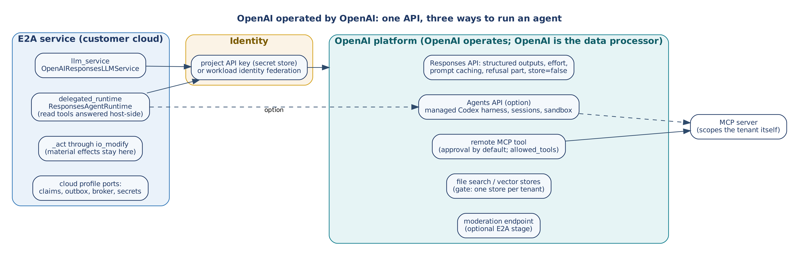
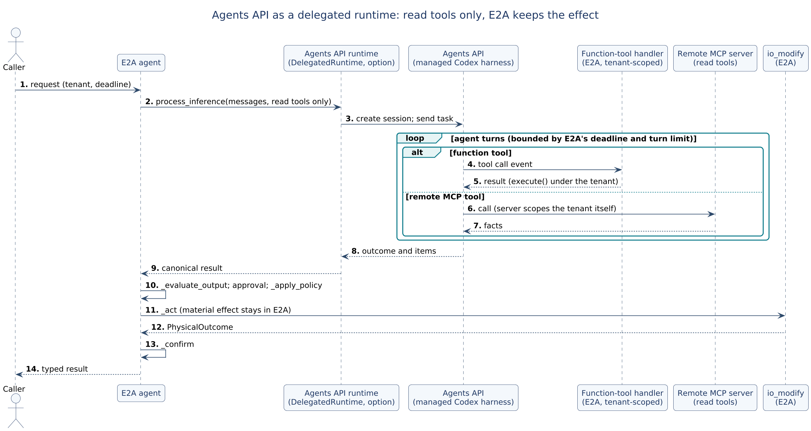

# OpenAI API — Design

### OpenAI models operated by OpenAI: Responses API, Agents API, remote MCP, file search

*This document places OpenAI models within E2A when OpenAI operates the service and the E2A service calls the OpenAI API directly. It covers the Responses API for model calls, the Agents API (a managed Codex harness) as a delegated runtime, remote MCP servers called by OpenAI, and hosted file search. It records only what differs from the core design.*

| | |
|---|---|
| Framework | E2A, with `e2a-adapters` and `e2a-managed-providers` |
| Document type | Provider design document (HLD + LLD), OpenAI series |
| Author | Subham Gupta, Principal Platform Architect |
| Source baseline | `e2a-framework` `v1.7.4`; `e2a-managed-providers` `main`: `OpenAIResponsesLLMService`, `ResponsesAgentRuntime` (both used today through the `openai_azure` profile) |
| Date | 16 November 2026 (product facts checked on this date) |
| Status | Documented. The Responses wire is Implemented (shared with the Foundry profile); no profile here points at the OpenAI API itself. |

> **Disclaimer.** This is independent reference material for studying software architecture. It has no affiliation with, and no endorsement by, OpenAI, Microsoft, Amazon / AWS, Google or any other company named, and it is not a substitute for any provider's products, documentation or terms. Product names are trademarks of their owners. Product facts change: they were checked on the date shown, against the sources listed in the last section; check them again before use. Provided "as is", without warranty; not legal, compliance, security or procurement advice. Full text: [DISCLAIMER.md](../DISCLAIMER.md).

## 1. Variant identity

| | OpenAI API |
|---|---|
| Operator and data processor | OpenAI |
| Identity | OpenAI project API key, held in the deployment's secret store. Or short-lived tokens through **workload identity federation** from AWS, Azure, Google Cloud or Kubernetes workloads (Documented; not used by this repository yet). |
| Billing | OpenAI |
| Model call | Responses API (`POST /v1/responses`). The Assistants API is retired. |
| Agent runtimes OpenAI offers | **Agents API**: OpenAI runs a managed Codex harness with durable sessions, an optional sandbox (OpenAI-hosted or self-hosted) and remote MCP servers. **Agents SDK**: the loop runs inside the application. |
| Data | Abuse-monitoring logs by default; Modified Abuse Monitoring or Zero Data Retention for eligible customers. Data residency is a per-project option for eligible organisations (priced with an uplift). |
| Network | Public endpoints; **Private Link** from Azure workloads (not self-service: arranged with OpenAI). |
| Pattern (core Section 3.2) | 1 |

## 2. Profile

No profile in this repository targets the OpenAI API, but the wire is already written once. `OpenAIResponsesLLMService` builds Responses requests "independent of who hosts it"; `AzureOpenAIResponsesLLMService` only changes the client. A direct profile would therefore be small:

| Seam | Binding (proposed) |
|---|---|
| `llm_service` | `OpenAIResponsesLLMService` with the SDK's default client (`OPENAI_API_KEY` resolved from the secret store, never written in the profile) |
| `delegated_runtime` | `ResponsesAgentRuntime` with the same client (read tools answered host-side); an Agents API runtime is a later option (Section 3) |
| `embedding_model` | OpenAI embeddings (`text-embedding-3-large` / `-small`) through the same client as `AzureOpenAIEmbeddingModel` |
| infrastructure ports | from the cloud profile the service runs on (`aws`, `gcp` or `azure`), as for every profile |

## 3. Dispositions that differ from the core

| Responsibility | Disposition | This variant |
|---|---|---|
| `_format_and_validate_output` | REPLACE implementation | `text.format` with `type: json_schema`. OpenAI states structured outputs constrain "completed, non-refusal" output, so E2A still validates the result. |
| Reasoning control | REPLACE | `reasoning.effort`. E2A's `max` maps to the top documented level; temperature is never sent to reasoning models. |
| `_apply_kv_caching` | REPLACE | automatic prefix caching; E2A's cache handle becomes `prompt_cache_key` |
| Refusal detection | ADAPT | an output content part of type `refusal` → `ModelRefusal` (the codec already does this) |
| Refusal outcome | COMPOSE | OpenAI documents no server-side fallback, so E2A's `model_routes` answer |
| Response storage | ADAPT | `store: false` by default (`openai_store_responses`), so no server-side copy unless a delegated runtime needs state |
| `DelegatedRuntime` | EXTEND | **Today:** `ResponsesAgentRuntime`: the Responses API's tool loop, with E2A's read tools as function tools answered host-side under the tenant, and a turn limit. **Option:** the **Agents API** (durable sessions, compaction, sandbox). Function tools still come back to E2A's handler; remote MCP servers are called by the harness directly. E2A binds read tools only and bounds the session by its deadline. Not implemented here. |
| `MCPToolService` transport | REPLACE transport, EXTEND policy | the `mcp` tool type: OpenAI calls the remote server. By default OpenAI asks for approval before data is shared with an MCP server; the repository sets `require_approval: "never"` only for read tools listed in `allowed_tools`. The server's token comes from `token_env`, and a server holding tenant data scopes it itself. Private servers can use Secure MCP Tunnel. |
| `BaseVectorIndex` + `BaseRAGPipeline` retrieval | conditional REPLACE (gate) | **file search** over OpenAI vector stores is a hosted tool. It passes the gate only when one store per tenant is enforced and E2A keeps `evaluate_answer`; otherwise the cloud's index stays (RETAIN). |
| Guardrail | COMPOSE | the **moderation endpoint** (`omni-moderation-latest`, free) can be an E2A governance stage before and after the call; refusals and E2A's own stages still apply |
| Batches | REPLACE (offline only) | the Batch API for evaluation runs in the release pipeline |

Everything else keeps the core default: the business idempotency key, approval, `_act` through `io_modify`, `_confirm`, and tenant resolution at ingress.

## 4. Sequences that differ

The model call, failure handling, unknown effects, outbox and identity follow the core's Section 5. With the Agents API, a function-tool handler that is unavailable leaves the session waiting (OpenAI's architecture page), so E2A's deadline, not the session, ends the step.

## 5. Error mapping

| Signal (OpenAI "Error codes") | E2A result | Design intent |
|---|---|---|
| 429 rate limit / `slow_down` (`Retry-After`) | throttled: retried within the deadline | same |
| 429 `credit_balance_exhausted`, `organization_spend_limit_exceeded`, `project_spend_limit_exceeded`, `organization_usage_limit_exceeded`, or error type `insufficient_quota` | deterministic: no retry, `FAILED` (`classify_openai_error`, since P-2; before, it was retried as throttling) | same |
| 500 / 503 | transient or overloaded: retried within the deadline | same |
| 400 invalid request | deterministic: no retry, `FAILED` | same |
| 401 (key, organisation, IP allowlist), 403 (unsupported country or region) | auth: no retry, `FAILED`, alert | same |
| 200 with a `refusal` content part | `ModelRefusal`, then `model_routes`, else `REFUSED` | same |
| Agents API session beyond E2A's deadline or turn limit | `DelegatedTurnLimit` / deadline: typed failure | same |

The provider request id (`x-request-id`) is recorded in E2A telemetry with the tenant and correlation id.

## 6. Security, NFRs and cost

- **Identity.** The project API key lives in a secret store and is injected by the platform (N2). Per-project keys separate environments; workload identity federation removes the static key where adopted.
- **Data.** OpenAI is the processor. Abuse-monitoring logs may contain prompts and responses unless Zero Data Retention or Modified Abuse Monitoring is approved. Background mode under ZDR still stores response data for about 10 minutes. E2A sends a managed runtime only what a read-only task needs.
- **Tenancy.** MCP servers and file-search stores sit outside E2A's call path: each must scope to the calling tenant itself, or the capability is not used for tenant data.
- **Network.** Public endpoints, or Private Link from Azure by arrangement.
- **Cost drivers.** Tokens (cached input cheaper), hosted tools at their own rates, Agents API sandboxes, file storage, the Batch API for offline evaluation; data residency adds an uplift.

## 7. Evidence

| Item | Status |
|---|---|
| Responses wire: function tools, MCP tools, structured output, effort, cache key, refusal part | Implemented: `OpenAIResponsesLLMService` (offline replay, `check_llm_service`), exercised through the `openai_azure` profile |
| Responses tool loop as delegated runtime | Implemented: `ResponsesAgentRuntime`, offline |
| A direct OpenAI API profile | Documented (proposed bindings in Section 2) |
| Agents API runtime, file search binding, moderation stage | Documented |
| Spend-limit 429 classified as non-retryable | Implemented (P-2): `classify_openai_error`, offline tests per code |
| Live behaviour, quotas, latency | Not covered: needs live tests |

## 8. Sources (checked 16 November 2026)

| Fact | Source |
|---|---|
| Runtime comparison (Agents API, Agents SDK, Responses API) | OpenAI, "Agents" (developers.openai.com/api/docs/guides/agents) |
| Agents API: managed Codex harness, sessions, environments, pricing | OpenAI, "Agents API" overview and "Architecture" |
| MCP tool, approvals, `allowed_tools`, Secure MCP Tunnel | OpenAI, "Connectors and MCP servers" |
| File search and vector stores | OpenAI, "File search" |
| Structured outputs and refusals | OpenAI, "Structured Outputs" |
| Background mode under ZDR | OpenAI, "Background mode" |
| Abuse monitoring, ZDR, Modified Abuse Monitoring | OpenAI, "Data controls in the OpenAI platform" |
| Data residency | OpenAI, "Data residency" |
| Private Link (Azure; not self-service) | OpenAI, "Private Link" |
| Moderation endpoint and model | OpenAI, "Moderation" |
| Error codes | OpenAI, "Error codes" |
| `x-request-id`; API keys and workload identity federation | OpenAI, API reference "Overview"; "Workload identity federation" |
