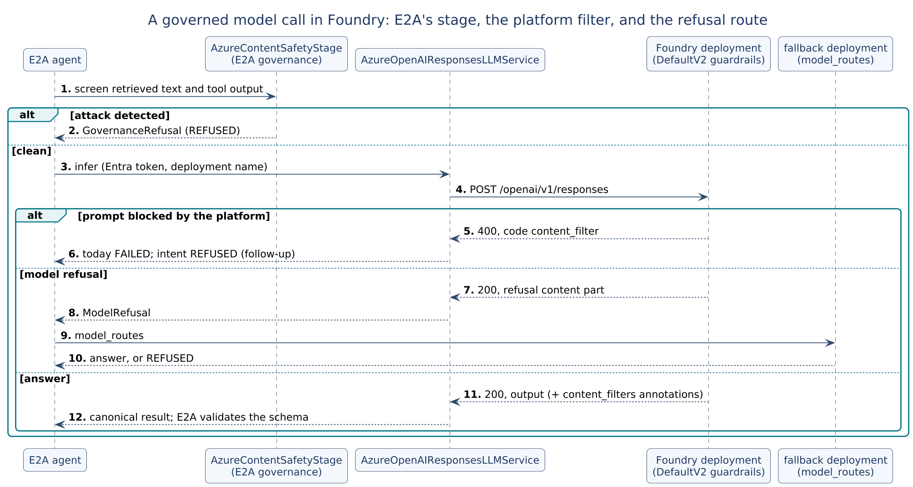

# OpenAI in Microsoft Foundry — Design

### Azure OpenAI in Foundry Models: the v1 API, Responses API, default guardrails and Foundry Agent Service

*This document places OpenAI models within E2A when they are deployed as Models sold by Azure in a Microsoft Foundry resource. Microsoft operates the service on Azure. Identity, billing, network and guardrails are Azure's, and the API is OpenAI's Responses API under Azure's v1 base URL. This is the implemented profile `openai_azure`. It records only what differs from the core design.*

| | |
|---|---|
| Framework | E2A, with `e2a-adapters` and `e2a-managed-providers` |
| Document type | Provider design document (HLD + LLD), OpenAI series |
| Author | Subham Gupta, Principal Platform Architect |
| Source baseline | `e2a-framework` `v1.7.4` (`azure` cloud profile); `e2a-managed-providers` `main`: `AzureOpenAIResponsesLLMService`, `AzureOpenAIEmbeddingModel`, `ResponsesAgentRuntime`, the Azure service classes; profile `openai_azure` |
| Date | 16 November 2026 (product facts checked on this date) |
| Status | Implemented (`openai_azure`). Foundry Agent Service as a runtime: Documented. |

> **Disclaimer.** This is independent reference material for studying software architecture. It has no affiliation with, and no endorsement by, OpenAI, Microsoft, Amazon / AWS, Google or any other company named, and it is not a substitute for any provider's products, documentation or terms. Product names are trademarks of their owners. Product facts change: they were checked on the date shown, against the sources listed in the last section; check them again before use. Provided "as is", without warranty; not legal, compliance, security or procurement advice. Full text: [DISCLAIMER.md](../DISCLAIMER.md).

## 1. Variant identity

| | Azure OpenAI in Foundry Models |
|---|---|
| Operator and data processor | Microsoft (Models sold by Azure). Prompts and completions "are NOT available to OpenAI" and are not used to train foundation models without permission. |
| API | the **v1 API**: the standard OpenAI client with `base_url` `https://{resource}.openai.azure.com/openai/v1/`, no dated `api-version`; `model` is the **deployment name** |
| Identity | Microsoft Entra ID (managed identity or workload identity, `DefaultAzureCredential`, scope `https://cognitiveservices.azure.com/.default`) with the Cognitive Services OpenAI User role; an API key only when configured |
| Billing, audit | Azure subscription; Azure Monitor and activity logs |
| Data location | Standard deployments in the resource's region; **Global** deployments may process prompts and responses in any geography; **DataZone** deployments within the data zone |
| Guardrails | **DefaultV2** applies to every deployment: hate and fairness, sexual, violence and self-harm filters on prompts and completions at Medium; user prompt attack detection on; document attack detection **off** until enabled |
| Agent platform | **Foundry Agent Service**: prompt agents, hosted agents (own code in a container), or the Responses API called directly; toolboxes expose tools through a managed MCP endpoint; Entra identity, RBAC, virtual network isolation |
| Pattern (core Section 3.2) | 3 |

## 2. Profile

`openai_azure` `extends` the `azure` cloud profile, so claims, checkpoints, rows, outbox, broker, secrets and identity come from Cosmos DB, Service Bus, Key Vault and Entra ID:

| Seam | Binding |
|---|---|
| `llm_service` | `AzureOpenAIResponsesLLMService` (v1 base URL, Entra token provider, deployment name as `model_id`) |
| `embedding_model` | `AzureOpenAIEmbeddingModel` (`text-embedding-3-large`, 1024 dimensions by default) |
| `delegated_runtime` | `ResponsesAgentRuntime` (Responses tool loop; read tools answered host-side; `delegated_runtime_id` names the deployment) |
| `vector_index`, `reranker` | `AzureAISearchIndex` (hybrid), `AzureSemanticRanker` |
| `guardrail_stage` | `AzureContentSafetyStage` (Prompt Shields) |
| `mcp_gateway_tool` | `APIMGatewayTool` (API Management as the MCP gateway) |
| `observability_engine`, `infra_provisioner`, `release_pipeline` | the Azure substrate classes |

`azure_openai_api_key` is unset by default, so the managed identity is used and no key appears anywhere. `openai_store_responses` is `false`.

## 3. Dispositions that differ from the core

| Responsibility | Disposition | This variant |
|---|---|---|
| `_format_and_validate_output`, reasoning, caching, refusal part | as the OpenAI API document | the same Responses wire (`text.format`, `reasoning.effort`, `prompt_cache_key`, `refusal` part) |
| Refusal outcome | COMPOSE | no server-side fallback; E2A's `model_routes` (`fallback_model_id` names a second deployment) |
| Content safety | COMPOSE | **Platform:** DefaultV2 filters on every call, outside E2A's control. **E2A:** `AzureContentSafetyStage` stays, because it screens what the platform does not by default: retrieved documents and tool outputs (document attacks), before they enter the prompt. |
| Platform filter outcome | ADAPT (gap) | A blocked prompt returns **400 with code `content_filter`**; Responses output carries a top-level `content_filters` array (a Foundry extension the SDK does not type). E2A should report a block as `REFUSED` (governance), not a failure. Today `classify_error` makes the 400 `deterministic` → `FAILED`; a provider-layer classifier is the follow-up (Section 5). |
| `DelegatedRuntime` | EXTEND | **Today:** `ResponsesAgentRuntime`. **Option:** a Foundry **prompt agent** or **hosted agent** called through the Agent Service. E2A binds read tools only and keeps `_act`; a toolbox's MCP endpoint replaces the per-server list when the toolbox holds read tools only. |
| `MCPToolService` | REPLACE transport, EXTEND policy | `mcp` tools called by the service (`require_approval: "never"` only for read tools), or API Management as a governed MCP gateway (`APIMGatewayTool`), which is where per-tenant policy can be enforced |
| `BaseVectorIndex`, `BaseReranker` | REPLACE | Azure AI Search hybrid retrieval and semantic ranker, with one index filter per tenant; E2A keeps `evaluate_answer` |
| Response storage | ADAPT | `store: false`; Microsoft notes the Responses API creates stored state when used, so state is opt-in per runtime |

Everything else keeps the core default: the business idempotency key, approval, `_act` through `io_modify`, `_confirm`, and tenant resolution at ingress (`azure_container_apps`, E2A v1.7.4).

## 4. Sequences that differ

## 5. Error mapping

| Signal | E2A result today | Design intent |
|---|---|---|
| 429 | throttled: retried within the deadline (SDK retries 0) | same |
| 5xx | transient or overloaded: retried within the deadline | same |
| 400 `content_filter` (prompt blocked by the platform) | deterministic → `FAILED` | `REFUSED` with a governance reason; no retry (follow-up) |
| 200 with `content_filters[].blocked` on output | not inspected | `REFUSED` (follow-up) |
| 400 other (unknown deployment name, invalid request) | deterministic: no retry, `FAILED` | same |
| 401 / 403 (Entra token, missing role) | auth: no retry, alert | same |
| 200 with a `refusal` content part | `ModelRefusal`, then `model_routes`, else `REFUSED` | same |
| `AzureContentSafetyStage` match | `GovernanceRefusal` at the guardrail stage | same |

## 6. Security, NFRs and cost

- **Identity.** Managed identity with the Cognitive Services OpenAI User role; no key. Callers are verified by Container Apps authentication (E2A v1.7.4).
- **Data.** Microsoft is the processor; content is not available to OpenAI. Choose Standard or DataZone deployments where residency matters; Global deployments may process anywhere. Customers may apply to modify abuse monitoring.
- **Network.** Private endpoints and virtual network isolation are Azure configuration, not part of this repository's Terraform.
- **Guardrails.** Keep DefaultV2 or stricter; enable document attack detection, or keep E2A's Content Safety stage on retrieved text.
- **Cost drivers.** Tokens per deployment type (Global, DataZone, Standard, provisioned), AI Search units and semantic ranker queries, Content Safety calls, API Management, Agent Service hosted agents.

## 7. Evidence

| Item | Status |
|---|---|
| `openai_azure` model calls, structured output, effort, caching, refusal route, MCP tool shape, embeddings | Implemented: offline replay of the real SDK; `check_llm_service`; the three projects' suites run on this profile |
| Responses tool loop as delegated runtime | Implemented: `ResponsesAgentRuntime`, offline |
| AI Search, semantic ranker, Content Safety, APIM gateway | Implemented: Azure service classes, offline |
| Platform `content_filter` → `REFUSED` | To validate: follow-up in the provider layer |
| Foundry Agent Service runtime | Documented |
| Live behaviour, quotas, latency | Not covered: needs live tests |

## 8. Sources (checked 16 November 2026)

| Fact | Source |
|---|---|
| v1 API, base URL, no `api-version`, Entra role | Microsoft Learn, "Azure OpenAI in Microsoft Foundry Models v1 API" |
| Responses API on Azure, MCP tool, `content_filters`, `content_filter` error | Microsoft Learn, "Use the Azure OpenAI Responses API" |
| DefaultV2 categories, levels, prompt and document attacks | Microsoft Learn, "Default Guardrail policies for Microsoft Foundry" |
| Data not available to OpenAI; Global and DataZone processing; stateful features | Microsoft Learn, "Data, privacy, and security for Foundry Models sold by Azure" |
| Agent Service: prompt agents, hosted agents, toolboxes, identity | Microsoft Learn, "What is Foundry Agent Service?" |
