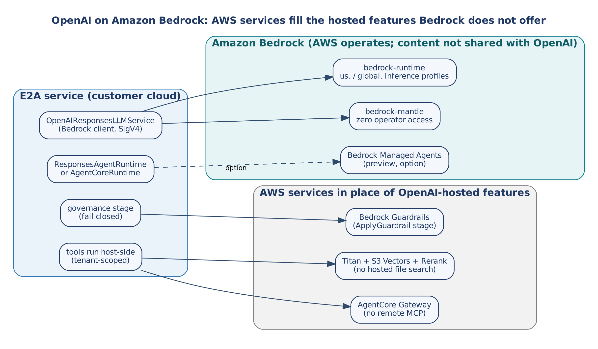

# OpenAI on Amazon Bedrock — Design

### OpenAI models operated by AWS: Bedrock Runtime and Mantle (Responses API), and Bedrock Managed Agents

*This document places OpenAI models within E2A when AWS operates them in Amazon Bedrock. Both Bedrock endpoints offer OpenAI's Responses and Chat Completions APIs, so E2A's Responses wire carries over. Several hosted features of the OpenAI API are not available on Bedrock, and AWS's own services take their place. It records only what differs from the core design.*

| | |
|---|---|
| Framework | E2A, with `e2a-adapters` and `e2a-managed-providers` |
| Document type | Provider design document (HLD + LLD), OpenAI series |
| Author | Subham Gupta, Principal Platform Architect |
| Source baseline | `e2a-framework` `v1.7.4` (`aws` cloud profile); `e2a-managed-providers` `main`: `OpenAIResponsesLLMService`, `ResponsesAgentRuntime`, the AWS service classes in `e2a_managed.clouds.aws` |
| Date | 16 November 2026 (product facts checked on this date) |
| Status | Documented. No OpenAI-on-Bedrock profile here; the AWS service classes are Implemented for the Anthropic Bedrock profile. |

> **Disclaimer.** This is independent reference material for studying software architecture. It has no affiliation with, and no endorsement by, OpenAI, Amazon / AWS, Microsoft, Google or any other company named, and it is not a substitute for any provider's products, documentation or terms. Product names are trademarks of their owners. Product facts change: they were checked on the date shown, against the sources listed in the last section; check them again before use. Provided "as is", without warranty; not legal, compliance, security or procurement advice. Full text: [DISCLAIMER.md](../DISCLAIMER.md).

## 1. Variant identity

| | Bedrock Runtime (`bedrock-runtime`) | Mantle (`bedrock-mantle`) |
|---|---|---|
| Operator and data processor | AWS | AWS. **Zero operator access**: AWS operators have no technical mechanism to reach Mantle's compute or customer data. |
| API | Responses and Chat Completions (OpenAI-compatible) | the same, at `https://bedrock-mantle.{region}.api.aws/openai/v1` |
| Model ids | `openai.<id>`; inference profiles `us.` and `global.` (for example `us.openai.gpt-6-sol`) | `openai.<id>` in the regions that serve it (for example GPT-6 Sol and Luna in `us-east-1`, GPT-6 Astra in `us-west-2`) |
| `previous_response_id` | `model` required on every request | model inherited |
| Background mode, hosted web search | not available | available (background subject to retention settings) |
| Identity | AWS credentials signed with SigV4, or a Bedrock API key (`AWS_BEARER_TOKEN_BEDROCK`) | the same |
| Data | AWS does not share request or response content with OpenAI (retention `default` or `none`). Zero data retention when the effective retention mode is `none`; `store: false` alone does not guarantee it. | the same |
| Residency | "An AWS Region is not an OpenAI data residency jurisdiction": the inference profile's destination regions decide | the same |
| Pattern (core Section 3.2) | 3 | 3 |

**Not available on Bedrock** (OpenAI's comparison): hosted file search, remote MCP servers, the shell tool, image generation tool, multi-agent, programmatic tool calling, asynchronous tool calling, WebSockets, mid-turn steering, reasoning updates and pro mode. **Available:** structured outputs, function calling, custom tools, reasoning effort, prompt caching, persisted reasoning (supported models), computer use, client-side `tool_search`, streaming.

**Bedrock Managed Agents, powered by OpenAI (preview)** adapts OpenAI's Agents API to AWS: the agent harness and inference run in Bedrock; AgentCore Runtime or self-hosted compute runs commands and tools; authentication is IAM with SigV4.

## 2. Profile

A profile would `extend` the `aws` cloud profile and reuse the AWS service classes already bound by `anthropic_bedrock`:

| Seam | Binding (proposed) |
|---|---|
| `llm_service` | `OpenAIResponsesLLMService` with a Bedrock client: Mantle base URL for the region, and SigV4 credentials from the workload role (or a Bedrock API key from Secrets Manager). Runtime: an inference-profile id and `model` on every request. |
| `delegated_runtime` | `ResponsesAgentRuntime` with the same client (function tools answered host-side), or `AgentCoreRuntime` (bound today by `anthropic_bedrock`) for an agent deployed on AgentCore Runtime; Bedrock Managed Agents is the managed option (Section 3) |
| `embedding_model`, `vector_index`, `reranker` | Titan embeddings, S3 Vectors, Bedrock Rerank (hosted file search is not available) |
| `guardrail_stage`, `prompt_registry` | Bedrock Guardrails (`ApplyGuardrail`), Bedrock Prompt Management |
| `mcp_gateway_tool` | AgentCore Gateway, called host-side (remote MCP is not available) |
| `observability_engine`, `infra_provisioner`, `release_pipeline` | the AWS substrate classes |

## 3. Dispositions that differ from the core

| Responsibility | Disposition | This variant |
|---|---|---|
| Output format, reasoning, caching, refusal part | as the OpenAI API document | the same Responses wire |
| Refusal outcome | COMPOSE | no server-side fallback documented; E2A's `model_routes` |
| `DelegatedRuntime` | EXTEND | **Default:** `ResponsesAgentRuntime` (no multi-agent or programmatic tool calling on Bedrock, so E2A's loop is not a loss). **Option:** **Bedrock Managed Agents** (preview): the OpenAI harness in Bedrock, tools on AgentCore Runtime. E2A binds read tools only, bounds the session by its deadline, keeps `_act`. Preview status fails gate item "generally available" for production use. |
| `MCPToolService` | RETAIN (host-side) | remote MCP servers are not available, so the model never calls MCP directly. Tools run host-side through E2A under the tenant, optionally through AgentCore Gateway. This is the stricter shape: E2A stays in every tool call path. |
| `BaseVectorIndex` + retrieval | REPLACE with AWS services | S3 Vectors and Bedrock Rerank, tenant-filtered; E2A keeps `evaluate_answer` |
| Guardrail | REPLACE (stage) | Bedrock Guardrails through `ApplyGuardrail`, as a fail-closed governance stage |
| Response storage | ADAPT | `store: false`; for ZDR set the retention mode to `none` (then `store: true` is rejected and background mode is unavailable) |
| Background mode | not used | E2A's request deadline and resumable workflow steps own long work; Mantle background mode is not bound |

Everything else keeps the core default.

## 4. Sequences that differ

The model call follows the core's Section 5.1, with SigV4 signing in the client; tools always return to E2A (figure 1). No other sequence differs.

## 5. Error mapping

| Signal | E2A result |
|---|---|
| 429 / throttling | throttled: retried within the deadline (SDK retries 0) |
| 5xx / service unavailable | transient or overloaded: retried within the deadline |
| 400 validation (an unavailable feature, a model id outside its region, `store: true` under retention `none`) | deterministic: no retry, `FAILED` |
| 403 access denied (IAM, model access) | auth: no retry, `FAILED`, alert |
| 200 with a `refusal` content part | `ModelRefusal`, then E2A's route, else `REFUSED` |
| Bedrock Guardrails intervention | `GovernanceRefusal` at the guardrail stage |

The exact error bodies of the Mantle endpoint are To validate with live tests.

## 6. Security, NFRs and cost

- **Identity.** The workload's IAM role signs every call; prefer it to a Bedrock API key. Callers are verified by the API Gateway JWT authorizer (E2A v1.7.4, `aws_http_api`).
- **Data.** AWS is the processor; content is not shared with OpenAI. Mantle adds zero operator access. Set retention `none` for ZDR where eligible.
- **Residency.** Choose the region or inference profile by its destination regions; the endpoint's region alone does not decide.
- **Cost drivers.** Tokens (cache reads cheaper), Titan, S3 Vectors, Rerank, Guardrails assessments, AgentCore use, Bedrock Managed Agents sessions.

## 7. Evidence

| Item | Status |
|---|---|
| Responses wire | Implemented (shared class); not yet run against a Bedrock client |
| AWS service classes (S3 Vectors, Rerank, Guardrails, AgentCore Gateway, observability, IaC) | Implemented for `anthropic_bedrock`, offline |
| An `openai_bedrock` profile | Documented (proposed bindings in Section 2) |
| Bedrock Managed Agents runtime | Documented (preview) |
| Live behaviour, quotas, latency, error bodies | Not covered: needs live tests |

## 8. Sources (checked 16 November 2026)

| Fact | Source |
|---|---|
| Endpoints, models, ids, feature availability, Runtime vs Mantle, ZOA, ZDR, content not shared with OpenAI, residency | OpenAI, "OpenAI on Amazon Bedrock" (developers.openai.com/api/docs/guides/amazon-bedrock) |
| Bedrock Managed Agents: harness and inference in Bedrock, AgentCore, IAM | OpenAI, "Bedrock Managed Agents" |
| Bedrock Managed Agents, powered by OpenAI (Preview) | AWS, product page (aws.amazon.com/bedrock/managed-agents-openai) |
| AgentCore, `ApplyGuardrail`, S3 Vectors, Rerank | AWS documentation, as listed in the Claude on Amazon Bedrock document |
