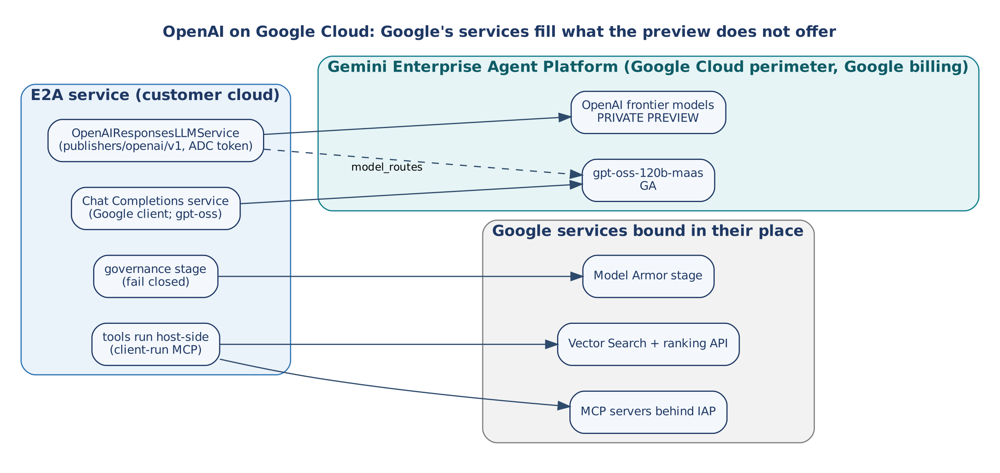

# OpenAI on Google Cloud — Design

### OpenAI frontier models in Google Cloud (private preview), and gpt-oss as a managed open model

*This document places OpenAI models within E2A on Google Cloud's Gemini Enterprise Agent Platform (formerly Vertex AI). There are two offerings. OpenAI's frontier models run within Google Cloud's security perimeter through an OpenAI-compatible Responses endpoint; this is a private preview, granted on request. gpt-oss-120b, an open-weight model, is a generally available managed API. It records only what differs from the core design.*

| | |
|---|---|
| Framework | E2A, with `e2a-adapters` and `e2a-managed-providers` |
| Document type | Provider design document (HLD + LLD), OpenAI series |
| Author | Subham Gupta, Principal Platform Architect |
| Source baseline | `e2a-framework` `v1.7.4` (`gcp` cloud profile); `e2a-managed-providers` `main`: `OpenAIResponsesLLMService`, the Google service classes in `e2a_managed.clouds.gcp.services` |
| Date | 16 November 2026 (product facts checked on this date) |
| Status | Documented. Frontier models: private preview (To validate with access). No profile here; the Google service classes are Implemented for the `google_vertex` profile. |

> **Disclaimer.** This is independent reference material for studying software architecture. It has no affiliation with, and no endorsement by, OpenAI, Google, Microsoft, Amazon / AWS or any other company named, and it is not a substitute for any provider's products, documentation or terms. Product names are trademarks of their owners. Product facts change: they were checked on the date shown, against the sources listed in the last section; check them again before use. Provided "as is", without warranty; not legal, compliance, security or procurement advice. Full text: [DISCLAIMER.md](../DISCLAIMER.md).

## 1. Variant identity

| | OpenAI frontier models on Google Cloud | gpt-oss-120b managed API |
|---|---|---|
| Status | **Private preview**, by request | GA |
| Operator | runs within Google Cloud's security perimeter; billed to Google Cloud | Google Cloud (Model-as-a-Service); OpenAI models "are not a Google product" and fall under the "Separate Offerings" terms |
| Models | `gpt-6-luna`, `gpt-6.1-sol`, `gpt-6.1-terra`, `gpt-6-astra` | `gpt-oss-120b-maas` (text in and out; function calling and structured output supported) |
| API | Responses API at `https://aiplatform.googleapis.com/v1/projects/{project}/locations/global/publishers/openai/v1` with the OpenAI SDK | Chat Completions (OpenAI-compatible) through the open-model MaaS endpoint |
| Identity | Google credentials (ADC, OAuth access token); IAM, for example `roles/aiplatform.user`; model enabled in Model Garden and allowed by organisation policy | the same |
| Data | not used to train OpenAI models; default retention up to 30 days; ZDR only by arrangement (`store: false` does not enable it) | Google Cloud's terms for the managed model |
| Pattern (core Section 3.2) | 3 | 3 |

**Not available for the frontier models** (OpenAI's guide): input token counting, Realtime WebSockets, background requests and stream resume, Chat Completions, batch, reasoning summaries, hosted web search, hosted file search and vector stores, hosted code execution, server-side remote MCP, image generation. **Available:** structured outputs, JSON mode, reasoning effort, encrypted reasoning, function calling, custom tools, client-run MCP, client-side shell, PDF and image input, conversation state and compaction, prompt-cache controls.

## 2. Profile

A profile would `extend` the `gcp` cloud profile (Firestore, Pub/Sub, Secret Manager, API Gateway identity) and reuse the Google service classes bound by `google_vertex`:

| Seam | Binding (proposed) |
|---|---|
| `llm_service` | `OpenAIResponsesLLMService` with the SDK pointed at the project's `publishers/openai/v1` base URL and a Google access token from ADC (refreshed, never stored) |
| `delegated_runtime` | `ResponsesAgentRuntime` with the same client (function tools answered host-side), or `VertexAgentEngineRuntime` for an agent deployed on Agent Engine |
| `embedding_model`, `vector_index`, `reranker` | `VertexGeminiEmbeddingModel`, `VertexVectorSearchIndex`, `VertexRankingReranker` (no hosted file search) |
| `guardrail_stage` | `ModelArmorStage` |
| `mcp_gateway_tool` | `IAPGatewayTool` (MCP servers behind IAP, called host-side) |
| `observability_engine`, `infra_provisioner`, `release_pipeline` | the GCP substrate classes |

For **gpt-oss-120b**, the transport is Chat Completions. `LlamaStackLLMService` already sends that wire, and the codec maps `finish_reason: "content_filter"` to a refusal. A subclass with a Google client (base URL and ADC token) is what remains before a profile.

## 3. Dispositions that differ from the core

| Responsibility | Disposition | This variant |
|---|---|---|
| Output format, reasoning, caching, refusal part | as the OpenAI API document | the same Responses wire, for the frontier models |
| Refusal outcome | COMPOSE | E2A's `model_routes` (for example to `gpt-oss-120b-maas` or a Gemini model) |
| `MCPToolService` | RETAIN (host-side) | server-side remote MCP is not available; "client-run MCP" means tools run in the caller, so E2A runs them under the tenant, through IAP where the server is private |
| Retrieval | REPLACE with Google services | Vector Search and the ranking API, tenant-filtered; E2A keeps `evaluate_answer` |
| Guardrail | REPLACE (stage) | Model Armor as a fail-closed governance stage, on prompts and on retrieved text |
| Release-pipeline evaluation | RETAIN | no batch for the frontier models; evaluation runs as ordinary calls inside the pipeline's budget |
| Production use of the frontier models | gate: not passed | private preview fails the replacement gate's "generally available" item; use for evaluation only, with a GA route configured |

Everything else keeps the core default, including tenant resolution at ingress (`gcp_api_gateway`, E2A v1.7.4).

## 4. Sequences that differ

None beyond the core's Section 5; tools always return to E2A (figure 1).

## 5. Error mapping

| Signal | E2A result |
|---|---|
| 429 (quota) | throttled: retried within the deadline (SDK retries 0) |
| 5xx | transient or overloaded: retried within the deadline |
| 400 (a feature not available, a model not enabled) | deterministic: no retry, `FAILED` |
| 401 / 403 (expired token, missing IAM role, organisation policy) | auth: no retry, `FAILED`, alert |
| 200 with a `refusal` content part (frontier) or `finish_reason: "content_filter"` (gpt-oss) | `ModelRefusal`, then E2A's route, else `REFUSED` |
| Model Armor match | `GovernanceRefusal` at the guardrail stage |

Error bodies under the preview are To validate.

## 6. Security, NFRs and cost

- **Identity.** The workload's service account through ADC; least privilege with `roles/aiplatform.user`; organisation policy restricts which models may be called.
- **Data.** Default retention up to 30 days for the frontier models; arrange ZDR during onboarding if required.
- **Location.** The documented endpoint uses `locations/global`; residency needs are To validate with Google and OpenAI.
- **Cost drivers.** Tokens billed by Google Cloud; Vector Search, ranking API, Model Armor; Agent Engine where used.

## 7. Evidence

| Item | Status |
|---|---|
| Responses wire | Implemented (shared class); not yet run against the Google endpoint |
| Google service classes | Implemented for `google_vertex`, offline |
| An OpenAI-on-Google profile; a Google-client subclass of the Chat Completions service for gpt-oss | Documented (gaps named in Section 2) |
| Frontier models in production | To validate: private preview |
| Live behaviour, quotas, latency | Not covered: needs live tests |

## 8. Sources (checked 16 November 2026)

| Fact | Source |
|---|---|
| Private preview, models, base URL, IAM, feature availability, retention and ZDR | OpenAI, "OpenAI on Google Cloud" (developers.openai.com/api/docs/guides/google-cloud) |
| OpenAI models as managed APIs, "Separate Offerings", `gpt-oss-120b-maas` | Google Cloud, "OpenAI models" (docs.cloud.google.com/vertex-ai/generative-ai/docs/maas/openai) |
| gpt-oss-120b model card: capabilities, consumption options, launch stage | Google Cloud, "OpenAI gpt-oss 120B" |
