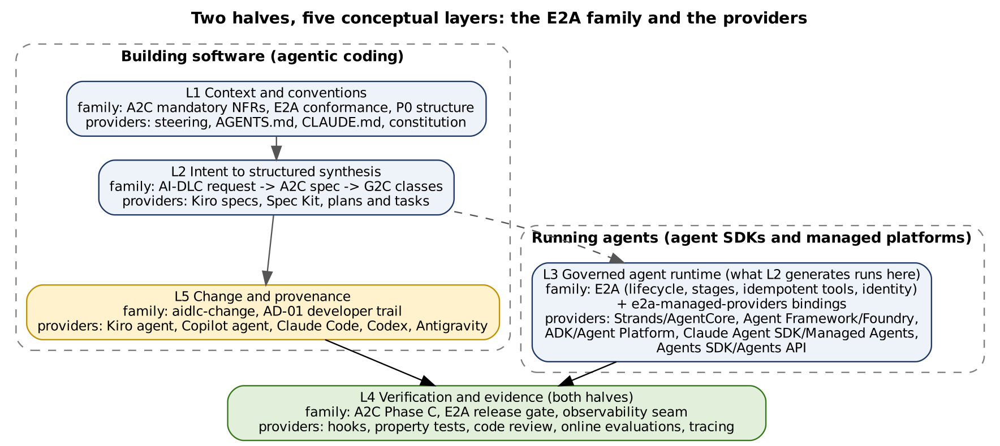
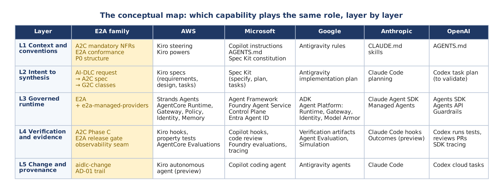
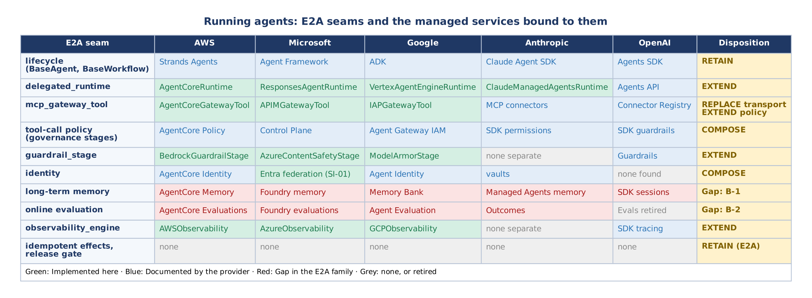

# Agentic Platforms × E2A Family — Conceptual and Mechanism Map

### How the agentic coding tools and managed agent platforms of AWS, Microsoft, Google, Anthropic and OpenAI correspond to P0, G2C, A2C and E2A, and what binds to what

*Every major provider now offers two halves: tools that build software with agents, and platforms that run agents in production. The E2A family has the same two halves: AI-DLC (P0, G2C, A2C, with `aidlc-change`) builds software, and E2A (with e2a-adapters and e2a-managed-providers) runs it. This document maps the two at two levels. The conceptual view shows, layer by layer, which provider capability plays the role each framework plays. The mechanism view says exactly what replaces, extends, adapts, composes with or leaves to the family, and what this repository implements. Every product fact carries its source and the date it was checked.*

| | |
|---|---|
| Framework | E2A family: AI-DLC (P0, G2C, A2C) and E2A, with `e2a-adapters` and `e2a-managed-providers` |
| Document type | Design Document, map of the provider design series (agentic platforms) |
| Author | Subham Gupta, Principal Platform Architect |
| Source baseline | `subhamviky/e2a-framework` `v1.9.1`; `subhamviky/a2c-framework` `v1.6.0`; `subhamviky/e2a-managed-providers` `main` (profiles under `e2a_managed/providers/*/profiles`, cloud classes under `e2a_managed/clouds/*`); vendor sources checked on 20 November 2026 |
| Date | 21 November 2026 (online evaluation, Sections 5.1, 5.3 and 12; first issue 20 November 2026) |
| Status | Reference. Provider facts dated 20 November 2026; see Section 13 |

> **Disclaimer.** This is independent reference material for studying software architecture. It has no affiliation with, and no endorsement by, any company named, and it is not a substitute for any provider's products, documentation or terms. Product names are trademarks of their owners. Comparisons between products, and between products and the E2A family, are the author's architectural reading of public documentation: not a statement by any provider, not a compatibility claim, and not an evaluation or ranking. "None found" means not found in the sources checked by the date stated. Facts come from public sources, some secondary (marked *To validate*); preview features may change or be withdrawn; the selection of providers is not exhaustive. Product facts change quickly in this field: check the provider's current documentation. The views are the author's own and do not represent any employer. Prepared with AI assistance and reviewed by the author. Provided "as is", without warranty; not legal, compliance, security or procurement advice. The full text is in [DISCLAIMER.md](../DISCLAIMER.md).

## 1. Introduction

### 1.1 Purpose

The major providers now offer, as managed products, the same kinds of capability the E2A family provides: context and conventions for coding agents, specifications before code, governed agent runtimes, verification, and agents that change existing code. This document maps them to the family at two levels:
- the **conceptual view** (Section 3): the role each framework plays, and the provider capability that plays the same role;
- the **mechanism view** (Sections 4 and 5): what each capability actually is, whether it replaces, extends, adapts, composes with or leaves to the family, and what is implemented here.

A role can be the same while the mechanism differs. P0 and Kiro's steering files both set ground rules before code is written, but P0 generates a project's structure, while steering is standing context for an agent. Each conceptual cell therefore has its mechanism cell in Sections 4 and 5.

### 1.2 Audience

| Reader | Read |
|---|---|
| Architect choosing a platform | Sections 2, 3 and the provider's section (6 to 10) |
| Engineer binding a managed service to E2A | Section 5 and the provider's section; the core design's seams |
| Engineer using AI-DLC beside a coding tool | Section 4 |
| Reviewer | Sections 11 to 13 |

### 1.3 Labels

**Status** (as in the rest of this series):

| Label | Meaning |
|---|---|
| **Implemented** | A class or profile in this repository, E2A or a2c-framework, exercised by tests (not proof of production behaviour) |
| **E2A contract** | E2A's port exists with a contract suite; this binding is described, not implemented |
| **Documented** | Described by the provider's own documentation (source and date given); not implemented here |
| **To validate** | Found only in secondary sources, or unclear; confirm before relying on it |
| **Gap** | Neither the family nor a binding covers it today (a backlog candidate, Section 12) |
| **Retired** | Withdrawn or being withdrawn by the provider (dates given); not mapped |

**Disposition** (core design, Section 2.2): **REPLACE** (the managed service supplies the capability and every point of the replacement gate), **EXTEND** (managed execution surrounded by E2A policy, state, outcome or confirmation), **ADAPT** (a thin codec or client), **COMPOSE** (the responsibility spans provider, cloud and E2A; one seam, each owner named), **RETAIN** (no managed service supplies the guarantee; E2A stays authoritative).

**Relation** (building-software half, where there are no runtime seams): **Equivalent**, **Partial** (same role, different mechanism), **Complementary** (both can be used together, with value), **Family only** (no provider counterpart found).

## 2. Two halves, five layers

*Figure 1 — Two halves, five conceptual layers*

| # | Layer | The E2A family | The role across providers |
|---|---|---|---|
| L1 | Context and conventions | A2C's mandatory NFRs, injected into every generation request before any model call; E2A's conformance rules; the project structure P0 generates | What every agent must always know and obey in this project |
| L2 | Intent to structured synthesis | The AI-DLC request (declarations) → A2C's specification → G2C's classes | Intent becomes a reviewable contract before code is written |
| L3 | Governed agent runtime | E2A: agent and workflow lifecycle, ordered governance stages, tool access with idempotency, identity at ingress and between services; bound to managed services by e2a-managed-providers | Deterministic control around a probabilistic loop, in production |
| L4 | Verification and evidence | A2C's Phase C checks, E2A's release gate (`e2a.release`), the observability seam | Nothing reaches production unchecked, and behaviour stays visible |
| L5 | Change and provenance | `aidlc-change`, and the developer's trail (hub note AD-01): developer as author, `Assisted-by`, change records | Agents changing existing code, with an accountable person and an audit trail |

L1, L2 and L5 belong to building software; L3 to running agents; L4 to both. Every provider now ships a coding agent that commits code (L5), and how such commits are attributed differs from provider to provider (Section 4).

## 3. The conceptual map

*Figure 2 — The conceptual map: layer × provider*

| Layer | E2A family | AWS | Microsoft (with GitHub) | Google | Anthropic | OpenAI |
|---|---|---|---|---|---|---|
| **L1** Context and conventions | A2C mandatory NFRs; E2A conformance; P0 structure | Kiro steering files; Kiro powers | Copilot custom instructions (`.github/copilot-instructions.md`, `AGENTS.md`); Spec Kit constitution | Antigravity rules | `CLAUDE.md`; skills | `AGENTS.md` |
| **L2** Intent to synthesis | AI-DLC request → A2C spec → G2C | Kiro specs (requirements, design, tasks) | Spec Kit (specify, plan, tasks) | Antigravity implementation plan | Claude Code planning | Codex task plan *(To validate)* |
| **L3** Governed runtime | E2A + e2a-managed-providers | Strands Agents; AgentCore (Runtime, Gateway, Policy, Identity, Memory, Harness) | Microsoft Agent Framework; Foundry Agent Service; Foundry Control Plane; Entra Agent ID | ADK; Gemini Enterprise Agent Platform (Agent Runtime, Agent Gateway, Agent Identity, Model Armor, Memory Bank) | Claude Agent SDK; Claude Managed Agents | Agents SDK; Agents API; Guardrails |
| **L4** Verification and evidence | A2C Phase C; E2A release gate; observability seam | Kiro hooks and property-based tests; AgentCore Evaluations and Observability | Copilot hooks and code review; Foundry evaluations and tracing; Agent Optimizer | Antigravity verification artifacts; Agent Evaluation, Simulation, Observability | Claude Code hooks; Managed Agents outcomes *(preview)* | Codex runs the tests and reviews pull requests; Agents SDK tracing |
| **L5** Change and provenance | `aidlc-change`; AD-01 trail | Kiro autonomous agent *(preview)* | Copilot coding agent (author Copilot, requester co-author, session-log trailer) | Antigravity agents | Claude Code (`Co-Authored-By` trailer) | Codex cloud tasks ending in a pull request |

**How to read it.** A cell says "this capability plays the same role". It does not say "this capability is the same thing", nor that one can replace the other. Sections 4 and 5 give the mechanism for every row.

## 4. Mechanism map: building software

The building-software half has no runtime seams, so cells carry a **relation** instead of a disposition.

| Family element | What it is | Provider counterparts | Relation |
|---|---|---|---|
| **P0** project bootstrap | Generates a project's structure, build file, Dockerfile, CI skeleton, settings and contract models from the request | Kiro: generated steering files (product, tech, structure). Spec Kit: `specify init` (the spec workspace). Claude Code: `/init` writes `CLAUDE.md`. Antigravity, Codex: none found | **Partial**: these create context, not a governed scaffold |
| **L1 standing context** (A2C mandatory NFRs, E2A conformance) | Enforced: NFRs injected into every generation request; conformance fails the build | Kiro steering and powers; Copilot instructions and `AGENTS.md`, Spec Kit constitution; Antigravity rules; `CLAUDE.md` and skills; `AGENTS.md` for Codex | **Partial**: advisory context, not enforced |
| **L2 specification** (request + A2C spec) | Declarations (agents, workflow, governance, settings, contracts) drive generation; A2C writes the specification | Kiro specs (EARS requirements, design, tasks); Spec Kit (specify, plan, tasks); Antigravity implementation plan; Claude Code planning; Codex: *To validate* | **Partial**: documents that guide an agent, not declarations that drive generation |
| **G2C** declarations → classes | Typed E2A agents, workflow, governance, tool stubs and contract tests, with framework methods sealed | none found at any provider | **Family only** |
| **A2C** IaC, CI/CD, NFR modules | Deterministic templates per cloud, mandatory NFRs, critic | Generated on request by every coding agent | **Partial**: free generation, no mandatory NFRs |
| **L4** build-time checks | Phase C (secret scan, conformance, compile, tests), release gate | Kiro hooks and property-based tests from specs; Copilot hooks (`.github/hooks`) and code review; Antigravity verification artifacts and browser recordings; Claude Code hooks; Codex runs the project's tests and reviews pull requests | **Equivalent role**, different checks |
| **`aidlc-change`** | Bounded edits: framework-owned methods sealed, declarations refused, three verified attempts, nothing committed on failure | Kiro autonomous agent (*preview*); Copilot coding agent; Antigravity Agent Manager; Claude Code; Codex cloud tasks | **Partial**: none seals framework-owned code or refuses declaration changes |
| **AD-01 provenance** | Developer as author, bot as committer in CI, `Assisted-by`, `Change-Id`, `AIDLC-Run`, change record, version and changelog | Copilot: agent as author, requester as co-author, `Agent-Logs-Url`, signed. Claude Code: `Co-Authored-By` trailer. Kiro, Antigravity, Codex: *To validate* | **Partial**: different author model |

**What this shows.**
- **G2C has no counterpart.** The coding tools write free-form code guided by context and specs; none generates framework-bound classes from declarations with sealed methods. This is the family's most distinctive piece.
- **The family enforces what the tools advise.** Steering files, instructions and `AGENTS.md` are context the agent should follow. A2C injects mandatory NFRs into every generation request, and E2A's conformance check fails a build that overrides a framework-owned method.
- **They combine well.** A2C could write the standing context the tools read (`AGENTS.md`, Kiro steering, Copilot instructions, `CLAUDE.md`) from the request, so every coding tool sees the same rules AI-DLC enforces (Section 12, B-4). A developer can use any of these tools on an AI-DLC project; E2A's conformance check still runs in CI.

## 5. Mechanism map: running agents

Rows are E2A responsibilities and seams (core design, Section 4.1). Cells name the provider service; the disposition and status follow.

*Figure 3 — E2A's seams and the managed services bound to them*

### 5.1 Summary

| E2A responsibility (seam) | Disposition | Implemented here | Provider services |
|---|---|---|---|
| Agent and workflow lifecycle (`BaseAgent`, `BaseWorkflow`) | **RETAIN**: E2A owns the lifecycle; a peer SDK runs inside a delegated runtime | E2A itself | AWS: Strands Agents. Microsoft: Agent Framework. Google: ADK. Anthropic: Claude Agent SDK. OpenAI: Agents SDK |
| Managed runtime (`delegated_runtime`) | **EXTEND**, read tools only | `AgentCoreRuntime`, `ResponsesAgentRuntime`, `VertexAgentEngineRuntime`, `ClaudeManagedAgentsRuntime` | AWS: AgentCore Runtime and Harness. Microsoft: Responses API; hosted agents (Documented). Google: Agent Runtime. Anthropic: Managed Agents. OpenAI: Agents API (Documented) |
| Tool gateway and MCP (`mcp_gateway_tool`) | **REPLACE** transport; **EXTEND** with tenant and tool policy | `AgentCoreGatewayTool`, `APIMGatewayTool`, `IAPGatewayTool` | AWS: AgentCore Gateway. Microsoft: API Management; Foundry Toolboxes (preview, Documented). Google: Agent Gateway with IAP. Anthropic: MCP connectors with vaults (Documented). OpenAI: Connector Registry (beta, Documented) |
| Policy on tool calls (governance stages) | **COMPOSE**: a managed decision is one more stage; E2A keeps order, fail-closed and the typed refusal | E2A's stages | AWS: AgentCore Policy (Cedar at the Gateway). Microsoft: Control Plane guardrails on tool calls and responses. Google: Agent Gateway with IAM. Anthropic: SDK permissions and hooks. OpenAI: SDK guardrails. All Documented (B-6) |
| Content guardrails (`guardrail_stage`) | **EXTEND** | `BedrockGuardrailStage`, `AzureContentSafetyStage`, `ModelArmorStage` | Anthropic: none separate. OpenAI: Guardrails, open source (Documented) |
| Workload and agent identity (`identity_resolver`, `credential_provider`) | **COMPOSE** | Entra workload federation (SI-01, E2A v1.8.0) | AWS: AgentCore Identity. Microsoft: Entra Agent ID. Google: Agent Identity (SPIFFE). Anthropic: vaults for MCP credentials. All Documented |
| Long-term memory | **Gap** (E2A has short-term pruning only); COMPOSE candidate (B-1) | none | AWS: AgentCore Memory. Microsoft: Foundry memory (preview). Google: Memory Bank (GA). Anthropic: Managed Agents memory (preview). OpenAI: SDK sessions |
| Idempotency of material effects, checkpoints | **RETAIN** (storage REPLACE) | E2A; DynamoDB, Firestore, Cosmos DB stores (e2a-adapters) | none at any provider |
| Online evaluation (`online_evaluator`) | **COMPOSE**: since E2A v1.9.0 a port, `BaseOnlineEvaluator`; E2A samples, budgets, redacts and submits after settlement (through the outbox when one is bound); a managed evaluator scores (Section 5.3) | E2A's `RecordingOnlineEvaluator`, `OutboxOnlineEvaluator`, `ScoringOnlineEvaluator`; no managed binding (Documented) | AWS: AgentCore Evaluations. Microsoft: Foundry evaluations, Agent Optimizer. Google: Agent Evaluation, Simulation. Anthropic: Outcomes (preview). OpenAI: Evals **Retired** 30 November 2026 |
| Release gate (offline) | **RETAIN** | `e2a.release`; since E2A v1.9.0 the `e2a.evals` scorers (trajectory, refusal, schema, contains, no PII, groundedness), several trials per case, and the evidence kind (wiring, quality, live) with profile and model | none equivalent at any provider |
| Observability (`observability_engine`) | **EXTEND** | `AWSObservability`, `AzureObservability`, `GCPObservability` | Anthropic: none separate. OpenAI: SDK tracing (Documented) |
| Sandboxed execution | **EXTEND** through the delegated runtime; E2A has no sandbox of its own | through the delegated runtimes above | AWS: Firecracker microVM per session. Microsoft: hosted-agent sandboxes. Google: Agent Runtime. Anthropic: Managed Agents sandbox. OpenAI: sandbox agents, Codex harness |
| Agent-to-agent (A2A) | **Gap** (B-3) | none | Microsoft: Foundry A2A (Documented). Google: ADK and Agent Platform (Documented). AWS: *To validate*. Anthropic, OpenAI: none found |

### 5.2 Notes on the dispositions

- **The lifecycle stays E2A's.** Strands, Agent Framework, ADK, the Claude Agent SDK and the Agents SDK are peers of E2A's agent and workflow classes. E2A does not wrap them; it binds the *managed runtimes* they deploy to as a `delegated_runtime`, which EXTENDs: the managed agent does the work, and E2A keeps the claim, the governance stages, the outcome and the confirmation. Delegated runtimes get read tools only, so a material effect always goes through E2A's idempotent tool path.
- **Managed policy composes, it does not replace.** AgentCore Policy and Foundry's tool-call guardrails decide allow or deny at the gateway. E2A still decides the order of stages, fails closed, and returns a typed refusal. The two compose: the managed decision becomes one stage's input.
- **Where the family is stronger.** No provider offers idempotency claims for material effects, conditional commits, or an offline release gate that blocks a deployment. These stay RETAIN.
- **Where the providers are ahead.** Long-term memory and A2A are gaps in the family today (Section 12). Online evaluation has an E2A port since v1.9.0; the managed evaluators that would score its records are not bound (Section 5.3).

### 5.3 Online evaluation: the E2A port and the managed evaluators

E2A v1.9.0 defines what leaves a run for online evaluation and when. After a run settles, `BaseWorkflow` hands it to `config['online_evaluator']`. E2A decides whether to send it (`online_eval_sample_rate`, deterministic by correlation id), within a budget (`online_eval_max_per_minute`), and never fails or delays the request. What it sends is one record per run: identifiers (tenant, correlation id, idempotency key, workflow), the evaluation the agent made (`eval_outcome`), the path (`trajectory`: each tool call with read or modify, a payload hash, outcome and latency; each agent), the steps, the status and the answer, with personal data and credentials redacted. `OutboxOnlineEvaluator` writes the record to the outbox (topic `e2a.evaluation`), so the broker delivers it after the business transaction commits. `python -m e2a.evals promote` turns low-scoring, fallback and refused records into candidate cases for review; `calibration_report` compares a scorer with human labels.

**Where a managed evaluator binds.**

| Provider | Managed evaluation | How it would bind to the port | State |
|---|---|---|---|
| AWS | AgentCore Evaluations (LLM-as-judge and code evaluators, online and batch) | A `BaseOnlineEvaluator` that submits E2A's record, or an outbox consumer on `e2a.evaluation` | Documented |
| Microsoft | Foundry evaluations; Agent Optimizer | As above | Documented |
| Google | Agent Platform Agent Evaluation; Simulation | As above | Documented |
| Anthropic | Outcomes (preview): self-evaluation against success criteria inside Managed Agents | Runs inside the delegated runtime; its result can be read back into `eval_outcome` | Documented |
| OpenAI | Evals | None: Evals is retired on 30 November 2026 | — |

No managed binding is implemented: this landscape has no provider account, so a binding could not be tested against the service. Each would be a replay-tested adapter once the provider's ingestion format is pinned. The order-to-cash landscape demo runs the port with `RecordingOnlineEvaluator` and promotes candidates from its records.

## 6. AWS

| Half | Product | State (checked 20 November 2026) |
|---|---|---|
| Build | **Kiro** (IDE, CLI) | GA 17 November 2025. Specs (`requirements.md`, `design.md`, `tasks.md`, EARS requirements), steering (`.kiro/steering/`), hooks, powers (bundles of MCP servers, steering and hooks), property-based tests from specs, checkpoints. 2026: CLI 2.0, headless mode, Kiro Web, Automations |
| Build | Kiro autonomous agent | Preview from December 2025; GA not confirmed (*To validate*) |
| Run | **Strands Agents** | Open-source SDK; deploys to AgentCore Runtime |
| Run | **AgentCore Runtime** | One Firecracker microVM per session; also an Instances type on managed EC2 |
| Run | AgentCore **Gateway**, **Identity**, **Memory**, **Observability** | Gateway: MCP tools and connectors. Identity: inbound JWT, consent portal. Memory: short and long term |
| Run | AgentCore **Policy** | Preview December 2025; GA 3 March 2026. Cedar policies evaluated at the Gateway on every tool call |
| Run | AgentCore **Evaluations** | Preview December 2025; GA 31 March 2026. LLM-as-judge and code evaluators, online and batch |
| Run | AgentCore **Harness** | Preview April 2026; GA 17 June 2026 |

**How E2A binds today.** The `anthropic_bedrock` profile binds `AgentCoreRuntime` (delegated runtime) and `AgentCoreGatewayTool` (MCP gateway), with Bedrock Guardrails, S3 Vectors, the Bedrock reranker and prompt registry, and `AWSObservability`. Stores come from e2a-adapters (DynamoDB).

**What AWS adds.** Cedar policy at the gateway (compose with E2A's stages), managed memory, online evaluations, session microVMs.

**What the family adds.** G2C's framework-bound generation; enforced NFRs; idempotent material effects; the offline release gate; the developer's trail.

## 7. Microsoft (with GitHub)

| Half | Product | State (checked 20 November 2026) |
|---|---|---|
| Build | **GitHub Copilot** coding agent | Reads `.github/copilot-instructions.md`, `.github/instructions/*.instructions.md`, `AGENTS.md`, `CLAUDE.md`, `GEMINI.md`; hooks in `.github/hooks`; MCP tools; commits as Copilot with the requester as co-author and an `Agent-Logs-Url` trailer; signed |
| Build | **Spec Kit** | Open source (September 2025): specification → plan → tasks; project constitution |
| Build | Foundry for VS Code | Local development to production deployment of agents |
| Run | **Microsoft Agent Framework** | 1.0 GA April 2026; successor to Semantic Kernel and AutoGen; graph workflows with checkpointing, human approval, pause and resume; Agent Harness stable at Build (June 2026) |
| Run | **Foundry Agent Service** | GA (the current generation announced March 2026); hosted agents in preview from April 2026, GA expected July 2026 (*To validate*); Toolboxes in preview |
| Run | **Foundry Control Plane**, **Entra Agent ID** | Guardrails on inputs, outputs, tool calls and tool responses; an Entra Agent ID per agent |
| Run | Memory; tracing and evaluations; Agent Optimizer; ASSERT; Foundry IQ | Memory in preview (procedural, user, session); tracing and evaluations GA in spring 2026; Optimizer and ASSERT announced at Build 2026 |

**How E2A binds today.** The `openai_azure` profile binds `ResponsesAgentRuntime`, `APIMGatewayTool`, `AzureContentSafetyStage`, Azure AI Search with the semantic ranker, and `AzureObservability`. Service-to-service identity uses Entra as the single issuer (SI-01, E2A v1.8.0). Stores come from e2a-adapters (Cosmos DB).

**What Microsoft adds.** Guardrails on tool calls and tool responses; Entra Agent ID; managed memory; online evaluation and optimisation.

## 8. Google

| Half | Product | State (checked 20 November 2026) |
|---|---|---|
| Build | **Antigravity 2.0** (desktop, CLI, SDK) | I/O, May 2026. Rules and workflows, implementation-plan and verification artifacts, Agent Manager |
| Build | Gemini CLI, Gemini Code Assist (individuals) | **Retired** for individuals on 18 June 2026 (moved to Antigravity CLI); Code Assist Standard and Enterprise keep access |
| Build | Jules | **Retired**: read-only 11 November 2026, shut down 31 December 2026 |
| Run | **ADK** | Open source; evaluation tooling built in |
| Run | **Gemini Enterprise Agent Platform** | Launched 22 April 2026; all Vertex AI services delivered through it. Agent Runtime (formerly Agent Engine); Sessions and Memory Bank (GA December 2025); Agent Evaluation, Simulation, Observability |
| Run | **Agent Gateway**, **Agent Identity**, **Model Armor** | Agent Identity (SPIFFE) GA for Agent Runtime; Agent Gateway with IAP and Model Armor |

**How E2A binds today.** The `google_vertex` profile binds `VertexAgentEngineRuntime`, `IAPGatewayTool`, `ModelArmorStage`, Vertex Vector Search and the ranking API, and `GCPObservability`. Stores come from e2a-adapters (Firestore).

**What Google adds.** Memory Bank (GA); agent identities on SPIFFE; simulation before release; A2A's origin.

## 9. Anthropic

| Half | Product | State (checked 20 November 2026) |
|---|---|---|
| Build | **Claude Code** | `CLAUDE.md`, skills, hooks, subagents, plugins, planning; commits with a `Co-Authored-By` trailer by default |
| Run | **Claude Agent SDK** | Python and TypeScript: tools, hooks, sessions, permissions, subagents, skills, MCP |
| Run | **Claude Managed Agents** | Launched 8 April 2026 (beta header). Agents, environments (Anthropic-managed or self-hosted sandbox), sessions; MCP connectors with credentials in vaults; memory, outcomes and multi-agent orchestration in preview |

**How E2A binds today.** The `anthropic_claude_platform_aws` profile binds `ClaudeManagedAgentsRuntime` as the delegated runtime, with AWS services around it (Bedrock Guardrails, S3 Vectors, `AWSObservability`).

**What Anthropic adds.** A hosted harness, sandbox and session log; credentials kept out of the sandbox; outcomes (self-evaluation against success criteria).

## 10. OpenAI

| Half | Product | State (checked 20 November 2026) |
|---|---|---|
| Build | **Codex** (cloud, CLI, SDK, GitHub Action) | One isolated sandbox per task, ending in a pull request; `AGENTS.md`; reusable cloud environments (September 2026); code review |
| Run | **Agents SDK** | Open source: agents, handoffs, guardrails, sessions, tracing, human approval; sandbox agents (April 2026) |
| Run | **Agents API** | 10 September 2026: cloud agents on the Codex harness, OpenAI-managed or own sandbox |
| Run | Guardrails; Connector Registry | Guardrails open source; Connector Registry in beta |
| Run | Agent Builder and Evals | **Retired**: withdrawn on 30 November 2026; OpenAI points to the Agents SDK |

**How E2A binds today.** OpenAI models run through Microsoft Foundry (`openai_azure`, Responses API). The Agents API is not bound (Documented).

**What OpenAI adds.** A managed coding harness reusable as an agent runtime; `AGENTS.md` (now an open standard).

## 11. Cross-vendor standards

| Standard | State (checked 20 November 2026) | The E2A family |
|---|---|---|
| **MCP** | Founding project of the Agentic AI Foundation (Linux Foundation, December 2025) | MCP tools through `mcp_gateway_tool` (Implemented on three clouds) |
| **AGENTS.md** | Founding project of the same foundation (OpenAI, August 2025); read by Codex and the Copilot coding agent | Not generated (B-4) |
| **A2A** | Linux Foundation project (Google, 2025) | Gap (B-3) |
| **OpenTelemetry GenAI conventions** | Agent spans in Development status, not stable | E2A emits OpenTelemetry; span names not aligned yet (B-5) |

## 12. Gaps and backlog candidates

These are candidates, not commitments. Each would get its own design note first.

| # | Candidate | Why | Disposition when built |
|---|---|---|---|
| B-1 | A long-term memory port, bound to AgentCore Memory, Foundry memory, Memory Bank and Managed Agents memory | Every provider has it; E2A has short-term pruning only | COMPOSE: E2A keeps tenant scoping and redaction |
| B-2 | An online-evaluation hook beside the offline release gate | Providers evaluate production traces; E2A's gate runs before release | **Port built** (E2A v1.9.0, `BaseOnlineEvaluator`); the managed bindings remain candidates (Section 5.3) |
| B-3 | A2A for E2A agents (expose and call) | Foundry, ADK and Agent Platform support it | ADAPT at the edge, E2A governance inside |
| B-4 | A2C writes the coding tools' standing context (`AGENTS.md`, Kiro steering, Copilot instructions, `CLAUDE.md`) from the request | The tools advise what AI-DLC enforces; one source keeps both aligned | Generation only |
| B-5 | Align E2A's spans with the OpenTelemetry GenAI agent conventions once stable | Managed tracing (Foundry, AgentCore, Agent Platform) reads them | EXTEND |
| B-6 | Bind managed policy engines (AgentCore Policy, Foundry tool-call guardrails) as governance stages | Deterministic allow or deny at the gateway | COMPOSE |

## 13. Keeping current

- **Every fact is dated.** The products in this field change monthly; Sections 6 to 11 were checked on 20 November 2026.
- **Re-check every quarter**, and whenever a provider announces a GA, a rename or a retirement. Update the provider's section, the two maps and the figures together.
- **Renames and retirements.** A renamed product keeps its row with the new name and the old one in brackets. A retired product moves to *Retired* with its date, and leaves the maps.
- **Secondary sources** are marked *To validate* until a primary source confirms them.

## Sources

Checked on 20 November 2026. "(secondary)" marks a source that is not the vendor's own; the facts it alone supports are marked *To validate* above.

**AWS**
- Kiro, first project (specs): https://kiro.dev/docs/getting-started/first-project/index
- Kiro general availability: https://kiro.dev/blog/general-availability/
- Kiro powers (secondary): https://www.pwc.com/us/en/technology/alliances/library/kiro-powers-autonomous-ai-agents-aws.html
- AgentCore Policy and Evaluations (preview): https://aws.amazon.com/about-aws/whats-new/2025/12/amazon-bedrock-agentcore-policy-evaluations-preview
- AgentCore evaluations and policy, AWS News Blog: https://aws.amazon.com/blogs/aws/amazon-bedrock-agentcore-adds-quality-evaluations-and-policy-controls-for-deploying-trusted-ai-agents/
- AgentCore FAQs: https://aws.amazon.com/bedrock/agentcore/faqs/
- AgentCore release notes: https://docs.aws.amazon.com/bedrock-agentcore/latest/devguide/release-notes.html
- AgentCore harness GA: https://aws.amazon.com/about-aws/whats-new/2026/06/amazon-bedrock-agentcore-harness-generally-available
- Strands, deploy to AgentCore: https://strandsagents.com/docs/user-guide/deploy/deploy_to_bedrock_agentcore/python/index.md

**Microsoft and GitHub**
- Microsoft Agent Framework 1.0: https://devblogs.microsoft.com/agent-framework/microsoft-agent-framework-version-1-0/
- Foundry Agent Service GA: https://devblogs.microsoft.com/foundry/foundry-agent-service-ga/
- Hosted agents: https://devblogs.microsoft.com/foundry/introducing-the-new-hosted-agents-in-foundry-agent-service-secure-scalable-compute-built-for-agents
- What's new in Foundry, Build 2026: https://devblogs.microsoft.com/foundry/whats-new-in-microsoft-foundry-build-2026/
- What's new in Foundry, June 2026: https://devblogs.microsoft.com/foundry/whats-new-in-microsoft-foundry-june-2026/
- Memory in Foundry Agent Service: https://devblogs.microsoft.com/foundry/introducing-memory-in-foundry-agent-service/
- Foundry Control Plane: https://azure.microsoft.com/en-us/products/ai-foundry/control-plane
- Foundry toolbox: https://learn.microsoft.com/en-us/azure/foundry/agents/how-to/tools/toolbox
- Copilot customization cheat sheet: https://docs.github.com/en/copilot/reference/customization-cheat-sheet
- Copilot coding agent and AGENTS.md: https://github.blog/changelog/2025-08-28-copilot-coding-agent-now-supports-agents-md-custom-instructions
- Spec Kit: https://github.github.com/spec-kit/

**Google**
- Gemini Enterprise Agent Platform: https://cloud.google.com/blog/products/ai-machine-learning/introducing-gemini-enterprise-agent-platform
- Memory Bank: https://cloud.google.com/blog/products/ai-machine-learning/vertex-ai-memory-bank-in-public-preview
- IAM for agents (Agent Identity, Model Armor): https://cloud.google.com/blog/products/identity-security/whats-new-in-iam-security-governance-and-runtime-defense
- Agent Gateway overview: https://docs.cloud.google.com/gemini-enterprise-agent-platform/govern/gateways/agent-gateway-overview
- Gemini CLI to Antigravity CLI: https://developers.googleblog.com/an-important-update-transitioning-gemini-cli-to-antigravity-cli/
- Antigravity implementation plan: https://www.antigravity.google/docs/implementation-plan
- Antigravity 2.0 (secondary): https://techcrunch.com/2026/05/19/google-launches-antigravity-2-0-with-an-updated-desktop-app-and-cli-tool-at-io-2026/
- Jules shutdown (secondary): https://techradar.com/pro/google-kills-off-jules-its-ai-coding-agent-which-promised-to-do-all-the-jobs-you-didnt-want-to

**Anthropic**
- Claude Managed Agents overview: https://platform.claude.com/docs/en/managed-agents/overview.md
- Building with Claude Managed Agents: https://claude.com/blog/building-with-claude-managed-agents
- Managed Agents engineering: https://anthropic.com/engineering/managed-agents

**OpenAI**
- AgentKit, and the withdrawal of Agent Builder and Evals: https://openai.com/index/introducing-agentkit/
- Agents API: https://openai.com/index/introducing-the-agents-api/
- Agents SDK: https://openai.github.io/openai-agents-python/
- Codex manual: https://developers.openai.com/codex/codex-manual.md
- Codex reusable environments (secondary): https://techcrunch.com/2026/09/29/openai-gives-codex-reusable-cloud-environments-that-work-across-devices/

**Standards**
- Agentic AI Foundation: https://linuxfoundation.org/press/linux-foundation-announces-the-formation-of-the-agentic-ai-foundation
- OpenTelemetry GenAI agent spans: https://opentelemetry.io/docs/specs/semconv/gen-ai/gen-ai-agent-spans/

**This repository and the family**
- Core design (dispositions, seams): [../core/E2A_MANAGED_PROVIDERS_CORE_DESIGN.md](../core/E2A_MANAGED_PROVIDERS_CORE_DESIGN.md)
- Models × clouds matrix: [../matrix/MODEL_CLOUD_MATRIX.md](../matrix/MODEL_CLOUD_MATRIX.md)
- AI-DLC change mode and provenance (hub note AD-01), A2C design document Sections 5.9 and 8.9: https://github.com/subhamviky/a2c-framework/blob/main/docs/design/a2c/A2C_FRAMEWORK_DESIGN.md
